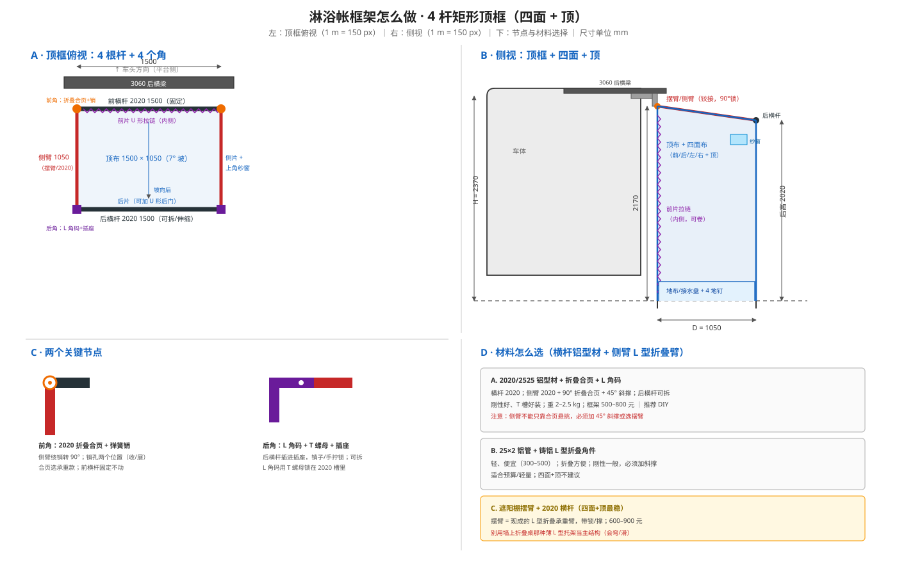

# 车尾横向淋浴帐（4 杆框，四面 + 顶，无腿版）

> **状态**：改版设计 ｜ **参考**：你发的实拍图（侧挂 4 杆框 + 布帘）+ 你的修正：**四面、内侧带拉链、顶部封闭**
>
> **一句话**：框架就是一个**矩形顶框**——前横杆固定、2 侧臂折叠、后横杆可拆；**四面布 + 顶布**都挂/绷在框上；靠车那面（内侧）做 **U 形拉链**，方便从车里进/开尾门；没有落地立腿。



---

## 0. 和你发的图的关系

图里成品是 **三面 + 开放顶**：4 杆框 + 外片 + 两侧片，靠车面不挂布（车体当墙），顶部不封。你要的是 **四面 + 顶**：

- 框架**不变**：还是 4 根杆（前横杆、后横杆、2 侧臂）+ 4 个角；
- 多了 **前片（靠车，带 U 形拉链）**、**后片**、**顶布**；
- 车体不再是“一面墙”，四面都是布，所以**顶框要更硬**、**必须通风**（封闭顶 + 淋浴 = 冷凝水）。

---

## 1. 框架：4 根杆 + 4 个角

```
        ┌──────── 前横杆 1500（固定，2020/2525）────────┐
        │  前角：折叠合页 + 锁销                         │
  侧臂  │                                               │  侧臂
 1050   │              顶布（7° 坡，前高后低）           │  1050
（折叠）│                                               │（折叠）
        │  后角：L 角码 + T 螺母                          │
        └──────── 后横杆 1500（可拆 / 中间伸缩）────────┘
```

| 杆 | 规格 | 作用 | 折叠方式 |
|----|------|------|----------|
| 前横杆 | 2020/2525 铝型材，1 500 mm | 固定在 3060 后横梁，整个框的根 | 不折 |
| 侧臂 | 2 × 1 000–1 100 mm | 把框从车上伸出去，承顶布/侧片 | 前端铰接，转 90° 锁死；收起贴前横杆 |
| 后横杆 | 2020/2525 铝型材，1 500 mm | 撑开两侧臂，挂后片/顶布后沿 | **可拆**（插进后角插座）或中间伸缩 |
| 顶布 | 1 600 × 1 200 | 蒙在框上，7° 坡 | 随布卷 |

**四角必须锁死**：前角折叠合页 + 弹簧销；后角 L 角码 + T 螺母。框展开后是一个**刚体矩形**，不能只靠布绷着。

**顶坡**：前横杆 2 170、后横杆 2 020（低 150 mm），顶布向车后下坡，水从后沿滴水檐走。

---

## 2. 材料与节点（回答“铝型材还是 L 型折叠支架”）

**结论：横杆用铝型材，侧臂用“L 型折叠臂”（遮阳棚摆臂）或铝型材 + 折叠合页。不是二选一，是分工。**

### 2.1 三种组合

| 方案 | 横杆 | 侧臂 | 优点 | 缺点 | 价格（框架） |
|------|------|------|------|------|--------------|
| **A. 2020 铝型材 + 折叠合页 + L 角码** | 2020/2525 | 2020 + 90° 折叠合页 + 45° 斜撑 | 刚性好、T 槽好装、DIY 友好 | 重（约 2–2.5 kg）、贵 | 500–800 |
| **B. 25×2 铝管 + 铸铝 L 型折叠角件** | 25×2 铝管 | 25×2 + 铸铝折叠角件 | 轻、便宜、折叠方便 | 刚性一般，必须加斜撑 | 300–500 |
| **C. 遮阳棚摆臂 + 2020 横杆** | 2020/2525 | 2 根房车遮阳棚摆臂（带锁/撑） | 最稳、本来就是悬挑承重件、收放快 | 贵、摆臂长度固定 | 600–900 |

**推荐**：

- 四面 + 顶（封闭）→ **C 或 A**；封闭顶风载大，别用 B 硬撑。
- 想省钱/轻量 → **B + 45° 斜撑**，但接受框会有点弹性。
- **不要**用墙上折叠桌那种**薄 L 型折叠托架**当主结构：它是静态桌板用的，悬挑 + 顶布风载会弯、会滑。

### 2.2 各部位怎么选

| 部位 | 推荐 | 说明 |
|------|------|------|
| 前横杆 | 2020/2525 铝型材 | T 槽直接装挂臂/角码，刚性好 |
| 侧臂 | **遮阳棚摆臂**（C）或 2020 + 折叠合页 + 斜撑（A） | 摆臂 = 现成的 L 型折叠承重臂，带锁；2020 方案要加 45° 斜撑 |
| 后横杆 | 2020/2525，两端插进后角插座 | 可拆（推荐）或中间伸缩（方便但重） |
| 前角 | 折叠合页 + 弹簧销 | 侧臂转 90° 锁死；合页选承重款 |
| 后角 | L 角码 + T 螺母 + 插座 | 固定角；后横杆插进去，销子/手拧锁 |
| 挂装 | 2 个不锈钢/铝挂臂 + M8 T 螺母 + 手拧 | 免打孔，年审快拆 |
| 顶布 | 420D PU 黑胶，1.6×1.2 | 压胶；后沿滴水檐 |
| 四面布 | 420D PU 黑胶 | 前片 U 形 #10 拉链；侧片上角纱窗 |

### 2.3 “L 型折叠支架”到底是什么

- **L 型角码** = 固定角，不能折；用在后角、前横杆与平台连接。
- **折叠合页/折叠角件** = 能折、90° 锁；用在前角。
- **遮阳棚摆臂** = 一根 L 型折叠臂 + 锁/撑，专门用于悬挑；最适合侧臂。
- **薄 L 型折叠托架**（折叠桌那种）= 不适合主结构，只适合当小支撑。

### 2.4 折叠 / 收纳

1. 拆后横杆（或缩回中间伸缩节）。
2. 2 侧臂转回贴前横杆。
3. 四面布向顶布内折，顶布 + 布卷在侧臂上。
4. 三道魔术贴绑住，进袋。

---

## 3. 布：四面 + 顶

| 片 | 尺寸（约） | 做法 |
|----|------------|------|
| 前片（靠车） | 1 500 × 2 170 | **U 形 #10 拉链**，可从下往上卷起；拉开可开尾门/从车内进 |
| 后片 | 1 500 × 2 020 | 固定；想从外面进就加 U 形后门拉链（选配） |
| 左右侧片 | 1 050 × 2 020（梯形） | 上边与顶缝合；上角各开 200×120 纱窗 + 雨檐 |
| 顶布 | 1 600 × 1 200 | 前高后低 7°；压胶；后沿滴水檐 |
| 底部 | 下摆配重 300–500 g + 4 地钉 + 地布/接水盘 | 下摆入盘；地钉在盘外 |

**封闭顶必须通风**：左右侧片上角各一个纱窗 + 雨檐，形成对流；湿气大时加一个 USB/12V 小风扇。否则顶布内侧会滴水。

**前片拉链**：U 形（两侧 + 顶）比中间竖拉链更好用——整片能卷到顶，开口大，尾门能开。拉链内侧加挡水/挡光舌。

**尾门**：前片拉开后可开尾门，帐篷和车内连通；前片拉上就是四面封闭。注意尾门开 90° 时门扇会贴近侧片，侧片外留 30–50 mm。

---

## 4. 展开 / 收纳

### 4.1 展开（2–3 分钟）

1. 关尾门（前片拉链要贴车）；车头迎风。
2. 开袋、拉拉链，布体下垂。
3. 2 侧臂转出 90°、锁销锁死。
4. 装后横杆：两端插进后角插座，锁紧（或拉长中间伸缩节）。
5. 前片拉链拉好；四面布下摆拉出，4 个地钉固定；铺地布/接水盘。
6. 接花洒。

### 4.2 收纳（3–4 分钟）

1. 收花洒、收地钉/水袋。
2. 拉开前片拉链，把前片卷起；四面布向顶布内折。
3. 拆后横杆；2 侧臂转回贴前横杆。
4. 布 + 顶布卷在侧臂上，三道魔术贴绑住。
5. 进袋、拉拉链、扣搭扣；湿布当天晾干。

---

## 5. 成本（框架为主，这次分开算）

| 项目 | 方案 | 价格 |
|------|------|------|
| 框架 | A 2020 + 合页 + 角码 | 500–800 |
| 框架 | B 25 管 + L 角件 + 斜撑 | 300–500 |
| 框架 | C 摆臂 + 2020 横杆 | 600–900 |
| 布 | 四面 + 顶，12–14 m² 420D | 400–600 |
| 拉链/纱窗/压胶/织带 | #10 ×2 + 网纱 | 200–300 |
| 袋 | 600D PVC | 80–150 |
| 挂装 | 2 挂臂 + C 型轨 + T 螺母 + U 槽 | 200–350 |
| 地钉/地布 | 4 钉 + 地布 | 50–100 |
| 缝纫 | 自缝 0；外发 300–500 | 0–500 |
| **合计** | 不含接水/花洒 | **约 1 400–2 300** |

> 你发的 **500–600 成品是三面 + 开放顶**；四面 + 顶多一块顶布、一块前片、两条拉链、通风窗，框架也要更硬，所以贵一档。想压到 1 000 左右，只能走 B + 薄布 + 自缝。

---

## 6. 框架配件清单

| 类别 | 配件 | 数量 | 参考价 |
|------|------|------|--------|
| 型材 | 2020/2525 铝型材 1.5 m（前/后横杆） | 2 | 120–200 |
| 型材 | 2020/2525 铝型材 1.05 m（侧臂，若不用摆臂） | 2 | 80–140 |
| 摆臂 | 房车遮阳棚摆臂（带锁） | 2 | 300–600 |
| 角件 | 2020 L 角码 + T 螺母/螺栓 | 4 套 | 80–150 |
| 折叠 | 2020 折叠合页 + 弹簧销 | 2 套 | 100–200 |
| 斜撑 | 45° 铝撑杆（A/B 方案） | 2 | 60–120 |
| 后横杆插座 | 铝/尼龙插座 + 手拧销 | 2 | 50–100 |
| 挂装 | 304 挂臂 + C 型轨 + U 槽 + M8 T 螺母 | 1 套 | 250–400 |
| 安全 | 4 mm 钢丝绳 + 卸扣 | 1 | 50–70 |

---

## 7. 测试与维护

- 展开/收纳计时：≤3 min / ≤4 min。
- 淋水：顶布接缝、前片拉链、后片、侧片纱窗；封闭顶冲 5 min，帐内不滴。
- 通风：洗完开纱窗 + 前片，10 min 晾干；顶布内侧冷凝水擦干。
- 风：3–4 级风展开 30 min，看侧臂/后横杆/角件；5 级以上加斜撑/腿或收。
- 行车：后横杆拆下/缩回，侧臂贴车，袋不遮灯；60–80 km/h 无异响。
- 维护：压胶条年度检查；折叠合页/锁销季度上油；拉链涂硅油；湿布当天晾干。

---

## 8. 参考

- 你发的实拍图：侧挂 4 杆框 + 布帘（三面/开放顶）——本文按你的修正改为四面 + 顶
- 主文档（尺寸/车高/接水/水路）：[带腿版主文档](design-shower-tent.md)
- 成品形态：[Darche Eclipse Shower Awning G2](https://darche.com.au/collections/shower-awnings/products/eclipse-shower-awning-g2)、[Front Runner Easy-Out Awning](https://www.frontrunneroutfitters.com/en/int/easy-out-awning-2m-black-awni100bp.html)
