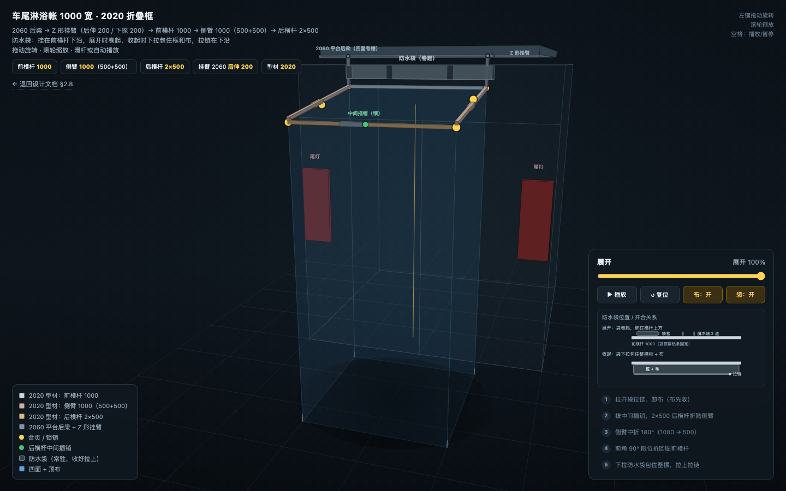
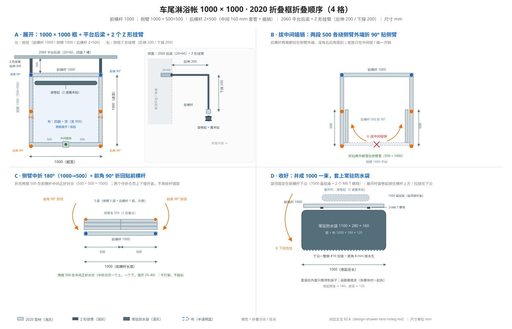
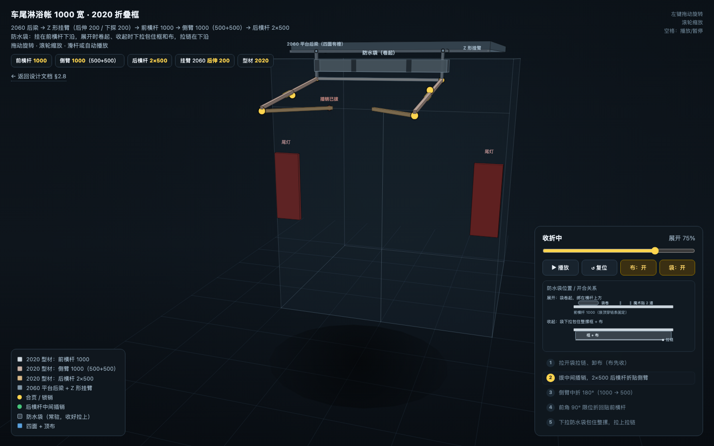
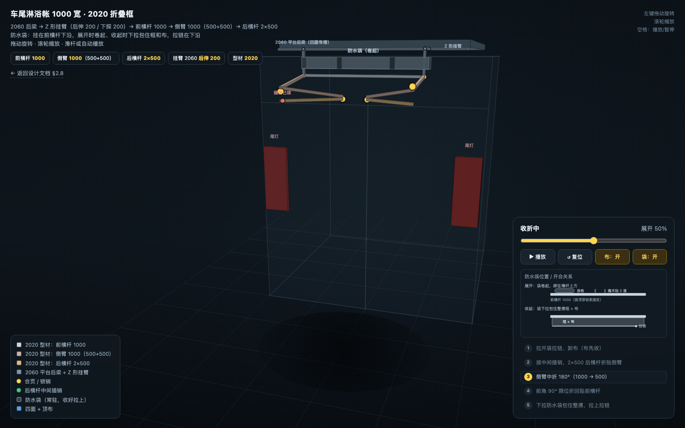
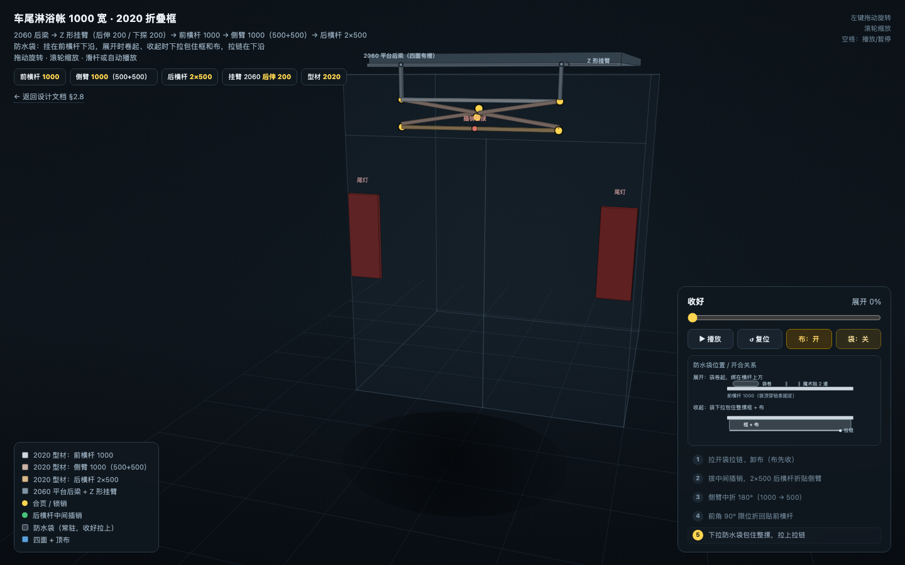
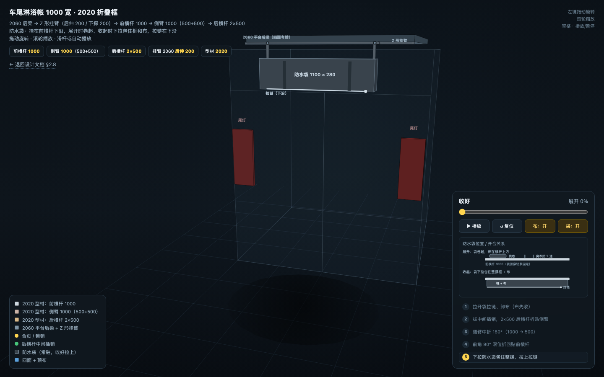

# 车尾横向淋浴帐（4 杆框，四面 + 顶，无腿版）

> **状态**：改版设计 ｜ **参考**：你发的实拍图（侧挂 4 杆框 + 布帘）+ 你的修正：**四面、内侧带拉链、顶部封闭**
>
> **一句话**：框架就是一个 **1000 × 1000 的矩形顶框**——前横杆 1000 用 **2 个 Z 形挂臂**吊在平台 2060 后梁上（后伸 200、下探 200）、2 侧臂 1000（500+500）2 段折、后横杆对拆成 **2×500**（中间 160 mm 套管 + 插销）折贴侧臂；**四面布（宽 950）+ 顶布**都挂/绷在框上；靠车那面（内侧）做 **U 形拉链**，方便从车里进/开尾门；没有落地立腿。收起后两根 500 在中间正好对合，整摞框 + 布约 **1000 × 180 × 120** 一起套进 **常驻防水袋**（和成品一样，外面只看得到袋子）。



---

## 0. 和你发的图的关系

图里成品是 **三面 + 开放顶**：4 杆框 + 外片 + 两侧片，靠车面不挂布（车体当墙），顶部不封。你要的是 **四面 + 顶**：

- 框架**还是 4 根杆**，但**收窄到 1000 × 1000**：前横杆 1000、侧臂 1000（2 段折 500+500）、后横杆对拆成 **2×500**（中间 160 mm 套管 + 插销；收起来两根 500 正好在中间对合）。定在 1000 的理由：**不挡车尾两侧尾灯**（模块边缘 ±500，尾灯从 ±760 起）；给平台后横梁两侧各留约 500 mm 的 T 槽，以后装滑轨/双层太阳能不打架；**2020 整料 1 m 好买好切**；比 1500 轻约 25–30%。
- 多了 **前片（靠车，带 U 形拉链）**、**后片**、**顶布**；布宽 950，绷在 1000 框里；
- 车体不再是“一面墙”，四面都是布，所以**顶框要更硬**、**必须通风**（封闭顶 + 淋浴 = 冷凝水）。

---

## 1. 框架：4 根杆 + 4 个角

```
        ┌──────── 前横杆 1000（2020，固定）────────┐
        │  前角：90° 限位折叠合页 + 弹簧销          │
  侧臂  │                                          │  侧臂
 1000   │        顶布（8.5° 坡，前高后低）         │  1000
(500+500)                                          (500+500)
        │  后角：90° 折叠合页（竖轴，带限位）      │
        └──── 后横杆 2×500（中间 160 套管 + 插销）──┘
```

| 杆 | 规格 | 作用 | 折叠方式 |
|----|------|------|----------|
| 前横杆 | 2020 铝型材，1 000 mm | 经 2 个 Z 形挂臂吊在平台 2060 后梁上，整个框的根 | 不折 |
| 侧臂 | 2 × 1 000 mm（500 + 500） | 把框从车上伸出去，承顶布/侧片 | 前端 90° 铰接锁死；中间 180° 折半；收起各 500 贴前横杆 |
| 后横杆 | 2020 铝型材，**2 × 500 mm** | 撑开两侧臂，挂后片/顶布后沿 | 中间 160 mm 套管 + 插销锁直；两半各绕侧臂外端 **90° 折贴侧臂** |
| 顶布 | 1 050 × 1 150 | 蒙在 1000 × 1000 框上，8.5° 坡 | 随布卷 |

**四角必须锁死**：前角 90° 限位折叠合页 + 弹簧销；后角 90° 折叠合页；后横杆中间再加一道 160 mm 套管 + 弹簧插销。插销插上、四个角锁住，框才是一个**刚体矩形**，不能只靠布绷着。

**顶坡**：前横杆 2 170、后横杆 2 020（低 150 mm），进深 1 000，坡度 150/1000 ≈ **8.5°**；顶布向车后下坡，水从后沿滴水檐走。

**挂装（关键，和旧版不同）**：车顶平台的**后横梁是 2060 型材（20 × 60），平放、20 面朝后、四个面都有 T 槽**，下沿高约 2 370。旧版写的“前横杆直接吊在梁下 200”不成立——梁下面就是车顶，没有那 200 mm 可以吊。正确做法：做 **2 个 Z 形挂臂**，从 2060 梁的**后立面**先向车尾方向**后伸 200**（从梁后立面到前横杆中心 z ≈ 210），再**下探 200**（落到前横杆 2 170）；两个挂臂间距 **1 000（±500）**，正好在前横杆两端。挂臂用 2020 型材或 5 mm 铝板，M6 螺栓 + 梁 T 槽里的 T 螺母固定，免打孔。前横杆和防水袋都挂在这两个挂臂的**后端**——位置已经在车顶后弧之外、车尾外侧，下面不再是车顶。

**收起来的厚度（重要）**：折好后 前横杆（1000）+ 两臂（各折成 500）+ 后横杆（2×500）叠成 **约 3 层、总高约 150–180 mm**——这不是故意“一根比一根矮”，是 8.5° 顶坡在侧臂对折 180° 后被镜像，臂端天然比前横杆低 150 mm，后横杆再低 30 mm。两根侧臂各 500、两根后横杆各 500，**500+500 = 1000**，正好落在 1000 前横杆的范围内，**不用错层、也不会超长**；收起一束约 **1000 × 180 × 120**，套进常驻防水袋（§3.2），袋跟着框走（拆模块时一起拆）。这摞是**挂在 Z 形挂臂后端、车尾外侧**的：不占“平台后横梁与车顶之间那 20–30 mm 的缝”，而是向车尾外侧鼓出约 120–160 mm，形态和成品一样。想再薄：把顶坡从 8.5° 降到 4°（前后高差 150 → 约 70），收摞能从 ~180 降到 ~120 mm（见 §3.2）。

---

## 2. 材料与节点（回答“铝型材还是 L 型折叠支架”）

**结论：横杆用铝型材，侧臂用“L 型折叠臂”（遮阳棚摆臂）或铝型材 + 折叠合页。不是二选一，是分工。**

### 2.1 三种组合

| 方案 | 横杆 | 侧臂 | 优点 | 缺点 | 价格（框架） |
|------|------|------|------|------|--------------|
| **A. 2020 铝型材 + 折叠合页 + L 角码** | 2020 | 2020 + 90° 折叠合页 + 45° 斜撑 | 刚性好、T 槽好装、DIY 友好 | 重（约 2–2.5 kg）、贵 | 500–800 |
| **B. 25×2 铝管 + 铸铝 L 型折叠角件** | 25×2 铝管 | 25×2 + 铸铝折叠角件 | 轻、便宜、折叠方便 | 刚性一般，必须加斜撑 | 300–500 |
| **C. 遮阳棚摆臂 + 2020 横杆** | 2020 | 2 根房车遮阳棚摆臂（带锁/撑） | 最稳、本来就是悬挑承重件、收放快 | 贵、摆臂长度固定 | 600–900 |

**推荐**：

- 四面 + 顶（封闭）→ **C 或 A**；封闭顶风载大，别用 B 硬撑。
- 想省钱/轻量 → **B + 45° 斜撑**，但接受框会有点弹性。
- **不要**用墙上折叠桌那种**薄 L 型折叠托架**当主结构：它是静态桌板用的，悬挑 + 顶布风载会弯、会滑。

### 2.2 各部位怎么选

| 部位 | 推荐 | 说明 |
|------|------|------|
| 前横杆 | 2020 铝型材，1 000 mm | 两端各接一个 Z 形挂臂吊在 2060 平台后梁上；T 槽便于装挂臂/角码 |
| 侧臂 | **遮阳棚摆臂**（C）或 2020 + 折叠合页 + 斜撑（A），2 × 1 000（500+500） | 摆臂 = 现成的 L 型折叠承重臂，带锁；2020 方案要加 45° 斜撑 |
| 后横杆 | 2020，**2×500**，配 160 mm 25×2 套管 + 弹簧插销 | 两端都铰在侧臂外端、中间套管锁直；见 §2.8 为什么对拆 |
| 前角 | 90° 限位折叠合页 + 弹簧销 | 侧臂转 90° 锁死；合页选承重款 |
| 后角 | **90° 折叠合页（竖轴，带限位）** | 后横杆两半各绕侧臂外端折 90°；展开时靠中间插销锁住 |
| 挂装 | 2 个 **Z 形挂臂**（2020 或 5 mm 铝板）+ M6 螺栓 + 2060 梁 T 槽 T 螺母 | 后伸 200、下探 200，间距 1000（±500）；免打孔，年审快拆 |
| 顶布 | 420D PU 黑胶，1 050 × 1 150 | 压胶；后沿滴水檐 |
| 四面布 | 420D PU 黑胶，宽 950 | 前片 U 形 #10 拉链；侧片上角纱窗 |

### 2.3 “L 型折叠支架”到底是什么

- **L 型角码** = 固定角，不能折；用在后角、前横杆与平台连接。
- **折叠合页/折叠角件** = 能折、90° 锁；用在前角。
- **遮阳棚摆臂** = 一根 L 型折叠臂 + 锁/撑，专门用于悬挑；最适合侧臂。
- **薄 L 型折叠托架**（折叠桌那种）= 不适合主结构，只适合当小支撑。

### 2.4 折叠 / 收纳（两根侧臂会不会打架？）

**不会。** 侧臂 1000 分 2 段、中间折 180° 后每根只剩 **500**；两根侧臂分别从前横杆两端折回贴杆，**500 + 500 = 1000**，正好等于前横杆长度，两根在中间**正好对合**——不用上下错层、不用前后错层、不用伸缩、也不用拆一根。（唯一要注意：两根侧臂的两个**中折合页**会在中点相会，合页**一个装上面、一个装下面**，上下错开 25–40 mm 就不会撞；杆本身还是同一平面。）后横杆 2×500 折贴侧臂后同样各 500，也整个落在 1000 的长度里。这就是把框收窄到 1000 最省事的地方：折完就是一束 **1000 × 约 180 × 120**。

折叠步骤（2 段折 + 后横杆 2×500，共 5 步）：

1. 拉开常驻防水袋的拉链，卸布（四面 + 顶先收成一卷，**布先收**）。
2. 拔后横杆中间插销，两半（各 500）各绕侧臂外端折 90° 贴到侧臂上（500 < 1000，整段都在臂里，不超长）。
3. 两根侧臂中间折 180°（1000 → 500）。
4. 前角 90° 限位折回贴前横杆（两边各 500，正好在中间对合）。
5. 下拉防水袋包住整摞框 + 布，拉上拉链。

想更快 → **伸缩摆臂**（缩到 500 再折）；不想折、想快 → 看 §2.5 滑轨。

### 2.5 滑轨滑出方案（另一种思路，哪个更好？）

> **说明**：以下 §2.5 ~ §2.7 的替代方案（滑轨 / 摆臂 / 35 cm 滑轨）当年按 **1500 宽**估算。主方案已收窄到 **1000**，原理与对比不变，具体尺寸、数量按 1000 重算即可（侧臂 1000 = 500+500、后横杆 2×500、进深 1000）。

不做折叠臂，做一个**刚性矩形框**，整体在 2 根滑轨上从平台下面**滑出来**：

```
平台下：2 根滑轨（前后方向）
   ├─ 前横杆 2020（固定在平台/滑轨外轨）
   ├─ 2 侧轨（滑轨内轨，也是框的侧边）
   └─ 后横杆 2020（滑出后锁销固定）
布/顶布一直挂在框上；滑出 → 插锁销 → 打 4 地钉 → 展开
```

| 项目 | 折叠侧臂 | 滑轨滑出 |
|------|----------|----------|
| 重量 | 轻 | **+2–4 kg** |
| 成本 | 低 | **+300–600 元** |
| 折叠碰撞 | 不需要错层/伸缩（500+500 正好对合） | **没有** |
| 刚性 | 靠臂/铰链/斜撑 | **刚体框，较好** |
| 展开 | 2–3 min | **1–2 min** |
| 收纳 | 布 + 臂卷进袋 | 框 + 布在平台下面，外面只一个小袋 |
| 维护 | 铰链/锁销 | 滑轨要**防雨/防尘/锁止** |
| 安装 | 简单 | 要**对齐**，平台下要有 1.0 m 空间 |
| 适合 | 轻量/便宜/偶尔 | **四面+顶/经常用/抽屉式** |

**滑轨怎么选**：

- **不要用便宜的抽屉滑轨**：它是按“抽屉垂直载荷”设计的，帐篷是**悬挑 + 风载**，1 m 伸出去会有弯矩，便宜滑轨会晃、会卡。
- 预算够：**2 × HGR20 线性导轨 + 4 个滑块**（1.1 m 行程），刚性好，加**锁销**和**防雨罩**；约 300–600。
- 预算紧：**2 × 1.0 m 重型三节锁止滑轨（304 不锈钢）**，但接受一点晃，且户外要定期润滑/防锈。
- 框：2020 前横杆（固定）+ 2 侧轨 + 后横杆；布/顶布挂框上；滑出后**锁销**；底部 4 地钉；顶框前高后低约 8.5°（150/1000，按 1000 重算）。

**结论（哪个更好）**：

- **偶尔用、想轻/便宜** → **2 段折侧臂 + 后横杆 2×500 中间套管**（见 §2.8）。这是成品 500–600 的思路，成熟、轻。
- **四面 + 顶、经常用、想“抽屉式”快开** → **滑轨**，但必须用**线性导轨/重型锁止滑轨**，不能用便宜抽屉滑轨；+2–4 kg、+300–600 元。
- 你现在的方案是**四面 + 顶**，比成品重；如果平台下面有 1.0 m 空间、你能接受重量/成本，**滑轨更省心**；否则**伸缩摆臂折叠**性价比更高。

### 2.6 你有 2 根 35 cm 滑轨：滑出式成立，2 段折也不会打架

**先说 35 cm 滑轨**：框架要伸出 1.0–1.1 m，单根 35 cm 不够；但你**有 2 根**，所以可以做成 **“滑出前舱 35 cm + 折叠后舱 70 cm”**，总进深 105 cm：

```
2×35cm 滑轨（平台下）→ 滑出 35cm 锁止
  滑轨底座：前横杆 1500 + 2 侧轨 + 底座后横杆（1500×350）
  2 侧臂 700（底座后角铰接，展开 90° 锁）
  后横杆 1500（臂端）
  总进深 35+70=105cm；0.7×2=1.4<1.5，侧臂折起来不打架
```

| 方案 | 折叠后 | 两根合计 | 打架？ | 滑轨 | 总进深 | 评价 |
|------|--------|----------|--------|------|--------|------|
| 1.05 m 同层折 | 1.05 | 2.1 | **会**（重叠 0.6） | 不用 | 1.05 | 不行 |
| 2 段折（中间铰链） | 0.525 | 1.05 | **不会** | 不用 | 1.05 | 最简单/最轻 |
| **35cm 滑出 + 0.7m 侧臂** | 0.7 | 1.4 | **不会** | **用 2 根** | **1.05** | 用上你的滑轨，抽屉式 |
| 35cm 滑出 + 2 段折臂 | 0.525 | 1.05 | 不会 | 用 2 根 | 0.875 | 没必要，0.7m 已够 |
| 单根 35cm 做框架 | — | — | — | 1 根 | 0.35 | 不够 |

**滑出式的关键细节**：

- **前片位置（关键，别装错）**：前片要挂在**车尾/固定前横杆**上，**不要**挂在滑出底座的前端。滑出的 35 cm 是**前段顶框/顶布**，不是前厅；这样帐篷内部进深 = **35（前顶段）+ 70（0.7 m 侧臂）= 105 cm**，洗澡够。若把前片放在滑出底座前端，内部只剩 70 cm，那就真不够了。
- **前片到底怎么装（像窗帘，不像抽屉）**：
  - 前片是一堵**固定的墙**，不跟滑轨走。顶边穿在**车尾/固定前横杆**的 keder 或魔术贴里；两侧与侧片拉链/魔术贴；底部配重；中间 U 形拉链开向尾门。
  - 滑轨只带动**后框**：滑出底座的后横杆 + 0.7 m 侧臂 + 帐篷后横杆。
  - 布的前边缝在**固定前片**上，后边缝在**帐篷后横杆**上；布按 105 cm 做。
  - 滑轨收进 35 cm 时，前 35 cm 的布**自然松/打堆**（像窗帘拉到一半）；滑出后布被后横杆拉紧。**不需要打褶**，就是留 35 cm 余量。
  - 前片不承受滑轨的力，只承受布和风；滑轨/后框承受顶框和侧臂的力。
- **如果这个“固定前片 + 前 35 cm 布松”还是觉得绕**：直接用 **2 段折侧臂**——前片还是固定在车尾/固定前横杆，但框架整体折/伸，布跟着卷，不存在滑轨和布余量的问题；2 根 35 cm 滑轨做平台下抽屉。**更推荐 DIY**。
- **滑轨**：2 根 35 cm 重型滑轨，间距 1.2–1.5 m，装在平台下面；滑出后**锁止**（插销/锁扣）；加**防雨罩**；定期润滑。
- **底座**：2020 前横杆 1500 + 2 侧轨 + 底座后横杆，整体 1500×350；侧臂 700 铰在底座后角；后横杆 1500 在臂端。
- **侧臂**：0.7 m，简单 25×2/2020 + 铰链 + 锁销；不用 2 段折，因为 0.7×2=1.4<1.5。
- **0.7 m 侧臂装在哪（滑出式）**：

```
        车尾/尾门
   ┌────────────────────────┐
   │ 固定前横杆 1500         │ ← 前片挂这里（固定）
   │ 滑轨底座 1500×350       │ ← 2×35cm 滑轨在两侧
   └────────────────────────┘
      ● 侧臂铰点（底座后横杆两端，离车尾 35cm）      ●
      │ 左臂 700                                      │ 右臂 700
      ●──────────── 帐篷后横杆 1500 ─────────────────●
```

  - **不是**装在车尾固定前横杆上，而是装在**滑出底座的后横杆两端**（左/右各一个铰点，离车尾 35 cm）。
  - 侧臂前端：**竖向销轴**铰接在底座后横杆端部的 L 形耳板上；转 90°：收起贴底座后横杆，展开向后；弹簧销锁两个位置。
  - 侧臂后端：插座/三通接**帐篷后横杆 1500**；后横杆两端插进去，销子锁。
  - 收起：两根 0.7 m 臂向内转，贴底座后横杆；0.7×2=1.4<1.5，中间留 10 cm，不打架。
  - 展开：滑轨滑出 35 cm → 侧臂向后转 90° → 装后横杆 → 布/顶布绷紧 → 前片拉链 → 地钉。
  - 对比：2 段折方案的侧臂装在**车尾固定前横杆**上，1000 折半 **500**；滑出式的侧臂装在**滑出底座后横杆**上，0.7 m 不折半。
- **布**：四面 + 顶；前片在底座前端（带 U 形拉链）；后片/侧片/顶布；底部 4 地钉 + 地布/接水盘。
- **展开**：滑出 35 cm 锁止 → 侧臂展开 90° 锁 → 装后横杆 → 前片拉链 → 地钉/盘。1.5–2 min。
- **收纳**：拆后横杆 → 侧臂折回贴底座后横杆 → 布卷在臂上 → 滑轨推回 → 袋/罩。2–3 min。
- **成本**：滑轨已有；底座 2020 约 200–350；2 臂 + 铰链 + 后横杆 200–350；布（四面+顶）400–600；拉链/五金 300–400；袋 100–150；挂装/滑轨支架 200–350；总 **1 400–2 200**（滑轨不算）。
- **注意**：滑轨是“抽屉”件，35 cm 伸出时弯矩不大，但 0.7 m 侧臂是悬挑，四面+顶的风载仍靠侧臂/后横杆/底钉；5 级以上收，硬地加斜撑/腿。

**2 段折侧臂（不用滑轨）**：

- 1.05 m = 2 × 0.525 m；中间铰链折半；两根 1.05 m < 1.5 m，不打架；不需要错层。
- 中间铰链要**锁直**：带锁销折叠合页 + 展开后 100–150 mm 加强套管；更稳用**伸缩臂**（2 段套管+锁扣）。
- 前片在车尾/平台边（没有 35 cm 前厅）；尾门开启更直接；框架轻、便宜；2 根滑轨可做**平台下抽屉**（地布/接水盘/花洒）或后储物。

**以后加车尾拖车杠 / 自行车架**：

- 自行车架在车尾后 **0.5–0.8 m**，帐篷现在 1.05 m，自行车会**进帐篷**；35 cm 滑轨**肯定不够**，你说得对。
- 两条路：① 帐篷加深到 **1.4 m+**（换更长滑轨/更长侧臂/后片加长）；② 自行车架用**摆臂式**，洗澡时摆到侧面。
- 建议现在做**模块化**：侧臂可换长度（0.7 m → 1.0 m）、后片可拉链加长、滑轨可升级；到时候和拖车杠/自行车架一起改。

**哪个更好**：

| | 滑出式（2×35 + 0.7m 臂） | 2 段折侧臂（不用滑轨） |
|---|---|---|
| 用上你的 2 根滑轨 | ✅ | 滑轨可做抽屉/别处 |
| 展开 | 1.5–2 min（滑+折） | 2–3 min（折） |
| 前片位置 | 车尾后 35 cm（小前厅） | 车尾/平台边 |
| 尾门开启 | 先开前片拉链，进 35 cm 前厅 | 直接开前片 |
| 重量 | +2 根滑轨 | 更轻 |
| 维护 | 滑轨防雨/对齐/锁止 | 铰链/锁销 |
| 适合 | 想用滑轨、抽屉式 | 简单/轻/便宜、以后好加长 |
| 以后加自行车架 | 35 cm 滑轨不够，要换更长滑轨/臂 | 换更长侧臂即可，滑轨可做抽屉 |

**我的建议**：

- **你已经有 2 根 35 cm 滑轨，且不介意 35 cm 小前厅** → 做 **滑出式**：35 cm 前舱 + 0.7 m 侧臂；侧臂不打架；收在平台下；展开快。
- **想简单/轻/便宜，或不想处理滑轨防雨/对齐** → **2 段折侧臂**；2 根滑轨做平台下抽屉（放地布/接水盘/花洒）或后储物。
- 两者都能做**四面 + 顶**；滑出式的前片在 35 cm 外，尾门要先拉开前片；2 段折的前片在车尾，尾门更直接。

### 2.7 伸缩摆臂的结构（偶尔用不必上，但先看懂）

> **术语提醒**：中文“摆臂”在汽车里指**悬挂控制臂**，搜“伸缩摆臂”会搜到汽车底盘件——我之前的叫法不对。遮阳篷这个件一般叫 **支撑臂 / 手臂 / 支架**。正确的搜索词：**遮阳篷支撑臂、房车遮阳棚手臂、天幕支架、车顶侧帐支架、270 天幕支架、蝙蝠帐支架**。带斜撑的水平摆臂，多半是**整套天幕/侧帐**的一部分，单卖很少；要么买一套便宜天幕拆臂，要么 DIY。

一根“房车遮阳棚/车顶帐水平摆臂”大致是五件套：

```
前横杆/平台
  │ 安装座（L 形，竖向销轴 + 锁销）
  ├──────── 摆臂（25/22 伸缩铝管）────────┐
  │        ↑ 伸缩锁扣（扳扣/插销）        │ 外端连接座
  │        └──── 斜撑（折叠撑杆 + 锁）────┘
  │                                        │
  └── 前横杆（固定）                       后横杆（1.5m）
```

| 部件 | 作用 | 参考 |
|------|------|------|
| 安装座 | 固定在前横杆/平台两端；竖向销轴让摆臂水平转 90° | 3–5 mm 铝/钢 L 座，2 个 |
| 锁销 | 锁住“收起/展开”两个位置 | 弹簧销/插销，2 套 |
| 摆臂 | 25×2 外管 + 22×2 内管，伸缩 0.6–0.75 m → 1.05–1.2 m | 2 根，300–600 元/对 |
| 伸缩锁扣 | 锁住伸出长度 | 扳扣/插销，2 套 |
| 斜撑 | 从安装座撑到摆臂外端，锁死 90°，承受顶框/风载 | 20×1.5 管 + 折叠铰链 + 锁，2 套 |
| 外端连接座 | 接后横杆/帐篷后角 | L/T 形 + 销，2 套 |
| 后横杆 | 1.5 m，连接两摆臂外端，挂后片/顶布 | 2020/25 管，1 根 |

**展开**：摆臂向外转 90° 锁 → 伸缩管拉到 1.05–1.2 m 锁 → 斜撑撑开锁死 → 装后横杆 → 布/顶绷紧。**1–2 min**。
**收起**：斜撑折 → 伸缩缩回 0.6–0.75 m → 摆臂贴前横杆 → 后横杆拆/缩 → 布卷。两根 0.6–0.75 m 臂合计 1.2–1.5 m，**刚好不打架**（这就是摆臂要伸缩的原因）。

**偶尔用，建议走 2 段折，不必上摆臂**：

- 2 段折 = 1.05 m 臂分 0.525 + 0.525；中间**折叠合页 + 锁销**，展开套 100–150 mm **加强套管**；前端铰在前横杆，后端接后横杆。
- 折后每根 0.525 m，两根 1.05 m < 1.5 m，**不打架**；不需要错层。
- 成本：2 根 2 段折臂 + 铰链 100–200 元；摆臂 300–600 元；**偶尔用省 200–400**。
- 展开 2–3 min，比摆臂多 1 min 左右；但结构简单、坏了容易换。
- 4 面 + 顶、前片拉链、底钉、滑轨抽屉都不变；以后加自行车架，把 1.05 m 臂换 1.2 m 即可。

**如果一定要“摆臂”，DIY 一套（搜这些件）**：

| 件 | 搜什么 | 说明 |
|----|--------|------|
| 伸缩杆 | 天幕杆 铝合金 伸缩 / 帐篷支撑杆 25/22 | 2 根，1.2–1.5 m |
| 90° 锁 | 90 度自锁合页 / 旋转定位铰链 / 法兰旋转座 | 锁 0°/90°，承重款 |
| 斜撑 | 折叠撑杆 / 支撑拉杆 / 花兰 + 钢丝绳 | 从安装座到臂外端，必须有 |
| 安装座 | L 形铝座 / 法兰座 | 前横杆两端 |
| 外端座 | L/T 形角码 / 三通 | 接后横杆 |

> **不要**买“房车遮阳篷手臂”直接水平用：那是**垂直卷臂**，水平状态下弹簧/锁不一定吃得住；要买**水平摆臂**（bat-wing/270 天幕那种），或者按上表 DIY。

**偶尔用，2 段折的件（搜这些）**：

| 件 | 搜什么 | 说明 |
|----|--------|------|
| 折叠合页 | 折叠合页 自锁 180° / 折叠桌腿铰链 / 梯子合页 | 中间 + 前端，选带锁销/承重款 |
| 铝管 | 25×2 铝管 | 1.05 m，切 2×0.525 |
| 加强套管 | 25×2 管 120 mm + 弹簧销 | 展开后套在中间，锁直 |
| 后横杆 | 25×2 或 2020，2×0.5 m | 中间 160 mm 套管 + 插销；两半各铰在侧臂外端 |

**结论**：**每天用 → 水平伸缩摆臂（1–2 min）**；**偶尔用 → 2 段折（2–3 min，省 200–400，件也好买）**；2 根 35 cm 滑轨都做平台下抽屉。

### 2.8 铝型材折叠框（你发的图）



> **型材结论**：顶框**全部 2020** 就够（1 m 侧臂 + 四面+顶 + 偶尔用）。**2040 不建议**：比 2020 高 20 mm、重约 1.6 倍；前横杆装平台下会多下探 20 mm、更容易突出平台/碰车顶后弧，袋也更厚。2040 留给后储物箱/厨房/滑轨托盘。2020 不够时，加斜撑/立腿比换 2040 更有效。


图里是**折叠桌/折叠工作台**的铝型材框：T 槽型材 + **折叠腿支架/脚轮**。**折叠原理是对的，但那个折叠件不是你要的**——它是“桌腿支架 + 脚轮”，不是承重的 180° 框合页。

**可以照抄的**：

- 2020 欧标铝型材 + T 螺母 + 角码；前横杆 1.0 m、后横杆 **2×0.5 m**、侧臂 2 段（各 1.0 m = 0.5+0.5）。
- 折叠思路：侧臂在**前角**折、在**中间**折；收起贴前横杆；后横杆**对拆成 2 段**，两半各绕侧臂外端折 90° 贴侧臂，中间套管 + 插销锁直。

**不能照抄的**：

- 图里的**折叠腿支架/脚轮**是桌腿用的，锁止和承重不适合“悬挑顶框 + 四面+顶 + 风载”；不要拿它当主铰链。
- 你不需要桌腿/脚轮；要的是**承重 180° 带锁销合页**（搜：折叠合页 自锁 180°、折叠床合页、折叠桌合页带锁）。

**你的框（2 段折）具体件**：

| 位置 | 件 | 说明 |
|------|----|------|
| 前横杆 | 2020，1.0 m | 经 2 个 Z 形挂臂吊在平台 2060 后梁后端，不折 |
| 挂臂 ×2 | **Z 形挂臂**：2020 或 5 mm 铝板 | 后伸 200、下探 200，间距 1000（±500）；M6 螺栓 + 2060 梁 T 槽 T 螺母 |
| 前角 ×2 | **90° 限位折叠合页 + 弹簧销**（竖轴） | 侧臂从“向后”折到“贴前横杆”，两个位置锁死 |
| 侧臂 ×2 | 2020，1.0 m = 0.5 + 0.5 | 中间再折一次；折后各 500，500+500 = 1000 正好对合；两个中折合页上下错开装（25–40 mm） |
| 中间 ×2 | **180° 锁合页 + 120 mm 加强套管 + 弹簧销** | 展开锁直；套管承弯 |
| 后横杆 | 2020，**2 × 0.5 m** | 中间 **160 mm 25×2 套管 + 弹簧插销**；两半各铰在侧臂外端 |
| 后角 ×2 | **90° 折叠合页（竖轴，带限位）** | 后横杆两半各绕侧臂外端折 90° 贴侧臂 |
| 布 | 四面 + 顶（布宽 950）；前片 U 形拉链 | 挂框上，随框折/卷 |
| 底 | 4 个快钉 + 地布/接水盘 | 风大加 2 拉绳 |

> **为什么后横杆拆成 2×500（而不是一根 1000）**：旧版讲“单根 1.5 m 多出 450 撞车尾”已经**不适用**了——1000 宽时，单根后横杆 1000 正好等于侧臂长，绕一端折 90° 也只是倒在 1000 范围内，不会超长。真正的理由是**铰接方式**：两根后横杆的**两端都铰在侧臂外端**、中间用 160 mm 套管 + 插销锁直——**没有右后角搭扣**，收放只在中间拔/插一次销，一个动作就全松开；两根 500 收起来在中间**正好对合（500+500 = 1000）**，正好落进 1000 的长度。
>
> **“两端都装 90° 铰链、中间不断开”也不行**：单根整杆两端都铰接、中间还连着，收折时就是一个**四杆机构**，两端互相别住，折不动。所以正确做法是 **“中间断开 + 两端各 90° 折”**，不是“两端铰链的一根整杆”。

**折叠顺序**：① 拉开袋拉链、卸布 → ② 拔中间插销，两半各折 90° 贴侧臂 → ③ 侧臂中折 180°（1000→500）→ ④ 前角 90° 限位折回贴前横杆 → ⑤ 下拉防水袋包住整摞、拉上拉链。折完两根 500 在前横杆中间**正好对合**，不打架、不超长；整摞 1000 × 约 180 × 120。

**提醒**：2 段折的中间合页是薄弱点，必须**带锁销 + 加强套管**；四面+顶风载大，5 级以上收，硬地/大风加 2 根斜撑或腿。

### 2.9 3D 收折动画（可直接拖）

**[▶ 打开 3D 动画](./assets/shower-frame-3d.html)** —— 单文件、纯 canvas、不用联网；拖动旋转 / 滚轮缩放 / 空格播放暂停 / 右下角滑杆手动拖（`?t=0` 展开，`?t=1` 收好，`?bag=0` 关袋）。

| 展开（布 + 框） | 拔中间插销，后横杆 2×500 折贴侧臂 |
|---|---|
|  |  |
| **侧臂中折 180°（1000→500）** | **套袋中：下拉防水袋** |
|  |  |
| **收好（关袋，看框）** | **收好（套袋）** |
|  |  |

动画已按新方案重做：**矩形 2020 型材 + 2060 平台后梁 + Z 形挂臂（后伸 200 / 下探 200）+ 前横杆 1000 + 侧臂 1000（500+500）+ 后横杆 2×500 + 防水袋开合**。顺序：布先收 → 拔销 → 2×500 后横杆各折 90° 贴侧臂 → 侧臂中折 180°（1000→500）→ 前角 90° 折回 → 并成 1000 一束 → 防水袋下拉包住、拉上拉链。右下角有 **“布 / 袋” 两个开关**可以单独关掉布或袋，看里面的框；`?bag=0` 也能直接看关袋的版本。

---

## 3. 布与袋

### 3.1 四面 + 顶（尺寸 / 通风 / 拉链）

| 片 | 尺寸（约） | 做法 |
|----|------------|------|
| 前片（靠车） | 950 × 2 170 | **U 形 #10 拉链**，可从下往上卷起；拉开可开尾门/从车内进 |
| 后片 | 950 × 2 020 | 固定；想从外面进就加 U 形后门拉链（选配） |
| 左右侧片 | 1 000 × 2 020（梯形） | 上边与顶缝合；上角各开 200×120 纱窗 + 雨檐 |
| 顶布 | 1 050 × 1 150 | 前高后低 8.5°（150/1000）；压胶；后沿滴水檐 |
| 底部 | 下摆配重 300–500 g + 4 地钉 + 地布/接水盘 | 下摆入盘；地钉在盘外 |

> 布宽 **950**，比 1000 框每边内收约 25 mm，布绷在框内侧、包住 2020 型材的内沿；顶布 1 050 × 1 150 盖过框顶、四周留出压边和滴水檐。

**封闭顶必须通风**：左右侧片上角各一个纱窗 + 雨檐，形成对流；湿气大时加一个 USB/12V 小风扇。否则顶布内侧会滴水。

**前片拉链**：U 形（两侧 + 顶）比中间竖拉链更好用——整片能卷到顶，开口大，尾门能开。拉链内侧加挡水/挡光舌。

**尾门**：前片拉开后可开尾门，帐篷和车内连通；前片拉上就是四面封闭。注意尾门开 90° 时门扇会贴近侧片，侧片外留 30–50 mm。


### 3.2 常驻防水袋（折叠框 + 布一起装）

**结论：和成品一样，做“常驻式遮阳篷袋”**——袋子**挂在前横杆下沿**，跟着框走（拆模块时一起拆）；展开时袋子空着卷在前横杆上方，收起时下拉把整摞折叠框 + 布一起包进去、拉上拉链，外面只看得到袋子。

| 项目 | 做法 |
|------|------|
| 外形 | 横长条袋，净空约 **1100 × 280 × 160 mm**（长 × 高 × 深），收起的框 + 布约 **1000 × 180 × 120**，留 50–80 mm 好塞 |
| 固定位置 | 袋顶缝一条穿杆套，穿 **1000 扁铝条**，用 **2 个 M6 T 螺母**固定在**前横杆下沿**（不是固定在平台梁上）——袋跟着框走；前横杆又在 Z 形挂臂后端，所以袋整体在车顶后弧之外 |
| 悬挂高度 | 前横杆 2 170 下沿、车尾外侧；袋底约 y≈1 950–1 970（尾门顶上方），不挡尾门、不碰尾梯 |
| 材料 | **600D PVC 夹网**（最耐水）或 420D 牛津 + PU 涂层；缝线压胶 |
| 开口 | **下沿一整根 #10 拉链**（从下面拉也行），袋口加魔术贴挡水舌 |
| 排水 | 袋底两角 **8 mm 排水孔 + 网眼**；湿布可直接塞进去，回家再晾 |
| 空袋状态 | 展开时把袋整体向上卷成 **~90–100 mm 粗**的一卷，用 **2 道魔术贴**绑在**前横杆上方**，不晃不响 |
| 为什么常驻 | 每次把袋子取上取下更麻烦；而且湿布必须有地方放——袋子本身就是“湿布兜” |

**和 3D 动画对应**：动画里袋子从“前横杆下沿的小卷”撑成“包住整摞”的大袋；点右下角 **“袋”** 开关可关掉看里面的框（`?bag=0` 同理）。

**关于“平台后横梁与车顶之间的空间”**：这摞杆**不进那道 20–30 mm 的缝**，它挂在 Z 形挂臂后端、车尾外侧，袋向车尾外鼓出 ~120–160 mm——成品遮阳篷袋也是这么挂的。要实测确认的是：① 2060 平台后梁下沿的高度（约 2 370）和四个面的 T 槽位置；② 车顶后弧/尾门顶高度，袋底要在门顶上方；③ 尾门开合轨迹、尾梯位置；④ Z 形挂臂后伸 200、下探 200 后，挂臂后端下方是否完全在车顶后弧之外（这是本方案成立的前提）。

**想更薄的两个办法**：
1. 顶坡 **8.5° → 4°**（前后高差 150 → 约 70）：收摞高度从 ~180 降到 ~120 mm，袋可以做到 ~200 高；代价是排水坡度小一点（顶布绷紧 + 后沿滴水檐仍够用）。
2. 两根侧臂/后横杆分别折到前横杆的上下两层（不再追求正好对合，袋厚 ~150、外突多一点，但总高 ~100）。

---

## 4. 展开 / 收纳

### 4.1 展开（2–3 分钟）

1. 关尾门（前片拉链要贴车）；车头迎风。
2. 拉开袋拉链，把袋口向上卷起、2 道魔术贴绑在前横杆上方，布体自然下垂。
3. 2 侧臂转出 90°、锁销锁死（到 1000 位）。
4. 两块 500 后横杆从侧臂上翻开、对正，套上 160 mm 中间套管、插上插销锁直（收/放只在中间拔插一次销）。
5. 前片拉链拉好；四面布下摆拉出，4 个地钉固定；铺地布/接水盘。
6. 接花洒。

### 4.2 收纳（3–4 分钟）

1. 收花洒、收地钉/水袋。
2. 拉开前片拉链，把前片卷起；四面布向顶布内折（**布先收**）。
3. 拔中间插销，两半后横杆各绕侧臂外端 90° 折贴侧臂。
4. 侧臂中折 180°（1000→500），前角 90° 折回贴前横杆；两根 500 在中间正好对合，布 + 顶布卷在臂上，魔术贴绑住。
5. 下拉**常驻防水袋**包住整摞框 + 布、拉上拉链（袋不用取下，跟着框走）；湿布当天晾干。

### 4.3 最便捷配置（推荐，按“每天用”来定）

**结论：框架用 2 根伸缩摆臂（每天用）或 2 段折（偶尔用），布和框做成一体；2 根 35 cm 滑轨做平台下的托盘抽屉。** 滑出式框架虽然能用，但“前片固定 + 布前 35 cm 留松”每天收放会绕，不如摆臂/2 段折直接。

| 配置 | 做法 | 为什么便捷 |
|------|------|------------|
| 框架 | 2 根伸缩摆臂 + 后横杆 2×500（中间 160 mm 套管 + 插销） | 摆臂一甩就开、一收就贴车；后横杆只在中间拔/插一次销 |
| 布 | 四面 + 顶**一片**，挂在框上，不每次重挂 | 开袋即展开，收时连布带框一起卷 |
| 前片 | 固定在车尾/固定前横杆，U 形拉链 | 拉链一拉就进车/开尾门，不用卷前片 |
| 底 | 下摆配重 + 4 个快钉 + 地布/接水盘 | 4 钉固定，不用拉绳（风大再加） |
| 托盘 | 2×35 cm 滑轨做**抽屉**：地布/接水盘/花洒/软管 | 35 cm 正好；不浪费滑轨，不增加框架复杂度 |
| 袋 | **常驻遮阳篷袋**（见 §3.2），600D PVC，底部排水孔 | 框+布一起进袋，不取袋；湿布不闷 |

**展开（目标 1.5–2 分钟）**：

1. 解袋扣、拉开袋拉链（10 s）。
2. 2 根伸缩摆臂向外转 90°，锁销锁死；四面+顶布随臂展开（20 s）。
3. 后横杆两半对正、套上 160 mm 套管、插销锁直（10 s）。
4. 前片 U 形拉链拉好（10 s）。
5. 下摆拉出，4 个快钉固定；铺接水盘（30 s）。
6. 接花洒、开阀（20 s）。

**收纳（目标 2–3 分钟）**：

1. 关水、收花洒（20 s）。
2. 盘内剩水推入排水口，倒灰水桶（30 s）。
3. 收 4 钉、折盘（30 s）。
4. 拉开前片拉链，四面布向顶布内折；布 + 顶 + 摆臂一起卷（40 s）。
5. 摆臂转回贴车，后横杆拔销、两半各折回贴侧臂（20 s）。
6. 进袋、拉上拉链（20 s）。

**便捷细节**：

- **布和框一体**：不要每次把布往框上挂；布顶边用 keder/魔术贴固定在摆臂和后横杆上，收时一起卷。
- **前片固定 + U 形拉链**：比“每次卷前片”快；拉链内侧加挡水/挡光舌。
- **4 个快钉**：用 20 cm 铝 Y 钉 + 织带环；不要 6–8 个地钉 + 拉绳（风大再加 2 根）。
- **托盘抽屉**：2×35 cm 滑轨放地布、折叠接水盘、花洒、软管；洗澡前后不用翻袋。
- **袋**：底部排水孔；湿布当天晾；袋外挂车尾/放平台下。
- **夜光拉手/挂钩**：天黑、湿手也能找到拉链和钉子。
- **风大**：加 2 根斜撑/拉绳；5 级以上收。

**滑出式 vs 摆臂（按便捷性）**：

| | 伸缩摆臂 | 2 段折 | 滑出式 35 + 0.7 臂 |
|---|---|---|---|
| 展开 | 1.5–2 min | 2–3 min | 1.5–2 min |
| 收纳 | 2–3 min | 2–3 min | 2–3 min |
| 前片/布 | 简单（固定+拉链） | 简单 | 固定+布留松，较绕 |
| 湿布 | 袋/晾 | 袋/晾 | 袋/晾 |
| 以后加自行车架 | 换更长摆臂 | 换更长侧臂 | 换更长滑轨/臂 |
| 适合 | **每天用、最便捷** | 轻/便宜 | 想用滑轨、抽屉式 |

**自行车架以后再加**：摆臂方案最容易——把 1 m 摆臂换成 1.2–1.4 m，后片加长/拉链扩展，帐篷加深到 1.2–1.4 m；2 根滑轨仍做抽屉。滑出式要换更长滑轨，改动大。

---

## 5. 成本（框架为主，这次分开算）

| 项目 | 方案 | 价格 |
|------|------|------|
| 框架 | A 2020 + 合页 + 角码 | 500–800 |
| 框架 | B 25 管 + L 角件 + 斜撑 | 300–500 |
| 框架 | C 摆臂 + 2020 横杆 | 600–900 |
| 侧臂 | 2 段折侧臂（中间铰链+锁） | +60–150 |
| 侧臂 | 伸缩臂（2 段套管+锁扣） | +150–300 |
| 35 cm 滑轨抽屉 | 1 根滑轨 + 浅抽屉（地布/接水盘/花洒） | +80–150 |
| 滑轨（选配） | 2×HGR20 线性导轨 + 4 滑块，或 2×重型锁止滑轨 | +300–600 |
| 布 | 四面 + 顶，约 9–10 m² 420D（布宽 950） | 350–550 |
| 拉链/纱窗/压胶/织带 | #10 ×2 + 网纱 | 200–300 |
| 袋 | 常驻防水袋 1100 × 280 × 160，600D PVC | 80–150 |
| 挂装 | 2 个 Z 形挂臂 + 2060 梁 T 槽 T 螺母 + M6 | 150–280 |
| 地钉/地布 | 4 钉 + 地布 | 50–100 |
| 缝纫 | 自缝 0；外发 300–500 | 0–500 |
| **合计** | 不含接水/花洒 | **约 1 300–2 200** |

> 你发的 **500–600 成品是三面 + 开放顶**；四面 + 顶多一块顶布、一块前片、两条拉链、通风窗，框架也要更硬，所以贵一档。主方案从 1500 收窄到 1000 后，型材和布省约 25–30%，上表取下限更容易达到。想压到 1 000 左右，只能走 B + 薄布 + 自缝。

---

## 6. 框架配件清单

| 类别 | 配件 | 数量 | 参考价 |
|------|------|------|--------|
| 型材 | 2020 铝型材 1.0 m（前横杆 1000） | 1 | 40–70 |
| 型材 | 2020 铝型材 1.0 m（侧臂，切 500+500） | 2 | 80–140 |
| 型材 | 2020 铝型材 0.5 m（后横杆 500） | 2 | 40–80 |
| 挂臂 | Z 形挂臂（2020 或 5 mm 铝板，后伸 200 / 下探 200） | 2 | 100–200 |
| 套管 | 25×2 套管 160 mm + 弹簧插销（后横杆中间） | 1 套 | 20–40 |
| 摆臂 | 房车遮阳棚摆臂（带锁，选配 C 方案） | 2 | 300–600 |
| 角件 | 2020 L 角码 + T 螺母/螺栓 | 4 套 | 60–120 |
| 折叠 | 2020 折叠合页 + 弹簧销（前角 90° + 中间 180°） | 4 套 | 160–280 |
| 后角 | 90° 折叠合页（竖轴，带限位） | 2 | 50–100 |
| 斜撑 | 45° 铝撑杆（A/B 方案） | 2 | 60–120 |
| 挂装 | 2060 梁 T 槽 T 螺母 M6 + 内六角 + 弹垫 | 1 套 | 40–80 |
| 袋 | 常驻防水袋 1100 × 280 × 160 + 1000 扁铝条 | 1 套 | 100–180 |
| 安全 | 4 mm 钢丝绳 + 卸扣 | 1 | 50–70 |

---

## 7. 测试与维护

- 展开/收纳计时：≤3 min / ≤4 min。
- 淋水：顶布接缝、前片拉链、后片、侧片纱窗；封闭顶冲 5 min，帐内不滴。
- 通风：洗完开纱窗 + 前片，10 min 晾干；顶布内侧冷凝水擦干。
- 风：3–4 级风展开 30 min，看侧臂/后横杆/角件；5 级以上加斜撑/腿或收。
- 行车：后横杆折回贴侧臂，侧臂贴车，袋不遮灯；60–80 km/h 无异响。
- 维护：压胶条年度检查；折叠合页/锁销季度上油；拉链涂硅油；湿布当天晾干。

---

## 8. 参考

- 你发的实拍图：侧挂 4 杆框 + 布帘（三面/开放顶）——本文按你的修正改为四面 + 顶
- 主文档（尺寸/车高/接水/水路）：[带腿版主文档](design-shower-tent.md)
- 成品形态：[Darche Eclipse Shower Awning G2](https://darche.com.au/collections/shower-awnings/products/eclipse-shower-awning-g2)、[Front Runner Easy-Out Awning](https://www.frontrunneroutfitters.com/en/int/easy-out-awning-2m-black-awni100bp.html)
