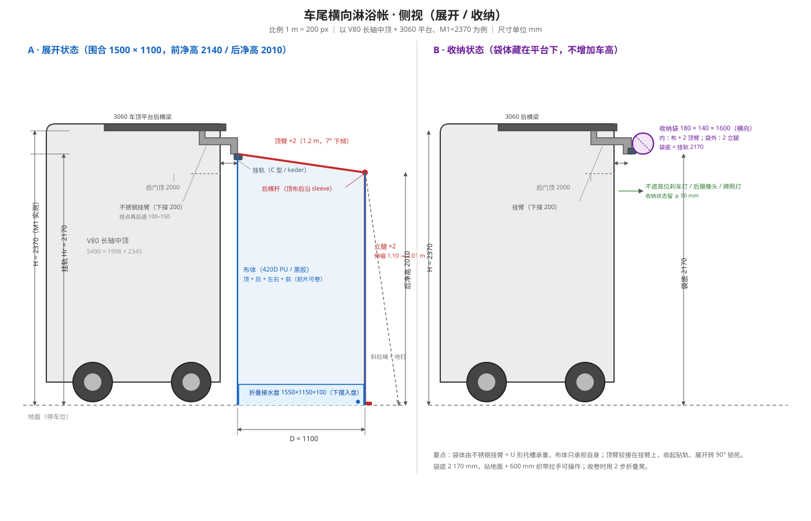
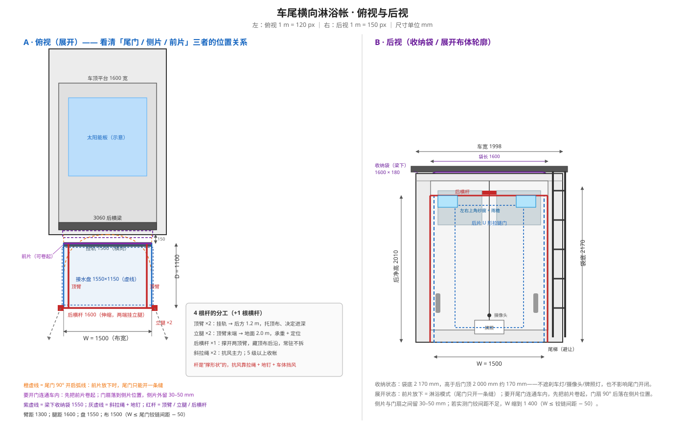

# 车尾横向淋浴帐（车顶平台挂装）

> **状态**：设计中 ｜ **依赖**：[02 车顶平台](design-platform.md)、[05 水路](../05-water-system/design.md)、[09 淋浴模块](../09-shower-module/design.md)、[03 外观](../03-exterior-appearance/design.md)
>
> **2026-10 改版**：用户决定不做立腿，主推 👉 [无立腿版](design-shower-tent-noleg.md)；本文的立腿做法保留作**硬地/大风备选**（可在后横杆两端预留腿座，随时加装）。
>
> **一句话**：在车顶平台**后横梁下方**挂一根 1.5 m 横向挂轨，帐篷布 + 2 根顶臂 + 2 根立腿卷进一个防水收纳袋；展开 2–3 分钟、收纳 3–4 分钟，围出 **1.5 × 1.1 × 2.1 m** 的淋浴/更衣空间，全部利用平台 T 槽固定，**免打孔、年审快拆**。



---

## 0. 先量 3 个尺寸（所有长度都由它推出来）

车高不是查参数能定的：平台高度、后部车顶弧度、尾门/尾梯位置，每个车都不一样。**动手下料前，先量下面 3 个数**（空车、胎压正常、平地）：

| 编号 | 测什么 | 怎么量 | 估值（V80 长轴中顶） |
|------|--------|--------|----------------------|
| **M1** | **平台后横梁下沿离地高 H** | 卷尺/激光测距，在地面量到 3060 后横梁**下沿**；左中右各量一次取最小值 | ≈ 2370 mm（原车 2345 + 平台脚 25） |
| **M2** | **后横梁到车尾最后端的水平距离 d₁** | 从后横梁后沿吊一根线到地面，量线到后门/保险杠最外点的水平距离 | 0–80 mm（视平台后缘位置） |
| **M3** | **后横梁垂线到后门顶/车顶后弧的水平间隙 d₂** | 同一条垂线，量到后门顶外沿（或后部车顶最外点）的水平距离 | 80–200 mm |

再补 5 个避让尺寸（决定能不能装、怎么避）：

| 编号 | 测什么 | 用途 |
|------|--------|------|
| M4 | 尾门洞宽度 / 两门铰链间距 | 定帐宽 W（W ≤ 铰链间距 − 50 mm） |
| M5 | 后门顶高度、高位刹车灯/后摄像头/牌照灯位置 | 收纳袋不能遮挡（留 ≥ 50 mm） |
| M6 | 尾梯（若装）最高安装点、横向位置 | 挂臂/袋体避让，或换到另一侧 |
| M7 | 车尾外接水口/电源口位置、能否从车外操作 | 决定花洒软管进帐位置 |
| M8 | 太阳能板后端位置（平台面） | 袋体在梁下，不遮板；展开时布面遮一点可接受 |

> **量完再往下看**：下面所有数字都以 M1=2370、W=1500、D=1100 为例；你的实测值按公式替换即可。

---

## 1. 推荐方案（结论先看）

### 1.1 形态

```
 车顶平台（3060 后横梁）
        │ 2 个不锈钢挂臂，向后下探 200 mm
        ▼
   ┌──────── 1.5 m 横向挂轨（遮阳篷 C 型轨，布顶边穿 keder 绳）
   │  ┌──── 防水收纳袋（180×140×1600 mm，包住卷好的布 + 2 顶臂）
   │  │
   │  │   ← 2 根顶臂：从挂臂铰接点向后伸 1.2 m，7° 下倾
   │  └───┐
   │      │ 2 根立腿：从后横杆两端落地，长 2.01 m（可调 ±50），腿距 1.6 m
   │      │
   │   布体：顶 + 后 + 左右 + 前（前片可卷起）  ┐
   │   下摆配重，垂入折叠接水盘内侧              │ 1.5 × 1.1 × 2.1 m
   ▼                                            ┘
  ═══════════ 地面 / 接水盘 ═══════════
```

### 1.2 关键参数（推荐值）

| 项目 | 符号/取值 | 说明 |
|------|-----------|------|
| 挂轨高度 | Hr = H − 200 = **2170** | 200 = 袋高 180 + 托槽/间隙 20；太低影响净高，太高够不着 |
| 帐宽（布） | W = **1500** | 平台 1600 留 50；且 W ≤ 铰链间距 − 50（M4） |
| 腿距 / 盘宽 | **1600 / 1550** | 腿距 > 盘宽 > 布宽：立腿站盘外，布下摆落盘内（见 §4.6） |
| 进深 | D = **1100** | 1000 转身局促，1300 悬臂/风载变大；1.1 m 最平衡 |
| 屋顶下倾 | β = **7°** | 1.1 m 降 135 mm，排水够；再大后墙变矮 |
| 帐内净高 | 前 **2140** / 后 **2010** | 站直洗头、举手不碰顶；后沿 2.01 m 足够 |
| 顶臂 | 2 根 × 1200 | 2020 铝型材或 25×2 铝管；一端铰接在挂臂 |
| 立腿 | 2 根 × 2010（可调） | 25/22 伸缩铝管，两段收 1.1 m；**后横杆末端**插座，腿距 1600 |
| 后横杆 | 1 根 × 1600（伸缩） | 藏在顶布后沿 sleeve 里，常驻不拆；两端各出布 50 mm 挂立腿 |
| 布面面积 | ≈ 12–13 m² | 420D PU 牛津布，约 2.8–3.2 kg |
| 收纳卷 | **180 × 140 × 1600 mm** | 布 + 2 顶臂卷成扁卷；立腿在袋外长口袋 |
| 总重 | **7–9 kg** | 平台后部增加载荷，需校核 |
| 接水盘 | **1550 × 1150 × 100** | 折叠 PVC 夹网布，角部排水 |

### 1.3 为什么是这个形态（和成品对照）

成品车顶淋浴帐（Darche Eclipse、Front Runner、San Hima、KickAss 等）本质都是 **“2 摆臂 + 2 立腿 + 卷袋”**：布顶边挂在一根固定轨上，摆臂从车上伸出，立腿落地，布随摆臂展开。它们通常装在**车侧**（沿车身纵向），因为侧帐长度可以做到 2 m。

你要**横向装在车尾**，差异只有三点，本方案都做了对应处理：

1. **挂点要从平台向后让 100–150 mm**（M2/M3）：否则布会蹭到后门顶/车顶后弧，而且雨水会顺着车顶滴进布和车尾之间的缝。
2. **收纳袋不能吊在布上**：袋和杆的重量走**不锈钢托架 + U 形托槽**，布只承担自己（约 3 kg），否则 keder 缝线是薄弱点。
3. **尾门会干涉**：前片做成**可卷起**的双拉链片——洗澡时放下、关门；要开门连通车内时先把前片卷上去（见 §4.4）。

---

## 2. 高度怎么定（车高的正确用法）

### 2.1 公式

```
挂轨高度     Hr = H − a            a = 袋高 + 托槽/间隙 ≈ 200
帐内前净高   Hf = Hr − 30          30 = 顶布/挂轨构造
帐内后净高   Hb = Hr − D·tanβ − 40  β=7°，D=1.1 → 约 Hr − 175
立腿长度     L  = Hb + 10          地脚可调 ±50
```

以 H=2370 为例：Hr=2170，Hf=2140，Hb≈2010，L≈2010。**后净高 2.00 m 是舒适下限**——低于 1.95 m 洗头就要低头了。

### 2.2 分档表（按你的 M1 实测值对号入座）

| 实测 H（梁下沿离地） | 挂轨 Hr（下探 200） | 帐内前/后净高 | 立腿 | 判断 |
|----------------------|--------------------|----------------|------|------|
| 2 450–2 550（高顶 + 平台） | 2 250–2 350 | 2.22 / 2.08 | 2.09 | 富余：可把袋体做到 200 高，或 8–10° 斜顶把后沿压到 2.05 |
| **2 300–2 450（中顶 + 平台，本车估）** | **2 100–2 250** | **2.07 / 1.93** | **1.94** | **推荐区间**（H=2370 时 2.14/2.01） |
| 2 150–2 300（低顶 + 平台） | 1 950–2 100 | 1.92 / 1.78 | 1.79 | 偏矮：把袋压到 150 高、β 降到 4°、D 缩到 1.0 m，可拉回 1.95+；否则改半顶 |
| < 2 150 | < 1 950 | < 1.92 | < 1.79 | **不建议做全高垂挂**：改“半顶篷”（顶只做前 1/3）或侧挂式 |

> **H 偏低时的三个补偿**（按优先级）：① 袋体从 180 压到 150（省 30 mm）；② β 从 7° 降到 4°（省 58 mm）；③ D 从 1.1 缩到 1.0（省 12 mm）。三个都做能多出约 100 mm。

### 2.3 操作高度（很多人忽略的坑）

挂轨 2.17 m，站在地面伸手约 2.1 m——**拉链在头顶上方**。三个补救一起做：

- 挂臂下探 200 mm，把袋底压到约 2.17 m（本方案已含）；
- 拉链头接 **2 根 600 mm 织带拉手**，垂到 1.5 m，站着就能拉；
- 收卷时用 **2 步折叠凳**（或后梯），别踮脚硬够；袋口加拉手环，湿手也好抓。

> 如果 M1 实测 > 2.5 m，别为了好操作把挂轨降太低（内部会矮）——用长拉手 + 踏步解决，而不是牺牲净高。

---

## 3. 方案对比（先选路线再画图）

| 方案 | 做法 | 展开/收纳 | 成本 | 风稳 | 适合谁 |
|------|------|-----------|------|------|--------|
| **A. 成品改造** | 买 1.4×2.1 m 车顶淋浴帐，拆掉侧装支架，做**横向转接托架**装到 3060 后梁 | 1–2 / 2–3 min | 成品 800–2 000 + 转接 300–500 | 好（成品已验证） | 不想缝布、想最快落地 |
| **B. 整体折叠框（推荐）** | 2 顶臂铰接在挂臂 + 2 立腿 + 布体，卷在袋里 | 2–3 / 3–4 min | 2 300–3 500 | 好（有立腿 + 拉绳） | 想完全按自己车尺寸做、能缝/能外发缝纫 |
| **C. 分离杆** | 4 根独立折叠杆插布套，布卷成筒 | 3–5 / 3–4 min | 1 800–2 800 | 中（靠拉绳/地钉） | 第一次做、想先验证尺寸 |
| **D. 纯帘式** | 2 根斜撑 + 配重下摆，无顶 | 1 / 1 min | 300–600 | 差 | 只挡视线、不防雨 |
| **E. 车尾隧道帐** | 帐篷连尾门，利用车内做更衣区 | 3–5 / 5 min | 1 000–2 000 | 中 | 想扩大空间、不介意防水/年审复杂 |

**建议**：先按 **B** 做；如果布体缝制没把握，就走 **A**（买成品 + 自己做转接和收纳），把精力放在“挂装 + 收纳”这两个真正需要定制的部分。**D 不要用于淋浴**（没顶，冬天/雨天没法用，隐私也差）。

---

## 4. 结构设计

### 4.1 挂装接口（免打孔，利用平台 T 槽）

- **2 个不锈钢挂臂**：304，3 mm 折弯。竖向贴 3060 后横梁的**下槽或后侧槽**，用 **2 颗 M8 T 螺母 + M8×20 内六角 + 弹垫** 固定；水平段向后伸 150 mm，再向下 200 mm，末端做耳板，装挂轨和顶臂铰接座。
- **挂臂间距**：约 **1300 mm（±650）**，落在 3060 横梁的 1/4–1/3 点，**不要顶到角件、也不要只挂中间一点**。若平台后梁只有 1.6 m，±650 是安全的。
- **U 形托槽**：一根 1600 mm 的 30×30×2 铝 U 槽，横跨两挂臂，用来**托住收纳袋**（袋重不走布）。托槽用 M6 螺栓挂臂连接。
- **挂轨**：1500 mm 铝合金遮阳篷 C 型轨（6 mm keder），用 M6 螺栓固定在托槽后下沿；轨口朝下/朝后，布顶边从一端滑入。
- **快拆**：4 颗 M8 **梅花手拧螺栓**（T 螺母预装），年审/长期不用时 2–3 分钟整组拆下；只留 2 个挂臂也不显眼。
- **防坠**：一根 **4 mm 不锈钢钢丝绳 + 2 个卸扣**，从挂轨中点连到后横梁，做二次保险（挂臂失效也不砸人）。
- **防松/防水**：T 螺母槽内填硅脂或塞槽盖条；所有螺栓点乐泰 243；**不钻车顶蒙皮**（这是本方案相对成品侧装的最大优势）。
- **载荷**：静态 7–9 kg；按 10 m/s 风（后墙约 3 m² → 约 200–300 N 水平力）由 2 立腿 + 2 拉绳分担；平台后部锚固与角件半年复查一次。

### 4.2 布顶边 ↔ 挂轨

- 布顶前边缝 **6 mm PVC keder 绳**（外包 25 mm 织带加强），从挂轨一端滑入，端头用 M4 自攻螺丝做**限位挡**，防止风把布吹出轨道。
- 不要用魔术贴/挂钩做顶部承力——2 m 长的布面在风里是“帆”，顶部必须是**连续轨道 + 缝线**。
- 挂轨两端各留 25 mm 空位，方便滑入/取出布体（洗布、换布）。

### 4.3 4 根杆（核心：到底怎么排）

> 成品说的“4 根折叠杆”，实际是 **2 根顶臂 + 2 根立腿**，不是 4 根一样长的杆。顶臂负责把屋顶从车上“伸出去”，立腿负责把屋顶撑到地面；**抗风靠拉绳，不靠杆硬扛**。

| 杆 | 数量 | 长度 | 截面 | 收纳长 | 连接方式 |
|----|------|------|------|--------|----------|
| 顶臂 | 2 | 1 200 mm | 2020 铝型材 或 25×2 铝管 | 1 200（随布卷） | 一端 **竖向铰接**在挂臂耳板：收起时贴轨，展开转 90° 后 **弹簧销锁死** |
| 立腿 | 2 | 2 010 mm（可调 ±50） | 25/22 伸缩铝管，两段 | 1 100 | 顶端插进**后横杆末端**的插座，销子锁；底端 **60 mm 地脚板 + 地钉孔**；腿距 1600，在布外 50 mm |
| 后横杆 | 1 | 1 600 mm（伸缩 1 500–1 650） | 22 mm 玻纤/铝管 | 1 150 | 与两顶臂末端 **T 形块锁死**（不只靠布套），藏在顶布后沿 sleeve；两端各出布 50 mm 挂立腿 |
| （选配）斜撑 | 2 | 800 mm | 20 铝管 | — | 风大时从顶臂中点撑到立腿中点，形成三角 |



**顶臂铰接的做法（DIY 关键件）**：

```
挂臂耳板（3 mm 不锈钢）
   │  ← M10 不锈钢销轴 + 尼龙轴套（顶臂能自由转）
   ├── 顶臂端部（2020 端面装一个 3 mm 转接板）
   │
   └── 弹簧销 Ø8：两个孔位
        孔位 A = 顶臂贴轨（收纳）
        孔位 B = 顶臂垂直向后（展开）
```

- 收起状态：顶臂转 90° 贴着挂轨，和布一起进袋；展开状态：转出来、插销“咔”一声锁死，**单手能操作**。
- 立腿不要做成一整根 2.01 m（收不进 1.6 m 的袋）：**两段伸缩 + 扳扣锁紧**，收 1.1 m；或两段插接 + 内置弹力绳。伸缩管更耐用，推荐。
- 后横杆与两顶臂末端用 **T 形连接块 + M6 螺栓**直接锁死——**不能只靠顶布 sleeve 传力**；横杆在臂外侧各悬挑 150 mm，22 mm 管足够。
- 后横杆末端与立腿之间用**插座 + 销子**，不要用螺栓（每次拆装太慢）；插座焊/螺接在后横杆末端下方，腿距 1.6 m（布宽 1.5 m，腿在布外 50 mm）。
- 立腿在布外 50 mm，所以**后片两上角、侧片后下角要用 25 mm 织带 + 插扣挂到立腿上**——否则风从侧面一压，布面会向内塌。
- **抗风**：2 根立腿落地 + **2 根斜拉绳**（25 mm 织带或 3 mm Dyneema，从顶臂外端拉到地面，与地面约 45°，地钉 20 cm 铝 Y 钉）。5 级以上风收帐；停车尽量**车头迎风**，让车体给帐篷挡风。
- **不要**把立腿做成完全垂直还只靠地脚摩擦——风一吹就滑；地钉 + 拉绳是必须的。

> **简化版 C**：不做铰接，4 根独立折叠杆（2 长 1.2 m + 2 短 2.01 m 可拆）平时放袋外长口袋，展开时插进布套、顶臂用挂钩挂到挂臂。多花 1–2 分钟，但金属件简单很多，适合第一次做。

### 4.4 布体（分片、材料、开口）

**分片**（以 W=1500、D=1100、前高 2170/后高 2010 为例）：

| 片 | 尺寸（约） | 做法 |
|----|------------|------|
| 顶 | 1 550 × 1 250（梯形，后沿低 135） | 前边 keder 入轨；两侧 sleeve 穿顶臂；后沿 sleeve 穿后横杆 |
| 后 | 1 500 × 2 010 | 中间开 **U 形 #10 双拉链门**（可整片卷起），下摆配重 |
| 左/右 | 1 150 × 2 010（梯形） | 上边与顶缝合；上角各开 **200×120 纱窗 + 外雨檐**；下摆配重 |
| 前（靠车） | 1 500 × 2 170 | **两侧 #10 可分离拉链**，可从下往上卷起并用织带绑住；洗澡时放下，要开尾门时卷起 |

**材料**：

- 墙布/顶布：**420D PU 牛津布，黑胶或涂银**（遮光、防走光、耐候）。不要用 PVC 做墙——重、冷天硬、冷凝水多；PVC 只用在收纳袋。
- 缝线：**UV 涤纶线 V-69**，主缝双针/包边；顶布和后墙上半段**压胶条**。
- 拉链：**#10 树脂/尼龙圈拉链**，双拉头；门和拉链外侧加**挡水/挡光舌**。
- 纱窗：150D 涤纶网，别用玻纤（折几次就断）。
- 受力点：所有织带/拉环位置加 **25 mm 织带 + 方块回针（box-X）**；不要让力只落在布面上。

**必须处理的 4 个细节**：

1. **下摆配重**：下摆缝 40 mm 套管，穿一根 **1.5 m × 16 mm 铝管/玻纤杆**（约 0.4–0.5 kg，可抽出）；四角再加织带环。配重是“开袋自然下垂”的关键，也是防飘水的关键。
2. **下摆入盘**：下摆自然垂进折叠接水盘**内侧**（沿用 [09 淋浴模块](../09-shower-module/design.md) 的“浴帘入盆”原则）；地钉环缝在**外侧**，钉子打在盘外，不扎破盘。
3. **前片留缝 + 导水**：前片在车尾后方 100–150 mm，**不要贴死车体**；车顶雨水从前片**外侧**流到地面，不会进帐。前片上沿加 40 mm 雨檐，底部加门槛舌。
4. **门与隐私**：后门 U 形拉链内侧加挡光舌；夜间灯放**顶部向下照**，不要放在人背后逆光（会透影子）。

### 4.5 收纳袋（“卷”还是“折”，这是使用体验的分水岭）

先说结论：

- **布和杆一起卷** → 卷不紧、打开不会自己掉、湿布更难卷；
- **布单独卷、杆另放** → 卷得紧，但每次要插 4 根杆，3–5 分钟；
- **布卷在“折好的 2 根顶臂”外面** → 兼顾：卷得动、杆不用插、展开快（**本方案采用**）。

**推荐结构**：

```
        ┌─ U 形托槽（固定）
        │   ┌──────── 600D PVC 防水袋（180 × 140 × 1600，上半个坐在托槽里）
        ▼   ▼
   ═══════════════════════  ← 袋底全长 #10 拉链 + 3 道 50 mm 魔术贴 + 2 道搭扣
        │  ┌── 卷好的布 + 折好的 2 顶臂
        │  └── 袋外 2 个长口袋：2 根伸缩立腿
        └── 袋底 2 个 Ø5 排水孔（湿布也能透气排水）
```

- **袋体**：600D PVC 夹网布，热合/双缝 + 压胶；两端加 **2 mm HDPE 衬板**，防止高速行驶时袋体拍打、也防紫外线把布晒脆。
- **开口**：全长拉链在**下方/后侧**，开袋后下片自然垂下当“帘”，布从下面掉出来；拉链头接 600 mm 织带拉手。
- **二次固定**：3 道 50 mm 魔术贴压缩带 + 2 道不锈钢搭扣（防止拉链失效/高速风振）。
- **快拆**：袋子用 2 根 25 mm 织带 + 插扣挂在托槽上，洗袋/换袋 1 分钟拆下。
- **不要**把袋子做成完全密封的硬筒——湿布闷在里面 24 小时就发霉；底部排水孔 + 透气网是必须的。
- **“自然下垂”的真相**：即使卷得松 + 下摆配重，也只是“自己滑下来大半”，最后 20% 要手拉一下。**想要 100% 一开就落，就改成手风琴式折叠**（不卷），代价是袋体略鼓。本方案建议：**先按卷做，接受手拉一下**；如果特别在意，改折叠。

### 4.6 接水盘与排水（户外淋浴的底线）

- **盘**：1550 × 1150 × 100，500D PVC 夹网布热合/缝制，四角加固；可折叠，收纳后约 400×300×100。
- **宽度关系（重要）**：**腿距 1600 > 盘外宽 1550 > 布宽 1500**。布下摆落在盘内侧 25 mm，立腿站在盘外 25 mm——脚不泡水、地钉不扎盘、水也不会顺墙流到盘外。
- **排水**：后角（远离车）装 25 mm 塑料**舱壁接头 + 90° 宝塔**，接 1 m 软管到 **25–30 L 折叠灰水桶**；盘底垫 20 mm 垫片做出 1–2° 坡度，最后一点水用海绵推过去。
- **不直排**：野外也建议收集（无痕露营）；营地必须收集。灰水倒进房车灰水箱或指定排放点，别倒进雨水沟。
- **站板**：盘内放 600×400 柚木/塑料格栅（可与车内淋浴盘的垫板共用一块），脚不泡水。
- **用量**：5 L/min × 5 min = 25 L；7 L 小厨宝 + 冷水混合大约够一次“打湿—关水—搓洗—冲净”，配 30 L 桶正好。

### 4.7 水路接口（现在就要和水路模块对齐）

- 车尾**只留一个出水口**（冲脚/冲车/淋浴共用），这是 [05 水路](../05-water-system/design.md#未来增项预留-车尾车外淋浴) 已定的原则。
- **关键改动**：这个出水口要能在**尾门关闭**时从车外操作。现在 05 方案的恒温阀位置在车尾柜内（预留 150×150），如果只能开门操作，帐篷就白做了。两个做法：
  1. 在车尾柜/后门**外侧**装一个 150×150 防水检修口，恒温阀 + DM 快接装在里面，软管从检修口出来；
  2. 或者在后门/尾板上开一个 **40 mm 带盖过管口**（橡胶膜 + 螺纹盖），花洒软管穿过去，门保持关闭。
- 帐内：前片下角留 **40 mm 过管孔 + 魔术贴挡片**，软管从孔进帐，不通过门缝（漏风/漏雨/夹管）。
- 花洒：**带一键止水**的节水花洒 + 3 m 软管；帐内 1.7 m 高装一个挂钩/网兜放洗护用品。
- 热水验证：按 05 模块的“车内恒温阀验证”结果再决定车尾是否装第二个恒温阀；没验证前先冷水 + 便携加热，不要一次买两个阀。

### 4.8 通风、照明、隐私

- **通风**：左右上角各一个 200×120 纱窗 + 40 mm 外雨檐，形成对流；洗完把后门拉开、前片卷起，10 分钟晾干。
- **照明**：优先** USB 充电营地灯**（挂顶部，向下照）；要做 12V 就在车尾加一个 **SAE 防水快接 + 3 A 保险**，灯线 5 m，帐内走顶棚。不要在帐内用任何**燃气/燃油取暖或热水器**（一氧化碳）。
- **隐私**：深色/黑胶布 + 顶部通风 + 灯在顶部；不要用白色/浅色薄布（晚上开灯等于投影）。

---

## 5. 展开 / 收纳 SOP（一个人，按这个顺序）

### 5.1 展开（目标 2–3 分钟）

1. 车停稳、拉手刹；**车头迎风**（让车体给帐篷挡风）。
2. 从袋外口袋抽出 2 根立腿，靠车放好；解开袋子的 2 道搭扣、3 道魔术贴，拉开全长拉链。
3. 抓住下摆拉手往下一拉——布卷展开、布体自然下垂（最后一点用手带一下）。
4. 把 2 根顶臂从贴轨位置**向外转 90°**，弹簧销锁死；顶布随之张开。
5. 2 根立腿插进后横杆末端插座，拉长到地面，扳扣锁紧；地脚踩实（腿在接水盘外）。
6. 打 2 根地钉 + 2 根斜拉绳（45°），把接水盘放进帐内、下摆压进盘内侧；接花洒、开阀。

### 5.2 收纳（目标 3–4 分钟）

1. 关水、收花洒；用海绵把盘里剩水推入排水口，倒灰水桶。
2. 抽出地钉/拉绳，收起立腿（缩到 1.1 m），放进袋外长口袋。
3. 把左右/后/前片依次**向内折**到顶布上（前片先卷起），尽量排掉空气。
4. 2 根顶臂转回贴轨位置；从后沿向挂轨方向**卷**（2 根顶臂当卷芯），卷紧。
5. 3 道魔术贴绑住，塞进收纳袋，拉拉链、扣搭扣、粘魔术贴。
6. **湿布绝不过夜**：当天回营地/到家展开晾干；实在要收，24 小时内必须展开。

### 5.3 行车前检查（30 秒）

- [ ] 袋子拉链 + 2 搭扣 + 3 魔术贴全部到位
- [ ] 立腿在袋外口袋里锁住，不晃动
- [ ] 挂臂 4 颗手拧螺栓复紧，防坠钢丝绳在位
- [ ] 收纳袋不遮挡高位刹车灯/后摄像头/牌照灯（≥50 mm）
- [ ] 尾梯、后门开启不受影响；袋体不超出车宽/车长
- [ ] 60–80 km/h 试车无异响/拍打

---

## 6. 关键校核

| 项目 | 校核 | 结论/措施 |
|------|------|-----------|
| 内部净高 | 后沿 ≥ 1.95 m，前沿 ≥ 2.05 m | H=2.37 时 2.01/2.14，合格 |
| 转身空间 | 1.5 × 1.1 m，肩宽 + 抬手 | 合格；比 0.9×0.9 家用淋浴房大近一倍 |
| 风载 | 后墙 3.15 m²，10 m/s ≈ 200–300 N | 2 立腿 + 2 拉绳 + 地钉；5 级收帐 |
| 车顶载荷 | +7–9 kg 静态 + 风载 | 平台后部 2 点锚固；半年复查角件/螺栓 |
| 排水量 | 5 L/min × 5 min = 25 L | 30 L 桶 + 1 m 软管；盘 100 mm 深，溢流水位足够 |
| 操作高度 | 袋底 2.17 m，拉手 1.5 m | 站地面可拉链；收卷用 2 步凳 |
| 行车高度 | 袋体在平台下，不增加车高 | 合格；不遮灯/摄像头要实测 |
| 年审 | 4 颗手拧螺栓全拆 | 2–3 分钟；不钻孔、不改车身 |

---

## 7. BOM 与成本（人民币，2026 价，供参考）

| 类别 | 名称 | 规格 | 数量 | 估价 |
|------|------|------|------|------|
| 布 | 420D PU 牛津布（黑胶/涂银） | 1.5 m 幅宽 × 10 m | 15 m² | 450 |
| 布 | 600D PVC 夹网布（袋） | 1.5 m 幅宽 × 2 m | 3 m² | 120 |
| 布 | 涤纶网纱 / 拉链 / 织带 / 魔术贴 / 缝线 | — | 1 批 | 350 |
| 轨 | 铝合金遮阳篷 C 型轨 + 6 mm keder | 1.5 m | 1 | 100 |
| 架 | 2020 铝型材（顶臂） | 1.2 m | 2 | 80 |
| 架 | 25/22 伸缩铝管（立腿） | 2.01 m | 2 | 160 |
| 架 | 22 mm 伸缩后横杆 | 1.6 m | 1 | 60 |
| 架 | 顶臂铰接座 / 弹簧销 / 立腿插座 | — | 2 套 | 220 |
| 架 | 地脚板 / 地钉 / 拉绳 / 调节扣 | — | 1 批 | 120 |
| 挂装 | 304 不锈钢挂臂（3 mm 折弯） | 定制 | 2 | 220 |
| 挂装 | 30×30×2 铝 U 形托槽 | 1.6 m | 1 | 80 |
| 挂装 | M8 T 螺母 / 手拧螺栓 / 弹垫 / 乐泰 243 | — | 1 批 | 150 |
| 安全 | 4 mm 不锈钢钢丝绳 + 卸扣 | 1 套 | 1 | 60 |
| 接水 | 折叠接水盘 1550×1150×100（定制 PVC） | 1 | 1 | 250 |
| 接水 | 25–30 L 折叠灰水桶 + 25 mm 软管/接头 | 1 套 | 1 | 120 |
| 淋浴 | 节水花洒（带止水）+ 3 m 软管 + DM 快接 | 1 套 | 1 | 150 |
| 加工 | 缝纫外发/热合（布体 + 袋） | — | 1 | 400 |
| **合计** | | | | **≈ 3 000（2 300–3 500）** |

> 成品改造路线：淋浴帐 800–2 000 + 转接托架 300–500，总价可能更低，但尺寸/挂点不如定制贴合。
> 工具：缝纫机（或外发）、手电钻、角磨机、铆螺母枪、热风枪（PVC 热合）、直角尺、卷尺、夹具。

---

## 8. 施工顺序

1. **放样**：按 §0 量尺寸，画 1:10 侧视/俯视图；用纸板做挂臂/挂轨 1:1 模板，上车比划。
2. **金属件**：挂臂折弯 → 托槽/挂轨 → 顶臂/立腿 → 地面组装成框，量对角线（误差 < 5 mm）。
3. **上车试挂**：装挂臂/托槽/挂轨，挂 20 kg 沙袋 24 h，检查平台、角件、螺栓；装防坠钢丝绳。
4. **布体**：先做顶布 → 挂上定位 → 按实际边缘裁侧/后/前片 → 缝拉链/纱窗/下摆 → 压胶。
5. **收纳袋**：把布 + 顶臂卷起来量实际直径/长度，袋体放 20 mm 余量；做袋外立腿口袋、排水孔。
6. **总装调试**：展开/收纳各 5 次，修剪干涉点，加拉手；淋水 10 分钟。
7. **测试**：淋水、排水、3–4 级风、60–80 km/h 行车、年审拆装（见 §9）。

---

## 9. 测试清单

| 测试 | 方法 | 通过标准 |
|------|------|----------|
| 淋水 | 花洒 5 min，重点冲顶布接缝、拉链、前片与车体间隙 | 帐内无明显滴水；车尾门/车内不湿 |
| 车顶雨水 | 水管从平台后沿淋 2 min | 水从前片外侧流走，不进帐 |
| 排水 | 盘内放 20 L 水 | 排水口不堵、软管不脱、桶够装 |
| 风 | 3–4 级风展开 30 min | 杆件不晃、拉绳不松、布不拍打 |
| 收纳 | 1 人计时 3 次 | ≤ 4 min；卷径能进袋 |
| 展开 | 1 人计时 3 次 | ≤ 3 min |
| 行车 | 60/80 km/h 各 10 km | 无异响、无拍打、不遮灯/摄像头 |
| 年审 | 拆装 1 次 | ≤ 3 min，车身无新增孔 |
| 发霉 | 湿布收纳 24 h 后展开 | 无霉点；若有，改干燥流程/加透气 |

---

## 10. 年审与维护

- **年审**：4 颗手拧螺栓拆下整组（袋 + 布 + 杆 + 挂轨），挂臂可留可拆；不钻孔、不改车身、不增加车高/车长，解释为“车顶行李架附属露营装备”。建议年审前拆下，避免解释成本。
- **日常**：每次用完擦干/晾干；拉链每季度涂硅油；缝线/织带每半年检查；挂臂螺栓半年复紧；防坠钢丝绳每年检查。
- **清洗**：布体可整片从挂轨滑出，中性洗涤剂手洗，阴干；不要机洗/漂白/烘干。
- **冬季**：收车前彻底干燥；水路排空（车尾快接/软管/恒温阀）。
- **更换**：布体是消耗品（3–5 年），挂轨/挂臂/杆是耐用品；设计时已留“布可从轨道滑出”，换布不用拆金属件。

---

## 11. 最容易踩的坑（按重要性排序）

1. **只挂后横梁中间一点** → 横梁受扭、角件松。用 2 个挂臂跨到 1/4–1/3 点。
2. **袋/杆的重量吊在布上** → keder 缝线先坏。重量走托槽，布只承担自己。
3. **挂点没向后让** → 布蹭后门顶、雨水灌缝。按 M2/M3 后退 100–150 mm。
4. **尾门打不开/刮布** → 前片必须可卷起；帐宽 ≤ 铰链间距 − 50 mm。
5. **遮住高位刹车灯/后摄像头/牌照灯** → 收纳状态留 50 mm；M5 先量。
6. **和尾梯打架** → M6 先看；挂臂/袋体偏置 150–200 mm 或换侧。
7. **湿布收袋** → 发霉是这类产品第一大报废原因；排水孔 + 当天晾干。
8. **5 级以上风硬撑** → 收帐；车头迎风停车。
9. **把燃气热水器/取暖器放帐内** → 一氧化碳中毒，绝对禁止。
10. **操作高度没算** → 2.17 m 的拉链够不着；下探 + 拉手 + 踏步。

---

## 12. 参考

- 成品形态参考：[Darche Eclipse Shower Awning G2](https://darche.com.au/collections/shower-awnings/products/eclipse-shower-awning-g2)、[Front Runner Easy-Out Awning](https://www.frontrunneroutfitters.com/en/int/easy-out-awning-2m-black-awni100bp.html)、[San Hima Shower Awning](https://www.sanhima.com.au/products/san-hima-awning-shower-tent-fold-out-instant-ensuite-built-in-led-camping-change)、[KickAss Shower Awning](https://kickassproducts.com.au/products/kickass-black-orange-shower-tent-and-shower-awning-base-bundle)
- 整车尺寸：上汽大通 V80 长轴中顶 5 490×1 998×2 345 mm（以实车为准）
- 相关模块：[车顶平台](design-platform.md) ｜ [水路：车尾车外淋浴预留](../05-water-system/design.md#未来增项预留-车尾车外淋浴) ｜ [淋浴模块：浴帘入盆/防水原则](../09-shower-module/design.md) ｜ [外观：黑色件统一](../03-exterior-appearance/design.md)
