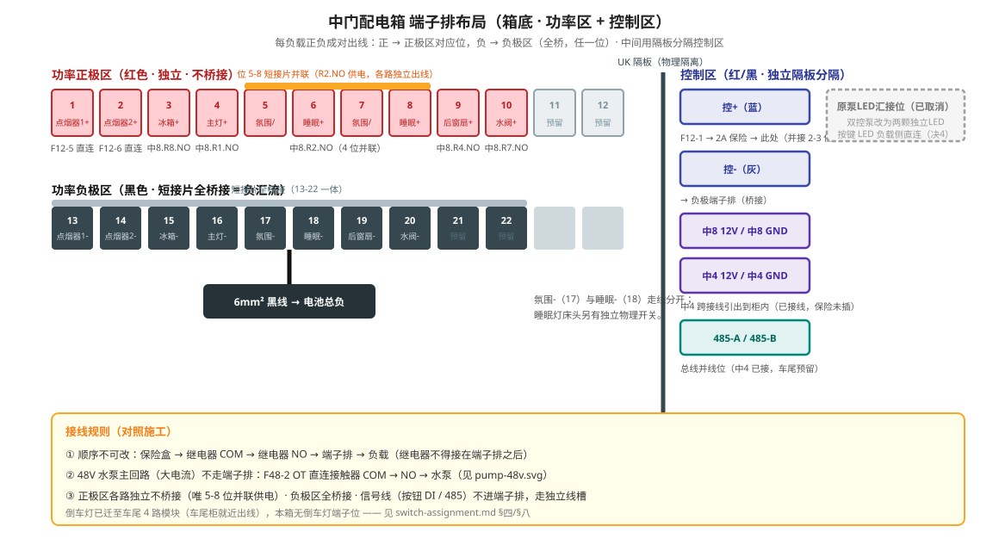
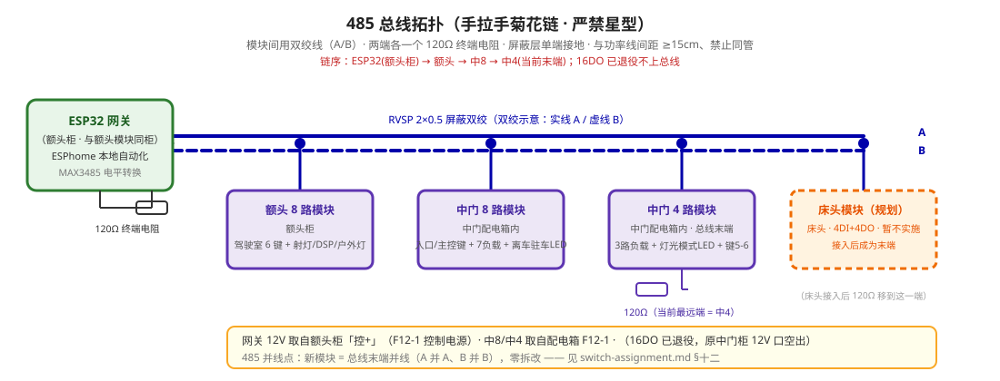

# 面板开关分配 & IO 通道分配

## 按钮规格

- **类型**: 自复位（不带自锁），常开 NO
- **单色 4 线**: 绿绿 = 开关触点（COM/NO），红 = LED 阳极，黑 = LED 阴极
- **双色 5 线**: 黄白 = 开关触点（NO/COM），红 = 共阳（+12V），黑 = 红LED 阴，绿 = 绿LED 阴
- **DI 常态**: 模块内部上拉，静态高电平，按压拉低
- **逻辑**: 短按/长按判定在 ESPhome 里做，按钮本身无状态
- **汇接**: 每面板开关 COM 共 GND、LED 阳极共 +12V，焊并后用端子压接

## 模块清单

| 模块 | 位置 | 通道数 | 阶段 | 干什么 |
|------|------|--------|------|--------|
| **驾驶室A/B** | 额头柜 | 4DI+4DO ×2（5A） | ✅ 已有 1 台 + 1 台待买 | 驾驶室 6 键 + 功率负载（**原「额头 8 路模块」未购买**） |
| **中门-8路** | 中门配电箱内 | 8 DI + 8 DO（10A） | 现在 | **纯负载**（主灯/氛围/排气扇/泵48V/水阀/冰箱/倒车灯+预留）+ 读入口/主控按键 |
| **中门-4路** | 中门配电箱内 | 4 DI + 4 DO（**5A**） | 现在 | 3 路低功率负载（泵线圈/水阀/后窗扇）+ **Y4 灯光模式逻辑LED**；DI 全空 |
| ~~中门-16DO~~ | 中门柜内 | 16 DO（5A，无DI） | **已到货 · 已退役备用**（决4） | ~~全部 LED~~ → LED 改负载侧直连 + 场景键逻辑 LED |

> **架构定稿（最终）**：配电箱 DO 优先给负载（稀缺，藏墙不拆）。
> - **车尾不设模块**：倒车灯负载并进中8，电源从中门拉线到车尾。
> - **上水泵 48V 切外部继电器线圈**（48V 动力侧由大继电器隔离），续流二极管 1N5408。
> - **每个开关配一颗 LED**：有负载的键 **LED 并到负载继电器 NO 输出**（负载侧直连）；
>   只有「无负载可并」的场景键（离车/驻车、灯光模式）用**空余 DO 做逻辑 LED**（中8.Y8 / 中4.Y4）。
> - **16DO 退役备用**：不再上总线、不再承担 LED（见 决4）。
> - 不上位机，ESPhome 在 ESP32 本地跑自动化。后期加 HA 只做 dashboard/远程/通知，**不承载安全关键自动化**（角色边界见 [10-smart-control/n100-ha/design.md](../10-smart-control/n100-ha/design.md)）。

**通道编号规则**：

| 写在表里的 | 意思 |
|-----------|------|
| `额头.R1` | 额头模块第 1 路继电器 |
| `额头.DI1` | 额头模块第 1 路数字量输入 |
| `中8.R1` | 中门 8 路模块第 1 路继电器 |
| `中8.DI1` | 中门 8 路模块第 1 路数字量输入 |
| `中4.R1` | 中门 4 路模块第 1 路继电器 |
| ~~`16DO.R1`~~ | ~~中门 16 路 DO 模块~~（已到货、**已退役备用**，决4） |

> **模块丝印对照**：中8 模块实物端子按 PLC 习惯标 **X/Y**——**X1-X8 = 数字量输入**（即本文 DI1-8），**Y1-Y8 = 继电器输出**（即本文 R1-R8）。接线/排查按丝印找端子，按本文名称对逻辑：如 中8.R1 = 丝印 **Y1**、中8.DI1 = 丝印 **X1**。每个 Y 是继电器干接点，**COM = 公共端（进电侧）**，**NO = 常开出线到负载**，**NC = 常闭（本设计不用，一律空着）**。每个 Y 有三口：NO / COM / NC。

---

## 决策更新（2026-10-28 / 定稿 2026-10-30）—— 与下方旧章节冲突时以本节为准

> 本节的 决1~决6 是**当前有效方案**。
>
> **2026-10-30 状态：决1~决4 全部落地（固件+文档+接线图+站点已同步，见 §十三 落地清单）**
> - **决4（16DO 退役）**：`relay-mid-16do.yaml` 不再 include，prod 固件里**已没有 0x05**；
>   LED 改为「负载侧直连 + 场景键逻辑 LED（中8.Y8 / 中4.Y4）」。
> - **决1/决2/决3（面板重构）**：固件里的 DI 实体已按新面板增删——入口只剩 X1/X2/X4 三键、
>   中8 X5-X8（中门主控 6 键）与中4 X1-X2（键5/键6）已下线、户外灯键移到额头 X5。
>   **物理面板与线缆（14P 主干/复合线）仍按新方案施工，固件先行就绪**。
> - 下方「一、驾驶室面板」「二、中门入口面板」「三、中门主控面板」「§四 通道分配」
>   「§LED 策略」「§七 面板线缆定义」「§八 端子排」等章节**保留为历史/参考记录**，
>   凡与本节冲突之处一律以本节为准；在役映射以本节的**终局表**为准。

### 决1：入口面板最终为「3 个 485 键」（原计划的第 4 键「踏板兜底」已取消，见 决7）—— ✅ 2026-10-30 已落地

入口面板**最终 3 键**（原计划的第 4 键物理兜底已取消，改场景联动，见 决7）：

| 键 | 功能 | 电气 | 固件位号（✅ 已定稿） | LED |
|----|------|------|------------------------|-----|
| 1 | 排水 | 485 DI | **中8.X1**（bit0） | 负载侧直连，并到 **中4.Y2**（水阀）NO |
| 2 | 上水泵 | 485 DI | **中8.X2**（bit1）※ | 负载侧直连，并到 **中4.Y1** 输出 |
| 3 | 离车/驻车 | 485 DI + LED | **中8.X4**（bit3） | **逻辑 LED = 中8.Y8** |
| ~~4~~ | ~~踏板兜底物理开关~~ | **已取消（决7）**：改为「睡眠模式自动收回」，走 **中8.Y3** 信号 | 用固件场景，不再需要面板键 | — |

> ※ **位号变更**：上水泵键原在 X3，现移到 **X2**（因原 X2 户外灯键移去了驾驶室，见决3）。
> **中8.X3 留空**；省下这颗键位不必接线。
> **中8.X5-X8 = 原中门主控键1-4，已随决2 取消**（固件已无对应实体，位图位照样解析但不发布）。

- ~~**键4 兜底 = 切「信号线」**~~ → **该物理开关方案已废弃（决7）**。原意是「在门碰开关与控制板之间串一个小开关，人手动掐断」，
  但**人躺下后没人愿意起身去门口拧**，故改为睡眠模式由固件自动发信号（见 决7）。
  仍然成立的原则：**强电（主电瓶 40A）不入口面板**，踏板动力线接原车电瓶，本箱只出干接点信号。
- **户外灯键从入口移到驾驶室**（见决3），故入口从原「排水/户外灯/上水泵/离车驻车」改为「排水/上水泵/离车驻车」三键。
- **第 4 键（踏板兜底）已取消**：改为睡眠模式自动收回踏板（见 决7），入口面板最终是 **3 键**。
- 因砍掉中门主控 6 键（见决2），入口不必再预留「双控上水泵」链路。

### 决2：中门主控面板（6 键）取消不装 —— ✅ 2026-10-30 已落地

- 原「三、中门主控面板（6 键）」**取消**：这 6 键从未接线，由 **P4 车机大屏 + 手机面板 + 床头 2 键（三之二）** 替代。
- **主灯物理冗余**另设独立位置（额头柜 / 后床上墙），不走中控 6 键。
- 连锁简化：不再需要「主控复合线」这根 14P 线；DI 汇总主干只需搬中8.X1/X2/X4（入口 3 键）。
- **固件落地（2026-10-30）**：删掉中8 的 `bs_bed_light/ambient/fan/pump`（X5-X8）与中4 的
  `bs_bed_fridge/scene`（X1-X2）；连带删除 `act_ambient/act_pump_bed/act_fridge/act_scene_bed`
  四个脚本与 `key1_hold_timer`/`hold_triggered`（**主控键1「长按 2s 灯光全关」随键一起取消**）。
  冰箱改用 P4 大屏/手机面板的 `[中8.Y6] 冰箱` 实体；灯光模式循环仍有「驾驶室键6（额头.X6）」一个入口。

### 决3：驾驶室面板增加「户外灯」键（负载侧直连）—— ✅ 2026-10-30 已落地

- 户外灯负载在**额头柜**（额头.R2），把户外灯键从入口移到驾驶室面板 → **键与负载同柜** → LED 直接并到额头.R2 输出（负载侧直连，零跨线，不需 16DO）。
- 驾驶室面板键位：射灯 / 倒车灯 / DSP / 换气风扇 / **户外灯（新增）** / 灯光模式。
- **固件位号（✅ 已定稿）**：X1 射灯 · X2 倒车灯 · X3 DSP · **X4 换气风扇**（蓝牙扇，按下只上报）·
  **X5 户外灯（新增，原为预留）** · X6 灯光模式 · X7-X8 预留。

### 决4：16DO 模块退役，LED 改为「负载侧直连为主」—— ✅ 2026-10-30 已落地

- **16DO（全部 LED 的唯一模块）退役不用，留着备用**：砍掉中控 6 键后，16DO 只剩入口 4 键 LED，16 路只用 4 路，浪费。
- LED 新策略：**能负载侧直连的，直接并到负载继电器输出**（状态=负载真实得电，无需 DO 模块、无需固件 led_ 脚本）；
  只有「无负载可并」的场景键（离车/驻车、灯光模式）才保留**逻辑 LED**，用中8.Y8 / 中4.Y4 等**空余 DO** 驱动。

#### 决4 终局接线表（唯一标准，施工照此做）

**① 负载侧直连 LED**（有负载的键全部走这里，**不经固件、不占任何模块通道**）

```
LED 阳极（+12V 控+） ── LED 阴极 ── 电阻 1~3.3kΩ ──┬── 该负载继电器 Y 的 NO（负载正极）
                                                    └── 负载正极
灯亮 = 该路真实得电（被遥控/物理开关改过也显示真实状态，不会骗人）
```

| 键 | 按钮 | LED 并到哪一路 Y 的 NO |
|----|------|------------------------|
| 排水 | 入口键1 | **中4.Y2**（水阀） |
| 上水泵 | 入口键2 | **中4.Y1**（切外部继电器线圈的 12V 面） |
| 户外灯 | 驾驶室「户外灯」键（决3） | **额头.R2** NO，键与负载同柜、零跨线 |
| 射灯 | 驾驶室键1 | 额头.R1 NO |
| 车尾灯 | 驾驶室键2 | 中8.Y7 NO |
| DSP | 驾驶室键3 | 额头.R3 NO（注意决5：>10A 时 LED 并到外部大继电器的输出侧） |
| 副驾扇 / 后窗扇 | 驾驶室键4 / 排气扇场景 | 额头.R4 NO / 中4.Y3 NO |
| 冰箱 | 床头或大屏 | 中8.Y6 NO |

> 若某路按决5 改为「模块 DO 只切大继电器线圈」，则 **LED 要并到大继电器的输出（负载侧）**，不要并到线圈上——并线圈只能表示「继电器吸合」，并输出才是「负载真得电」。

**② 逻辑 LED**（只有「无负载可并」的场景键才用）

| 场景键 | 逻辑 LED | 实体 id | 线圈地址 / 帧 |
|--------|----------|---------|----------------|
| 离车/驻车 | **中8.Y8** | `sw_led_camp` | 0x0007 · `02 05 00 07 FF00 3DC8` / `02 05 00 07 0000 7C38` |
| 灯光模式 | **中4.Y4** | `sw_led_scene` | 0x0003 · `03 05 00 03 FF00 7DD8` / `03 05 00 03 0000 3C28` |

接法（「吸地开关」）：`Y.COM = LED 阴极（经 1~3.3kΩ）`、`Y.NO = GND`、`LED 阳极 = +12V 控+`；Y 吸合 → 阴极回 GND → 亮。
颜色一律**单色**（亮 = 已进入该模式，灭 = 正常），不再用红绿双色。

**③ 固件/文档同步结果（2026-10-30）**

| 位置 | 变化 |
|------|------|
| `relay-mid-16do.yaml` | 不再 include（文件保留，头部标注「已退役备用」）；0x05 从总线撤下 |
| `relay-mid-8ch.yaml` | Y8 = `sw_led_camp`（`internal:true`）；删掉 Y1/Y2/Y6 的 `on_state → led_*` |
| `relay-mid-4ch.yaml` | Y4 = `sw_led_scene`（`internal:true`）；删掉 Y1/Y2/Y3 的 `on_state → led_*` |
| `relay-forehead-8ch.yaml` | 删掉 R2 的 `on_state → led_outdoor`（户外灯 LED 改负载侧直连） |
| `base.yaml` | `led_all_off` 只剩 `sw_led_camp` + `sw_led_scene` 两行 |
| `scenes.yaml` | `sw_led_y4 → sw_led_camp`、`sw_led_y10 → sw_led_scene`（逻辑不变） |
| 手机面板 `web/index.html` | **无需改动**：11 个开关实体名未变，两个 LED 实体是 `internal:true` 不上面板 |

### 决1~决4 终局：在役映射总表（施工/排查照此，2026-10-30 定稿）

**① 按键 → 模块引脚 → 动作**（只有这 9 个物理键在役）

| 面板 | 键 | 模块引脚 | 位图位 | 按下动作 | 按键 LED |
|------|----|---------|--------|----------|----------|
| 驾驶室 | 1 射灯 | 额头.X1 | bit0 | 切换 额头.R1 | 负载侧直连 → 额头.R1 的 NO |
| 驾驶室 | 2 倒车灯 | 额头.X2 | bit1 | 切换 中8.Y7 | 并到 中8.Y7 的 NO |
| 驾驶室 | 3 DSP | 额头.X3 | bit2 | 切换 额头.R3 | 并到 额头.R3 的 NO |
| 驾驶室 | 4 换气风扇 | 额头.X4 | bit3 | **只上报**（蓝牙扇，待解析协议） | 无（无继电器） |
| 驾驶室 | 5 户外灯 | 额头.X5 | bit4 | 切换 额头.R2 | 并到 额头.R2 的 NO |
| 驾驶室 | 6 灯光模式 | 额头.X6 | bit5 | 明亮→夜灯→全关 循环 | **逻辑 LED = 中4.Y4** |
| 入口 | 1 排水 | 中8.X1 | bit0 | 切换 中4.Y2 水阀 | 并到 中4.Y2 的 NO |
| 入口 | 2 上水泵 | 中8.X2 | bit1 | 切换 中4.Y1（切外部继电器线圈） | 并到 中4.Y1 输出侧 |
| 入口 | 3 离车/驻车 | 中8.X4 | bit3 | 正常→离车→驻车 循环 | **逻辑 LED = 中8.Y8** |
| 入口 | ~~4 踏板兜底~~ | **已取消（决7）** | — | 改为睡眠模式自动收回（中8.Y3），不需面板键 | — |

> **空置引脚**：中8.X3、中8.X5-X8（原主控键1-4）；额头.X7-8；中4.X1-X4（原键5/键6 已取消）——
> 共 **11 个 DI 空位**，全部留给未来分散独立按钮（中4 的 4 个最近）。
> **物理键从 14 个减到 9 个**，因此 DI 主干从 12 芯降到 3 芯。

**② 负载 → 模块通道**（在役 11 路，LED 走法见 ①）

| 负载 | 通道 | 规格 | 受控于 |
|------|------|------|--------|
| 前射灯 ×2 | 额头.R1 | 10A | 驾驶室键1 |
| 户外灯 | 额头.R2 | 10A | 驾驶室键5 |
| DSP + 低音炮 | 额头.R3 | 10A | 驾驶室键3 |
| 副驾排气扇 | 额头.R4 | 10A | **无键**（排气扇场景已移除；手机面板/大屏控制） |
| 主灯 | 中8.Y1 | 10A | 手机面板/大屏（主控键已取消） |
| 氛围灯+睡眠灯 | 中8.Y2 | 10A | 手机面板/大屏 + 灯光场景 |
| 冰箱 | 中8.Y6 | 10A | 手机面板/大屏（键5 已取消） |
| 车尾灯 | 中8.Y7 | 10A | 驾驶室键2 |
| 上水泵（48V） | 中4.Y1（切外部继电器 12V 线圈） | 5A | 入口键2 |
| 电控水阀 | 中4.Y2 | 5A | 入口键1 |
| 后窗排气扇 | 中4.Y3 | 5A | 手机面板/大屏 + 风扇场景 |
| 离车/驻车 LED | 中8.Y8（逻辑 LED） | — | 入口键3 |
| 灯光模式 LED | 中4.Y4（逻辑 LED） | — | 驾驶室键6 |

> **场景键仍有实体按键**（离车驻车、灯光模式），其余负载的物理入口是 **P4 车机大屏 + 手机面板**。
> 移除物理键不等于失去控制——11 个负载实体名全部保留，面板映射未改动。

### 决8：面板与模块重构（2026-10-30 定稿 · 驾驶室面板 / 5 模块布局）

> **背景**：原计划的「额头 8 路模块」**实际未购买**（文档此前误写为"已到货"，已更正）。
> 用户手头实际有：中8(8DI+8DO 10A)、中4(4DI+4DO 5A)、**4DI+4DO 5A ×1 闲置 + 1 待买**、8DO、16DO(库存)。

#### 模块布局（5 个在役）

| 站号 | 模块 | 位置 | 规格 | 职责 |
|------|------|------|------|------|
| **0x01** | 驾驶室 A | 额头柜 | 4DI+4DO 5A | 4 个功率键 + 射灯/DSP 大继电器线圈 + 户外灯/副驾扇 |
| **0x02** | 驾驶室 B | 额头柜 | 4DI+4DO 5A | 2 个场景键（灯光模式 / 离车驻车） |
| **0x03** | 8DO | 额头柜 | 8DO 5A | 场景键双色 LED ×2 + 倒车灯 LED |
| 0x04 | （预留） | 额头柜 | — | 下一个额头柜模块 |
| **0x05** | — | — | — | **分界线（不分配）** |
| **0x06** | 中8 | 中门配电箱 | 8DI+8DO **10A** | 主灯/氛围/冰箱/车尾灯 + **Y3 踏板收回** |
| **0x07** | 中4 | 中门配电箱 | 4DI+4DO 5A | 泵线圈/水阀/后窗扇（Y4 预留） |
| 0x08~0x0F | （预留） | 中门配电箱 | — | 中门扩展 |

> **站号编号规则（2026-10-30 重编，只动继电器模块，MPPT 等设备不变）**：
> **以 0x05 为分界线** —— `0x01~0x04 = 额头柜`、`0x05 = 分界线`、`0x06~0x0F = 中门配电箱`。
> 以后加模块：额头往后排 0x04，中门往后排 0x08、0x09…，**永不重编**。
> 能源设备仍是 0x10(MPPT)、0x20+(传感器)，与本段不冲突。
>
> **中门配电箱只留 中8 + 中4**（用户要求）。16DO 与 4DI+4DO 库存不动。

#### 驾驶室面板 6 键（全部在额头柜，同柜直连）

| 键 | 功能 | 模块引脚 | LED |
|----|------|---------|-----|
| 1 | 射灯 | 驾驶室A.X1 | 负载侧直连 → 并到**大继电器输出侧** |
| 2 | 倒车灯 | 驾驶室A.X2 | **8DO.Y5**（固件跟随 中8.Y7 真实状态） |
| 3 | DSP | 驾驶室A.X3 | 负载侧直连 → 大继电器输出侧 |
| 4 | 户外灯 | 驾驶室A.X4 | 负载侧直连 → 并到 驾驶室A.Y3 的 NO |
| 5 | **灯光模式** | **驾驶室B.X1** | **8DO.Y1/Y2 红/绿**（灭=全关 绿=睡眠 红=明亮） |
| 6 | **离车驻车** | **驾驶室B.X2** | **8DO.Y3/Y4 红/绿**（灭=正常 绿=离车 红=驻车） |

> **换气风扇键取消**（蓝牙扇无协议，2026-10-30 用户确认忽略）。
> **两个场景键并排**（键5/键6），语义同类、都用双色 LED，放在一起最自然。

#### 入口面板缩为 2 键

| 键 | 功能 | 模块引脚 |
|----|------|---------|
| 1 | 排水 | 中8.X1 |
| 2 | 上水泵 | 中8.X2 |

> 离车/驻车键已移到驾驶室；XD3-X8 全空，留给未来分散按钮。

#### 双色 LED 的接线（吸地开关）

```
双色按钮（5线）：黄白=触点 · 红=共阳(+12V) · 黑=红LED阴 · 绿=绿LED阴
LED 阳极（红，共阳）→ +12V 控+
LED 阴极（黑/绿）→ 串 1~3.3kΩ → 8DO 对应 Y 的 COM
8DO 对应 Y 的 NO → GND
→ Y 吸合 = 阴极接地 = 该色亮
```

**为什么倒车灯 LED 走 8DO 而不是负载侧直连**：倒车灯负载在 中8.Y7（中门），灯却在驾驶室柜。
把 LED 阴拉到中门并 中8.Y7 输出要一根绕路长线；改用 8DO + 固件同步（`led_reverse_sync` 监听
`sw_reverse.on_state`）更省线，且状态的仍是真实继电器状态。

#### 两级切换（配合 决5，用户已预留 3 路大功率继电器+保险）

| 负载 | 驾驶室A DO | 外部 |
|------|-----------|------|
| 前射灯（10~20A） | Y1 只切**线圈** | 30~40A 车规继电器 + 保险 |
| DSP+低音炮（20~30A） | Y2 只切**线圈** | 40A 车规继电器 + 保险 |
| 户外灯（≤5A 实测） | Y3 直切 | — |
| 副驾排气扇（小） | Y4 直切 | — |

> ⚠ 5A 模块 DO **只驱动大继电器线圈（mA级）**，动力线由外部大继电器走。
> LED 并到**大继电器的输出侧**（不是线圈侧），才是「负载真得电」。

#### 固件文件对应

| 文件 | 说明 |
|------|------|
| `relay-cabin-a-4ch.yaml` | 驾驶室 A（0x01，新） |
| `relay-cabin-b-4ch.yaml` | 驾驶室 B（0x02，新） |
| `relay-led-8ch.yaml` | 8DO（0x03，新） |
| `relay-mid-8ch.yaml` | 中8（**0x06**，改：Y3 踏板收回、DI 只留 X1/X2） |
| `relay-mid-4ch.yaml` | 中4（**0x07**，改：Y4 回归预留） |
| `relay-forehead-8ch.yaml` | **作废**（已被 cabin-a/b 取代，不再 include） |
| `relay-mid-16do.yaml` | 库存备用（不 include） |

### 决5：大功率负载统一「两级切换」分级

> 小继电器盒（中8/中4 的 DO，5/10A，端子最多压 6~8mm²）**天生扛不住 >10A 大负载**——线再粗也没用，是触点额定低。统一原则：

- **>10A 或 48V 大负载** → 模块 DO 只切「大继电器/接触器线圈」（mA级），大继电器切真正的动力线：
  - **电动踏板**（12V，启动 20~40A）→ 40A 车规继电器（**踏板收回信号见 决7**：中8.Y3 只做信号/带小继电器线圈，绝不直切这 40A）
  - **DSP + 低音炮**（12V，20~30A）→ 40A 车规继电器
  - **车头射灯 ×2**（12V，10~20A）→ 30~40A 车规继电器
  - **上水泵 48V**、**MPPT 待机** → 63A 接触器（已有）
- **≤10A 小负载** → 模块 DO 直接切（主灯/氛围/排气扇/水阀/户外灯/倒车灯）。
- **10A 临界（留观察）** → 冰箱、尾门灯用模块 DO 直切，峰值实测后再定是否升级。
- **常电大电流**（DCDC 降压器、点烟器口）→ 不用继电器，靠源头大保险保护。
- **大继电器「跟着负载就近装」**：粗动力线走最短路径到负载，只有 mA 级线圈控制线跨柜拉到 485 模块（呼应「粗线就近、细线远程」）。

### 决6：逆变器（5000W）控制方案 —— 继电器短接 RJ 口（2026-10-30）

**逆变器已购：5000W，48V→220V 纯正弦波，自带 RJ 口远程控制面板（类似电话线）。**

#### 控制方式：短接法，不走协议

实测可用**短接某两根线**实现开关。故采用：

```
逆变器 RJ 口  ──┬── 两根控制线 ──┬── 继电器「干接点/触点」
                │                  │
              面板口              线圈 ── 中门柜 485 模块 DO（mA 级）
```

- **为什么不用协议**：厂商私有协议有兼容风险、需抓包逆向；短接法**只看电气通断，可靠得多**。
  协议可留作后续优化（若拿到文档），但**短接是终局可靠方案**。
- **继电器就近装在逆变器旁**：只有**线圈控制线**（mA 级，细线）跨柜拉到中门柜；
  **RJ 口两根线极短**，不经长距离。

#### ⚠ 电气参数（必须先实测再选继电器）

RJ 面板口**尚未实测**，施工前必须用万用表确认三件事：

| 待测 | 怎么测 | 影响 |
|------|--------|------|
| 短接时是**无源干接点**还是**带电压** | 万用表 DC 档量两根线间电压 | 带电压 → 需注意极性与继电器触点额定 |
| 若有电压，**电压/电流多大** | 实测值 | 决定继电器触点规格（多数面板口 5~12V / 几十 mA） |
| 短接是**脉冲触发**还是**电平保持** | 短一下松开 vs 持续短接，看逆变器行为 | 脉冲 → 面板需用「点动」而非「保持」 |

> **实际适配**：不接原面板时，把 RJ 口两根线接到继电器 **COM/NO** 触点；
> 若原面板要保留并联使用，需确认并联后不会互相干扰（建议二选一，不要并接）。

#### ⚠ 5000W 的直流侧：116A，这是硬约束

```
5000W ÷ 0.9(效率) ÷ 48V ≈ 116A 持续放电
（51.2V 标称下约 108A；峰值/启动可到 200A+）
```

| 项 | 要求 | 理由 |
|----|------|------|
| **动力线径** | **≥25mm²，建议 35mm²** | 116A 按 3~5A/mm² 保守取值 |
| **保险** | 150~200A（直流断路器或 ANL） | 就近装在电池侧 |
| **安装位置** | **必须紧挨电池**，不得放中门柜 | 粗线每米成本高、压降大；"粗线就近"原则 |
| **BMS 持续放电能力** | ⚠ **需确认 JK BMS 额定持续电流** | 116A ≈ 0.53C @220Ah；须确认 BMS 支持（常见 200A/300A 版本） |
| **启动冲击** | 逆变器启动峰值约 2×额定 | 线径与保险按峰值校核 |

#### 状态回读

逆变器**没有状态回读**（短接法只给控制不给反馈）。面板上的"开/关"是
**乐观显示**（ESPHome `optimistic: true`），不代表真实状态。
若需真实反馈，后续可考虑从 RJ 口取 LED 指示灯信号，或走协议。

### 决7：电动踏板「睡眠模式自动收回」（2026-10-30 取代原「入口键4 物理兜底」）

> **背景变更**：原方案（2026-10 早）是「入口面板第 4 键 = 物理小开关，串在门碰信号线上，断开就掐掉踏板唯一触发源」。
> 该方案的痛点是**靠人工记得去拧**——人躺下了往往已经是睡前进卧室之后，谁也不会再起身去门口拧一下。
> **改为场景联动**：进入「睡眠模式」→ ESP32 自动发「收回」信号，不依赖人记得操作。

#### 触发条件（用户定稿 2026-10-30）

| 项 | 定稿 |
|----|------|
| **何时收回** | **只有「睡眠模式」**（离车/驻车模式**不收**，仍可正常上下车） |
| **收回时其余动作** | 主灯关 + 氛围灯开（与原「夜灯」档一致，不额外关风扇/氛围） |
| **离开睡眠模式** | 信号松开 → 踏板恢复正常联动（开门伸/关门缩） |

#### 场景档位命名变更

灯光场景循环第 3 档由「**夜灯**」改名「**睡眠模式**」（档位号不变，仍是 `light_scene == 2`）：

```
0 全关  →  1 明亮  →  2 睡眠模式  →  0 全关 …（驾驶室键6 / 额头.X6 循环）
```

- 手机面板场景卡显示「全关 / 明亮 / **睡眠**」（`web/index.html` 的 `SCENE_META.light`）。
- 不改档位数 → 不新增按键、不动 DI，纯粹是改名 + 挂一个动作。

#### 信号载体：中8.Y3（2026-10-30 决8 改到中门配电箱，就近踏板）

| 项 | 值 |
|----|-----|
| 通道 | **中8.Y3**（线圈 0x0002）—— 中门配电箱，离踏板最近 |
| 固件实体 | `[中8.Y3] 踏板收回`（`sw_step_retract`，`internal: true` 不上面板） |
| 帧 | 吸合 `01 05 00 04 FF 00 CD FB` / 释放 `01 05 00 04 00 00 8C 0B` |
| 为什么用中8.Y3 | 踏板在中门附近，拉到额头柜不现实（**就近原则**）；中8 的 Y3/Y4/Y5 空着，Y3 给踏板、**Y4/Y5 留给真正的大功率扩展**（10A 不浪费在 mA 信号上） |

> ⚠ **R5 不自带功率能力**，它是**干接点信号输出**：R5 触点只负责「带一只小型车规继电器的线圈」或「直接串/并到踏板信号线」，
> **48V/40A 的动力线绝不经 R5**（动力线接原车电瓶，本箱只出信号——见 §6.4）。

#### 物理接法：三种可能，实测后定档（⚠ 施工前必做）

踏板控制器的接口尚未实测。用万用表/试短接确认属于哪一种，再决定 R5 怎么接：

| 档 | 控制器行为 | R5 接法 | 固件动作 |
|----|-----------|---------|----------|
| **A. 脉冲短接** | 短接一对线一下就收回 | `R5.COM/NO` 并到那对控制线 | **吸合 1.5s → 释放**（当前固件即是） |
| **B. 保持短接** | 要持续短接才保持收回 | 同上 | 睡眠期间**一直吸合**，离开睡眠才释放（删掉 `step_retract_signal` 里的 `step_release` 一行） |
| **C. 切门碰信号线** | 断开后控制器收不到开门信号 | `R5.COM/NO` **串**在「门碰开关 → 控制器」之间 | 睡眠期间**断开**（即 R5 释放=断、吸合=通时需在固件里反相） |

> **判断方法**（断电前先测，接线上电前再验）：
> 1. 万用表 DC 档量那对疑似控制线：**有电压** → 多半是电平型（B）；**无电压** → 无源干接点（A 或 C）。
> 2. 用镊子/导线**短接一下再松开**：踏板动作一下 → **A（脉冲）**；短接期间才保持 → **B（保持）**。
> 3. 若短接无任何反应，改测「门碰开关 → 控制器」那段，断开它看踏板是否停止自动伸缩 → **C**。

#### 固件实现（已就绪，2026-10-30）

```yaml
# scenes.yaml → apply_light_scene
light_scene == 2（睡眠模式）→ 主灯关 + 氛围开 + script.execute: step_retract_signal
light_scene == 0 或 1        → script.execute: step_release

step_retract_signal（mode: restart）→ R5 吸合 → delay 1.5s → step_release   # A 档
step_release       → 若 R5 仍在吸合则释放
```

改动一处即可在 A/B 档之间切换：删/留 `step_retract_signal` 末尾那行 `- script.execute: step_release`。

#### 已知限制

- **无状态回读**：踏板控制器不回传位置，固件只知道「发过收回信号」，**不知道踏板是否真的收了**（乐观显示）。
- **睡眠模式下仍可能被门碰触发**：若走 A/B 档（只发收回信号，不断信号线），睡梦中有人开门仍会让踏板伸出。
  要**彻底禁止**睡眠期间伸缩 → 必须落 **C 档**（断开信号线），C 是 A/B 的**超集**，可两项并用（两只继电器或一只双组触点）。
- **重新上车**：离开睡眠模式即恢复联动，不需手动复位。

#### ⚠ 前置待排查（TODO 同步）

「关门后偶发自动伸出」的根因排查（门碰信号虚接/极性/控制器抗干扰）**不能因本方案而跳过**——
本方案是**兜底**，不是修根因。根因修好之前，睡眠模式收回只是多一层保护。

---

## LED 策略

> ⚠ **本节是历史记录（16DO 集中方案），已于 2026-10-30 被 [决4](#决416do-模块退役led-改为负载侧直连为主--2026-10-30-已落地) 取代。**
> 现行标准见决4 的「终局接线表」：有负载的键 → LED 并到负载继电器 NO（负载侧直连）；
> 场景键 → 中8.Y8（离车/驻车）/ 中4.Y4（灯光模式）逻辑 LED。下表仅保留作对照与复活参考。

**每个开关都配一颗 LED 状态指示**（远程+本地双控下，没 LED 根本不知道设备开没开）。

LED 全部走**中门 16DO 模块**（16 路 DO，5A，一个 485 地址）——ESPhome 软件把「负载 DO 动作」与「LED DO 动作」绑成同步：负载 Y 吸合时，软件同时驱动对应的 LED Y 吸合，灯亮 = 设备开。**LED 全集中在一个设备里，ESPhome 配一个 16 路开关实体，最简洁。**

> **场景键降单色**：离车/驻车、灯光模式这 2 个场景键的 LED 用**单色**（亮=进入模式，灭=正常），不用双色红绿——这样 12 个按钮 = 12 路 LED，16DO 用 12 留 4。

**接线（独立 Y 驱动 LED）**：

```
LED 阳极（共阳，红线）→ +12V 控+
LED 阴极 ── 电阻(裸LED串1-3.3kΩ) ──→ 16DO 对应 Y 的 COM
16DO 对应 Y 的 NO ──→ 模块 GND
```

> 即：独立 Y 的 COM/NO 当"吸地开关"用，Y 吸合 → LED 阴极经触点回 GND → 灯亮。LED 与负载继电器彻底分离：负载在中8/中4（配电箱），LED 全在 16DO（中门柜）。

**LED 分配（全走 16DO，12 现用 + 4 预留）**：

| LED | 16DO 的 Y | 跟踪 |
|-----|----------|------|
| 入口键1 排水 LED | Y1 | 中8.Y5 水阀 |
| 入口键2 户外灯 LED | Y2 | 额头.R2 |
| 入口键3 上水泵 LED | Y3 | 中8.Y4 泵（与主控键4 共用） |
| 入口键4 离车/驻车 LED（单色） | Y4 | 场景：亮=已进入模式 |
| 主控键1 主灯 LED | Y5 | 中8.Y1 |
| 主控键2 氛围 LED | Y6 | 中8.Y2 |
| 主控键3 排气扇 LED | Y7 | 中8.Y3 |
| 主控键4 上水泵 LED | Y8 | 中8.Y4（与入口键3 共用） |
| 主控键5 冰箱 LED | Y9 | 中8.Y6 |
| 主控键6 灯光模式 LED（单色） | Y10 | 场景：亮=场景激活 |
| 车尾扩展1 LED | Y11 | 未来负载 |
| 车尾扩展2 LED | Y12 | 未来负载 |
| 预留 | Y13-Y16 | 未来加按钮 |

> **双控泵 LED**：入口键3 与主控键4 都控 中8.Y4，两颗按钮各有一颗 LED（16DO.Y3 + 16DO.Y8），ESPhome 让它们一起亮灭。
> 裸 LED 每色串 1-3.3kΩ；双色灯若后期改回，每色占一个独立 Y（16DO 有多余 4 路可用）。

---

## 一、驾驶室面板（额头柜，6 键 + 2 预留）—— ⚠ 历史章节（键位见 决3）

面板 → 额头模块（同柜直连，不设接头）。

| 键 | 功能 | 按钮输入 | 负载继电器 | 备注 |
|----|------|----------|-----------|------|
| 1 | 射灯(前) | 额头.DI1 | 额头.R1 | |
| 2 | 倒车灯 | 额头.DI2 | 中8.Y7 | 纯手动，不联动倒挡；车尾灯并进中门，ESPhome 跨模块 |
| 3 | DSP | 额头.DI3 | 额头.R3 | 含低音炮 |
| 4 | 换气风扇 | 额头.DI4 | 无 (蓝牙) | 后期解析协议 |
| 5 | 预留 | 额头.DI5 | — | |
| 6 | 灯光模式 | 额头.DI6 | 无 | ESPhome 场景：明亮→夜灯→全关 |
| — | 预留 | 额头.DI7-8 | — | 后期扩展 |

---

## 二、中门入口面板（4 键）—— ⚠ 历史章节（面板方案见 决1，LED 见 决4）

面板出一根复合线（14P）：DI + LED 合一，从中门柜汇总排直连。见 §七。

| 键 | 功能 | 按钮输入 | 负载继电器 | LED（16DO · ⚠历史，现行见决4） | 备注 |
|----|------|----------|-----------|------------|------|
| 1 | 排水 | 中8.DI1 | **中4.Y2**（水阀） | 16DO.Y1 | **2026-10 迁至中4**；常闭型 12V 球阀，通电开/断电关 |
| 2 | 户外灯 | 中8.DI2 | 额头.R2 | 16DO.Y2 | 负载在额头柜；ESPhome 跨模块联动 |
| 3 | 上水泵 | 中8.DI3 | **中4.Y1**（泵48V） | 16DO.Y3 | **2026-10 迁至中4**：中4 切**外部继电器的 12V 线圈**，48V 侧由该外部继电器隔离（不再直切）；双控：主控键4 |
| 4 | 离车/驻车 | 中8.DI4 | 无 | 16DO.Y4（单色） | ESPhome 场景：离车→驻车→正常；亮=进入模式 |

> **键4 当前实装单色**：单色按钮 LED 黑线 → 入口复合线 位12 橙 → 16DO.Y4（离车驻车LED），触点线和共阳不动。

> **离车模式**: 主灯、氛围灯/睡眠灯、户外灯、射灯、倒车灯、排气扇、换气风扇、上水泵、电控水阀、DSP 全关。冰箱和 MPPT 不断电。
> **驻车模式**: 预设场景（主灯暖光、氛围灯亮、逆变器通电、PIR 感应启用等）。

---

## 三、中门主控面板（靠后床，6 键）—— ⚠ 历史章节（已按 决2 取消）

面板出一根复合线（14P）：DI + LED 合一，从中门柜汇总排直连。见 §七。

> **物理排位**：键1（主灯）与键6（灯光模式）可互换位置，接线按功能对号入座即可（每根按钮线独立压入对应线芯位）。按钮引线不够长时面板内加延长线。

| 键 | 功能 | 按钮输入 | 负载继电器 | LED（16DO · ⚠历史，现行见决4） | 备注 |
|----|------|----------|-----------|------------|------|
| 1 | 主灯 | 中8.DI5 | 中8.Y1 | 16DO.Y5 | 短按主灯开/关；长按2s灯光全关；灯带物理开关+2.4G遥控 |
| 2 | 氛围灯/睡眠灯 | 中8.DI6 | 中8.Y2 | 16DO.Y6 | 同一继电器；端子排5-8位并出线；睡眠灯床头独立开关 |
| 3 | 排气扇场景 | 中8.DI7 | **中4.Y3** + 额头.R4 | 16DO.Y7 | **2026-10 后窗扇迁至中4**（副驾扇仍在额头.R4）；循环：全关→仅后窗→后窗+副驾→全开 |
| 4 | 上水泵 | 中8.DI8 | **中4.Y1** | 16DO.Y8 | **2026-10 迁至中4**；双控：入口键3 |
| 5 | 冰箱 | 中4.DI1 | 中8.Y6 | 16DO.Y9 | ESPhome 跟踪 Y6 状态驱动 LED；离车自动关 |
| 6 | 灯光模式 | 中4.DI2 | 无 | 16DO.Y10（单色） | 明亮→夜灯→全关；亮=场景激活 |

> **键4（上水泵）双控 LED 同步**：入口键3 与主控键4 都控 中8.Y4，两颗按钮的 LED 分别进 16DO.Y3 和 16DO.Y8，ESPhome 让它们一起亮灭。

> **主灯和睡眠灯双控逻辑**：485 继电器（Y1/Y2）管总电源，灯上物理开关/遥控管本地控制。两者串联——继电器断电=灯必灭，通电=灯由本地开关决定。键1 长按 2s = ESPhome 同时断 Y1+Y2。

---

## 三之二、床头面板（2 键 · 规划中，暂不实施）

> **状态：规划，未施工、未采购。** 位置在后床床头（另一侧墙面），躺下时手可及。距离中门柜约 4m，走车顶。

**方案要点**：床头**自带一个 4DI+4DO 模块**（与中4 同款），面板线极短（面板就在模块旁），485 与 12V 由车顶网线主干供给——不拉长信号线回中门柜。

| 键 | 功能 | 按钮输入 | LED（双色，本地模块 DO） | 备注 |
|----|------|----------|------------------------|------|
| 1 | 通风模式 | 床头模块.DI1 | DO1=绿（低档）/ DO2=红（高档） | 短按循环档位 |
| 2 | 灯光模式 | 床头模块.DI2 | DO3=绿（夜灯）/ DO4=红（明亮） | 短按循环；灭=全关 |

**双色 LED 三态定义**：

| 键 | 灭 | 绿 | 红 |
|----|-----|-----|-----|
| 通风模式 | 全关 | 低档（如仅后窗） | 高档（全开） |
| 灯光模式 | 全关（Y1断 Y2断） | 夜灯（氛围/睡眠灯亮，主灯关） | 明亮（主灯+氛围全亮） |

> **LED 跟真实状态，不跟按键次数**：ESPhome 读 中8.Y1/Y2（灯）、中8.Y3（排气扇）的**实际继电器状态**驱动 LED。这样被 2.4G 遥控、灯带物理开关或其他按键改变后，LED 仍显示真实档位，不会骗人。

**床头模块接线（全在床头本地）**：

| 项 | 接法 |
|----|------|
| 模块供电 | 车顶网线主干 12V 对 |
| 485 | 车顶网线主干 A/B 对 + 485-GND |
| 键1/键2 NO | 模块 DI1 / DI2 |
| 两键 COM | 模块 GND（公共） |
| 键1 绿/红阴 | 模块 DO1 / DO2 |
| 键2 绿/红阴 | 模块 DO3 / DO4 |
| LED 阳极 | +12V |
| DI3-4 / DO5-8 | 预留 |

> **对现有预留位的影响**：床头若按本方案实施，则 **中4.DI3-4 不必再留给床头**，继续作为其他扩展位；床头自身用本地模块的 IO。若床头改走"信号线回中门柜"方案，才需要占用中4.DI3-4 + 汇总排 DI11/DI12。

> **485 拓扑**：床头模块接入车顶 485 主干（**严禁星型/环形**，须为菊花链），插在中4 之后作为**最末端**，则 120Ω 终端电阻由中4 端移到床头端。详见 §十。

---

## 四、继电器通道分配

### 额头模块（8 路）

| 通道 | 负载 | 控制方式 |
|------|------|---------|
| R1 | 车顶前射灯 ×2 | 驾驶室键1 |
| R2 | 户外侧灯 | 入口键2（ESPhome 跨模块） |
| R3 | DSP + 低音炮 | 驾驶室键3 |
| R4 | 副驾窗排气扇 | 主控键3（排气扇场景联动） |
| R5 | —（LED DO） | 入口键2 LED（跨箱线，预留） |
| R6 | MPPT 待机断电接触器线圈（备选硬件档） | ESPhome 自动化，见 [energy/mppt-protocol.md](../10-smart-control/energy/mppt-protocol.md) |
| R7-8 | 预留 | 后期扩展 |

### 中门 8 路模块（配电箱内 · 纯负载）

| 通道 | 负载 | 控制方式 |
|------|------|---------|
| Y1 | 主灯 | 主控键1 |
| Y2 | 氛围灯 + 睡眠灯 | 主控键2 |
| Y3 | 后窗排气扇（4 小风扇） | 主控键3（排气扇场景联动） |
| Y4 | 上水泵（48V 直切 + 续流二极管） | 入口键3 + 主控键4（双控） |
| Y5 | 电控水阀（排水） | 入口键1（常闭型，通电开/断电关） |
| Y6 | 冰箱 | 主控键5 / ESPhome 自动化 |
| Y7 | 倒车灯（车尾并进） | 驾驶室键2（ESPhome 跨模块，纯手动不联动倒挡） |
| Y8 | 预留 | 未来扩展负载 |

> 中8 = **负载模块**：7 路切功率 + **Y8 作离车/驻车逻辑 LED**（决4）。倒车灯从车尾并进，电源从中8.Y7 拉线到车尾。

### 中门 4 路模块（配电箱内 · 未来负载扩展）

| 通道 | 用途 | 备注 |
|------|------|------|
| Y1 | 未来负载 1 | 现空 |
| Y2 | 未来负载 2 | 现空 |
| Y3 | 未来负载 3 | 现空 |
| Y4 | 未来负载 4 | 现空 |
| DI1 | 主控键5（冰箱） | 短按切换冰箱 |
| DI2 | 主控键6（灯光模式） | 短按循环场景 |
| DI3-4 | 预留 | 未来分散独立按钮 |

> 中4 = **未来负载扩展**（4 路 DO 空着，等以后加负载）+ 读键5-6。配电箱 DO 全留给负载（稀缺资源，藏墙不拆）。

> **2026-10 迁移（中8 → 中4）**：三个低功率负载从中8 挪到中4，腾出中8 通道，
> 并让「桌面只接一块模块」时也能测负载。**模块地址不变**（中8=0x02、中4=0x03）。
>
> | 中4 通道 | 承接负载 | 原中8 通道 | 依据 |
> |---------|---------|-----------|------|
> | **Y1** | 上水泵（切外部继电器 12V 线圈） | 中8.Y4 | 中4 只切控制级，48V 由外部继电器隔离 |
> | **Y2** | 电控水阀 | 中8.Y5 | 控制级小电流（F12-1） |
> | **Y3** | 后窗排气扇（4 小风扇） | 中8.Y3 | 实际总电流远小于 5A |
> | Y4 | 预留 | — | — |
>
> ⚠ **中4 是 5A 规格**（2026-10-30 已确认实物换 5A 继电器，文档同步），**不得接 10A 级负载**：主灯、氛围灯/睡眠灯、冰箱（10A）
> ⚠ **中4.Y3 后窗排气扇必须实测电流**：4 个小风扇若为 120mm 级，总额定可能到 4~5A、启动更高；
> 实测运行电流 **>3A 就把这路挪回 中8（10A）**。Y1 只切外部继电器线圈（0.1~0.2A）、Y2 水阀（≤1A）、Y4 逻辑 LED（mA），三路都安全。
> **仍在中8**，不可再往中4 迁。
> ⚠ ESPhome 的 switch id（`sw_pump`/`sw_valve`/`sw_fan_rear`）保持不变，
> 因此 `base.yaml` / `scenes.yaml` / `relay-mid-16do.yaml` 的引用无需改动。

### 中门 16DO 模块（中门柜内 · ~~全部 LED~~）—— ⚠ 已退役，下表为历史记录

> 2026-10-30 按决4 退役：模块留着备用，**不装、不上总线、不占 0x05**。
> 现行 LED 分配见 决4「终局接线表」；下面这张表只作复活参考。

| 通道 | 用途 | 备注 |
|------|------|------|
| Y1 | 入口键1 排水 LED | 跟踪 中8.Y5 |
| Y2 | 入口键2 户外灯 LED | 跟踪 额头.R2 |
| Y3 | 入口键3 上水泵 LED | 跟踪 中8.Y4 |
| Y4 | 入口键4 离车/驻车 LED（单色） | ESPhome 场景 |
| Y5 | 主控键1 主灯 LED | 跟踪 中8.Y1 |
| Y6 | 主控键2 氛围 LED | 跟踪 中8.Y2 |
| Y7 | 主控键3 排气扇 LED | 跟踪 中8.Y3 |
| Y8 | 主控键4 上水泵 LED | 跟踪 中8.Y4 |
| Y9 | 主控键5 冰箱 LED | 跟踪 中8.Y6 |
| Y10 | 主控键6 灯光模式 LED（单色） | ESPhome 场景 |
| Y11 | 车尾扩展1 LED | 未来负载 |
| Y12 | 车尾扩展2 LED | 未来负载 |
| Y13-16 | 预留 | 未来加按钮 |

> 16DO = **全部 LED 的唯一模块**（16 路 DO，5A，一个 485 地址，ESPhome 一个设备）。只走 LED 小电流，绝不接大功率负载。

> **当前状态**（2026-10-30 更正）：原「额头 8 路模块」**未购买**，已由 驾驶室A/B（4DI+4DO ×2）取代（见 决8）；16DO 库存备用；中8 已接（负载+DI）；中4 已接线未通电。
> 本轮施工顺序见 [10-smart-control/execution-plan.md](../10-smart-control/execution-plan.md)。

---

## 五、DI 通道占用总览

### 额头模块（8 DI）

| 通道 | 接哪颗按钮 |
|------|-----------|
| DI1 | 驾驶室 射灯 |
| DI2 | 驾驶室 倒车灯 |
| DI3 | 驾驶室 DSP |
| DI4 | 驾驶室 换气风扇 |
| DI5 | 驾驶室 预留 |
| DI6 | 驾驶室 灯光模式 |
| DI7-8 | 预留 |

### 中门 8 路模块（8 DI）

| 通道 | 接哪颗按钮 |
|------|-----------|
| DI1 | 入口 排水 |
| DI2 | 入口 户外灯 |
| DI3 | 入口 上水泵 |
| DI4 | 入口 离车/驻车 |
| DI5 | 主控 主灯 |
| DI6 | 主控 氛围灯/睡眠灯 |
| DI7 | 主控 排气扇场景 |
| DI8 | 主控 上水泵 |

### 中门 4 路模块（4 DI）

| 通道 | 接哪颗按钮 |
|------|-----------|
| DI1 | 主控键5 冰箱 |
| DI2 | 主控键6 灯光模式 |
| DI3-4 | 预留（未来分散独立按钮） |

### 扩展预留（未来分散独立按钮）

计划后期在车内各处（床头、储物仓、户外等）加独立按钮。预留通道：

| 预留位置 | 通道 | 说明 |
|---------|------|------|
| 中4 DI3-4 | 2 个 | 优先用，最近（已随 DI 主干搬到汇总排 DI11/12） |
| 额头 DI5/D17-8 | 3 个 | 驾驶室侧扩展 |
| ~~16DO Y13-16（LED）~~ | 4 个 | 16DO 已退役（决4）；按钮 LED 改走负载侧直连 |
| 485 总线再挂模块 | 无限 | 零拆改，见 §十二 |

> **床头面板（规划中）不占用上述预留**：床头按 §三之二 方案自带 4DI+4DO 模块，用本地 IO，16DO.Y13-16 与 中4.DI3-4 仍留给其他扩展。

> 扩展原则：按钮走 **DI（输入）**、对应 LED 走 **DO（LED模块）**、负载走 **负载模块 DO**。加新按钮 = 断预留 DI/DO 并进中门柜汇总排 + ESPhome 配置，**永远不动现有负载接线**。中4.DI3-4 已随 DI 主干搬到汇总排 DI11/DI12，16DO.Y13-16 就地并汇总排，新按钮从中门柜汇总排出线。

---

## 六、12V 保险分配

### 中门 12V 保险盒（12 路箱，现用 6 路 + 新增 N100/路由，余 5 路预留）

| 保险位 | 负载 | 电流 | 合并逻辑 |
|--------|------|------|----------|
| F12-1 | 控制系统 + 485 + 电控水阀 + 车内锁 + 踏步 + **ESP32 + 面板LED**（控制组） | 10A | 全控制级小电流，ESP32/LED 均挂此路（16DO 已退役，不占保险） |
| F12-2 | 主灯 + 氛围灯 + 睡眠灯 | 10A | 灯全合，进模块时 COM 分线 |
| F12-3 | 后窗排气扇（4 小风扇） | 5A | 低功率，独立 |
| F12-4 | 冰箱 | 10A | 压缩机启动电流大，独立 |
| F12-5 | 点烟器 1 | 15A | 二排座椅后 |
| F12-6 | 点烟器 2 | 15A | 中门柜 |
| **F12-7** | **N100 + 路由器**（尾门台面） | **5A** | **算力/网络组，必须独立，不与控制组共保险** |

> F12-2 出一根 1.5mm² → 到模块处分叉 → R1.COM + R2.COM。继电器 COM 端不受保险保护的那段极短（几 cm），安全。

> **控制组 vs 算力组的边界（关键）**：
> - **F12-1 控制组**：ESP32、3 个在役继电器模块控制电（中8/中4/额头）、面板 LED 共阳、车内锁、踏步，全是 mA 级小电流，可合并一路。
> - **F12-7 算力组**：N100 是整机（12V 直供，启动尖峰 + 满载 2~3A），路由器也有一定功耗，**必须单独 5A 保险**，绝不与 F12-1 共保险——否则 N100 满载会拉低控制组电压 / 顶保险，连带失去全车控制。
> - 功率负载（F12-2~4、倒车灯）各管各，不与任何信号/算力串联。

### 倒车灯供电（并进中门，不再设车尾模块）

倒车灯负载由 中8.Y7 切（中门出线拉到车尾）。倒车灯 5A 独立保险（与 F12-6 点烟器分开）。车尾不再设独立保险盒/模块。

| 项目 | 值 |
|------|-----|
| 倒车灯 | 中8.Y7 → 拉线到车尾，5A 保险 |
| 车尾其他设备 | 未来加则从倒车灯同一路或点烟器取，或 485 总线再挂模块 |

### N100 + 路由器供电（尾门台面 · 12V 直供）

N100（12V 直供）+ 路由器装在**尾门台面（显示器后）**，距中门配电柜最远。供电从**中门 12V 保险盒 F12-7（5A）**出，沿「中门→尾门」路径拉 12V 正负极对（与倒车灯线同一路径、可共线槽，但**电不共用**——倒车灯挂中8.Y7 触点、随灯断电，N100/路由是常电设备）。

| 项 | 值 |
|----|-----|
| 取电 | 中门 12V 保险盒 F12-7（5A 独立） |
| 正负 | +12V + 负极对走到尾门台面（负极回配电柜负排） |
| 线径 | 1.5~2.5mm²（尾门距离下 5A 尖峰压降可接受，2.5mm² 更稳） |
| 与倒车灯关系 | 可共走线路径/线槽，**电气独立，不挂中8.Y7 触点后** |

> ⚠ N100/路由绝不能挂在中8.Y7（倒车灯）触点之后——否则倒车灯一关，N100 也断电。必须从 F12-7 常电直供。

---

## 七、面板线缆定义（中门柜汇总方案）

> **核心思路**：中门柜（16DO 所在处）作为**全车信号汇接中心**——所有 DI（来自中8/中4）与 LED 阴（来自 16DO）先在中门柜汇总到一个「总端子排」，再从汇总排分线到各面板。面板侧一根复合线直达中门柜，不跑配电箱。
> 优点：面板离中门柜近，走线最短；DI+DO 单一汇总点，理线最清爽；加面板/加按钮从汇总排直接出，零拆改。驾驶室面板走额头模块，另案处理，不在本方案内。

### 全车统一色序表（14 芯 · 唯一标准）

**所有面板复合线、DI 主干一律用 14P 线 + 14P 插头，芯位色序全车唯一**——同一个位号永远是同一种颜色、同一个含义。备线只需一种，插错位也能一眼对出。

| 位 | 色 | 含义（复合线） | 含义（DI 主干） |
|----|-----|--------------|----------------|
| 1 | 黑 | GND | GND |
| 2 | 红 | +12V | +12V |
| 3 | 白 | 键1 DI | DI1 |
| 4 | 黄 | 键2 DI | DI2 |
| 5 | 灰 | 键3 DI | DI3 |
| 6 | 淡绿 | 键4 DI | DI4 |
| 7 | 深绿 | 键5 DI | DI5 |
| 8 | 棕 | 键6 DI | DI6 |
| 9 | 蓝 | 键1 LED 阴 | DI7 |
| 10 | 黑白 | 键2 LED 阴 | DI8 |
| 11 | 粉 | 键3 LED 阴 | DI9 |
| 12 | 橙 | 键4 LED 阴 | DI10 |
| 13 | 红白 | 键5 LED 阴（预留） | DI11 |
| 14 | 紫 | 键6 LED 阴（预留） | DI12 |

> **规律**：位1-2 是公共电源（黑 GND / 红 +12V），位3-8 是 DI 段（白/黄/灰/淡绿/深绿/棕），位9-14 是 LED 段（蓝/黑白/粉/橙/红白/紫）。**面板复合线与 DI 主干共用同一套线色顺序**，只是同一根芯在线里的用途不同。

### 主干与面板线总览

| 线 | 从 → 到 | P 数 | 内容 | 跨距 |
|----|---------|------|------|------|
| **DI 汇总主干** | 配电箱(中8+中4) → 中门柜汇总排 | **14P** | 12路 DI + GND + 12V | 一根长线（柜间） |
| **入口复合线** | 中门柜汇总排 → 入口面板 | **14P** | GND + 12V + 4 DI + 4 LED阴 + 预留4 | 近（中门柜旁） |
| **主控复合线** | 中门柜汇总排 → 主控面板 | **14P** | GND + 12V + 6 DI + 6 LED阴 | 近（中门柜旁） |
| **16DO 阴极限** | 16DO.Y1-10 → 汇总排 | 就地并 | 10路 LED 阴直接并进汇总排 | 同柜，零长 |

> 全车（入口+主控）就这 **1 根 DI 主干 + 2 根面板复合线**，**全部 14P 统一**。线型统一 0.5mm² 多芯信号线（DI 干接点、LED 阴仅几 mA，无需粗线）。插头用 JST SM/XH 或 Deutsch DT，14P 物理防呆。

### 中门柜总端子排（汇接中心）

汇总排分三区，物理相邻、标签分色：

| 区 | 端子 | 内容 | 去向 |
|----|------|------|------|
| **DI 区** | DI1-8 | 中8.DI1-8（来自 DI 主干） | 面板复合线的 4/6 路 DI 芯 |
| | DI9-12 | 中4.DI1-4（来自 DI 主干） | 同上 |
| | GND | 按钮公共端（COM） | 面板复合线 GND 芯 |
| **LED 区** | Y1-10 | 16DO.Y1-10 阴极限（就地并） | 面板复合线 LED 阴芯 |
| | LED-GND | 16DO NO 公共端 | 面板复合线 GND 芯（可并 DI-GND，见下） |
| **电源区** | +12V | 控+ 取电 | 面板复合线 12V 芯（LED 阳极） |

> **GND 是否合并**：DI 的 COM（GND）与 16DO 的 NO 公共（GND）物理上同为电池负，可以并入同一个 GND 端子，减少芯数；若想隔离电磁干扰，可分两个 GND 端子。本方案**默认合并为一个 GND**（省芯、简化），需要隔离时再拆。

### DI 汇总主干 — 配电箱(中8+中4) → 中门柜汇总排（14P）

| 位 | 色 | 信号 | 接（配电箱侧） |
|----|-----|------|----------------|
| 1 | 黑 | GND（DI 公共） | 中8.GND / 中4.GND 并 |
| 2 | 红 | +12V（汇总排电源，备用） | 控+ |
| 3 | 白 | DI1 | 中8.DI1（入口 排水） |
| 4 | 黄 | DI2 | 中8.DI2（入口 户外灯） |
| 5 | 灰 | DI3 | 中8.DI3（入口 上水泵） |
| 6 | 淡绿 | DI4 | 中8.DI4（入口 离车/驻车） |
| 7 | 深绿 | DI5 | 中8.DI5（主控 主灯） |
| 8 | 棕 | DI6 | 中8.DI6（主控 氛围灯/睡眠灯） |
| 9 | 蓝 | DI7 | 中8.DI7（主控 排气扇场景） |
| 10 | 黑白 | DI8 | 中8.DI8（主控 上水泵） |
| 11 | 粉 | DI9 | 中4.DI1（主控 冰箱） |
| 12 | 橙 | DI10 | 中4.DI2（主控 灯光模式） |
| 13 | 红白 | DI11 | 中4.DI3（预留·未来按钮） |
| 14 | 紫 | DI12 | 中4.DI4（预留·未来按钮） |

> 主干把配电箱里中8(8DI)+中4(4DI) 的干接点**集中搬到中门柜汇总排**，12 路 DI 各自独立芯线，不可并。GND/12V 各一根。这是「DI 汇总到中门柜」的唯一代价：一根 14 芯柜间线。

### 入口复合线 — 中门柜汇总排 → 入口面板（14P）

| 位 | 色 | 信号 | 汇总排取 | 面板按钮 |
|----|-----|------|---------|---------|
| 1 | 黑 | GND | GND 端子 | 4键 COM 焊并 |
| 2 | 红 | +12V | +12V 端子 | 4键 LED 阳极焊并 |
| 3 | 白 | DI（排水） | DI1 | 键1 NO |
| 4 | 黄 | DI（户外灯） | DI2 | 键2 NO |
| 5 | 灰 | DI（上水泵） | DI3 | 键3 NO |
| 6 | 淡绿 | DI（离车/驻车） | DI4 | 键4 NO |
| 7 | 深绿 | 预留 DI | DI11（中4.DI3） | — |
| 8 | 棕 | 预留 DI | DI12（中4.DI4） | — |
| 9 | 蓝 | LED 阴 | Y1 | 键1 LED 阴 |
| 10 | 黑白 | LED 阴 | Y2 | 键2 LED 阴 |
| 11 | 粉 | LED 阴 | Y3 | 键3 LED 阴 |
| 12 | 橙 | LED 阴 | Y4 | 键4 LED 阴（单色） |
| 13 | 红白 | 预留 | — | 未来按钮 |
| 14 | 紫 | 预留 | — | 未来按钮 |

### 主控复合线 — 中门柜汇总排 → 主控面板（14P）

| 位 | 色 | 信号 | 汇总排取 | 面板按钮 |
|----|-----|------|---------|---------|
| 1 | 黑 | GND | GND 端子 | 6键 COM 焊并 |
| 2 | 红 | +12V | +12V 端子 | 6键 LED 阳极焊并 |
| 3 | 白 | DI（主灯） | DI5 | 键1 NO |
| 4 | 黄 | DI（氛围/睡眠） | DI6 | 键2 NO |
| 5 | 灰 | DI（排气扇场景） | DI7 | 键3 NO |
| 6 | 淡绿 | DI（上水泵） | DI8 | 键4 NO |
| 7 | 深绿 | DI（冰箱） | DI9 | 键5 NO |
| 8 | 棕 | DI（灯光模式） | DI10 | 键6 NO |
| 9 | 蓝 | LED 阴 | Y5 | 键1 LED 阴 |
| 10 | 黑白 | LED 阴 | Y6 | 键2 LED 阴 |
| 11 | 粉 | LED 阴 | Y7 | 键3 LED 阴 |
| 12 | 橙 | LED 阴 | Y8 | 键4 LED 阴 |
| 13 | 灰 | LED 阴 | Y9 | 键5 LED 阴 |
| 14 | 棕 | LED 阴 | Y10 | 键6 LED 阴（单色） |

> **双控泵 LED（不并线）**：入口键3（入口复合线 位11 粉）→ Y3，主控键4（主控复合线 位12 橙）→ Y8。两颗按钮各一颗 LED，ESPhome 软件让它们一起亮灭，物理上不并线。

### 面板侧接线（按钮线 → 线芯）

单色按钮两绿线不分极性（COM/NO 任意互换），双色按钮黄/白不分极性。除 COM 和阳极焊并外，每根按钮线独立压入面板 EDK 插座。

> 每个按键的 3 个回路（开关检测 / LED 指示 / 负载功率）与"两个 COM"辨析见 [button-wiring.svg](./diagrams/button-wiring.svg)。

**入口面板（4 键，3 单色 + 1 双色现单色）→ 入口复合线**：

| 按钮 | 触点线 | LED 线 |
|------|--------|--------|
| 键1 单色 | 绿→位3 / 绿→COM焊并 | 红→阳极焊并 / 黑→位9 蓝 |
| 键2 单色 | 绿→位4 / 绿→COM焊并 | 红→阳极焊并 / 黑→位10 黑白 |
| 键3 单色 | 绿→位5 / 绿→COM焊并 | 红→阳极焊并 / 黑→位11 粉 |
| 键4 单色 | 黄→位6 / 白→COM焊并 | 红→阳极焊并 / 黑→位12 橙 |

焊并点 2 个：

| 点 | 并线 | 去向 |
|----|------|------|
| COM | 键1-3 绿 + 键4 白（4 根） | 位1 黑（GND） |
| 阳极 | 键1-4 红（4 根） | 位2 红（+12V） |

**主控面板（6 键）→ 主控复合线**：

| 按钮 | 触点线 | LED 线 |
|------|--------|--------|
| 键1 单色 | 绿→位3 / 绿→COM焊并 | 红→阳极焊并 / 黑→位9 蓝 |
| 键2 单色 | 绿→位4 / 绿→COM焊并 | 红→阳极焊并 / 黑→位10 黑白 |
| 键3 单色 | 绿→位5 / 绿→COM焊并 | 红→阳极焊并 / 黑→位11 粉 |
| 键4 单色 | 绿→位6 / 绿→COM焊并 | 红→阳极焊并 / 黑→位12 橙 |
| 键5 单色 | 绿→位7 / 绿→COM焊并 | 红→阳极焊并 / 黑→位13 灰 |
| 键6 单色 | 黄→位8 / 白→COM焊并 | 红→阳极焊并 / 黑→位14 棕 |

焊并点 2 个：

| 点 | 并线 | 去向 |
|----|------|------|
| COM | 键1-5 绿 + 键6 白（6 根） | 位1 黑（GND） |
| 阳极 | 键1-6 红（6 根） | 位2 红（+12V） |

> 焊并做法：几根线拧一起焊透 + 热缩管包到根部，再单线压入 EDK 插座端子。键6 已降单色（原双色位预留不用）。

---

## 八、中门配电箱端子排布局



### 功率正极区（红色，独立，不桥接）

| 位 | 负载 | 来自 |
|----|------|------|
| 1 | 点烟器1+ | F12-5 直连（不经继电器） |
| 2 | 点烟器2+ | F12-6 直连（不经继电器） |
| 3 | 冰箱+ | 中8.R8.NO |
| 4 | 主灯+ | 中8.R1.NO |
| 5-8 | 氛围灯/睡眠灯+ | 中8.R2.NO，4 位并联供电，各路独立出线 |
| 9 | 后窗排气扇+ | 中8.R4.NO |
| 10 | 电控水阀+ | 中8.R7.NO |
| 11-12 | 预留 | — |

### 功率负极区（黑色，短接片全桥接）

| 位 | 负载 |
|----|------|
| 13 | 点烟器1- |
| 14 | 点烟器2- |
| 15 | 冰箱- |
| 16 | 主灯- |
| 17 | 氛围灯- |
| 18 | 睡眠灯- |
| 19 | 后窗排气扇- |
| 20 | 电控水阀- |
| 21-22 | 预留 |

> 位 13-22 短接片全桥接 → 6mm² 黑线到电池总负。

### 控制区（红/黑，独立隔板分隔）

| 端子 | 用途 |
|------|------|
| 控+ | 12V 控制电源（F12-1 → 2A 保险） |
| 控- | → 负极区 |
| 中8 12V | 8 路模块供电 |
| 中8 GND | 8 路模块地 |
| 中4 12V | 中门 4 路模块供电（已接线，保险未插） |
| 中4 GND | 中门 4 路模块地（已接线） |
| 485-A/B | 485 总线并线（中4 已接，车尾预留） |

### 施工顺序：在家预制，车里只接端子排

负载线都是「模块/保险 → 端子排 → 负载」，端子排是固定汇接中心，负载位置固定，线长可提前确定。

**在家做**：

1. 按上表量各负载线长（留 5-10cm 余量），裁线、剥线、压冷压端子（线鼻子）并压紧
2. 该并的先并好，套热缩管 + 贴标签：
   - 氛围灯/睡眠灯 4 路：中8.R2.NO 并 4 路出线（位5-8）
   - R1/R2 COM 分叉：F12-2 的 1.5mm² 分叉到 R1.COM + R2.COM
   - 负极全桥（位13-22）：端子排自带短接片，不用自己并
   - 双控泵 LED：入口键3（入口复合线 位11 粉）→ 16DO.Y3、主控键4（主控复合线 位12 橙）→ 16DO.Y8（各一颗，不并线），两颗阴极限就地并进中门柜汇总排 LED 区
3. 每个负载 2P 正负各一芯，正进红色区对应位、负进黑色桥

**到车里做**：

1. 每根线插进端子排对应位、拧螺丝
2. 万用表逐负载位量 12V、量短路（上电前）
3. 核对无误再插保险上电

---

## 九、导轨分区色标

同一条 DIN 导轨，不同电压/功能用端子颜色区分：

| 区域 | 颜色 | 内容 |
|------|------|------|
| 功率正极 | **红色** | 12V 负载出线（位 1-12）+ 控制区 12V |
| 功率负极 | **黑色** | 全桥接汇流（位 13-22）+ 控制区 GND |
| 蓝色 | 备用 | 后期扩展用 |
| 各区间 | **UK 隔板** | 物理隔离 |

---

## 十、485 总线拓扑



```
ESP32 网关（额头柜，与额头模块同柜）
  └── 额头 8 路模块（额头柜）── 中8（中门配电箱）── 中4（配电箱）── 床头模块（床头，规划中）
      ↑ 首端（120Ω）                                    ↑ 当前末端（120Ω）   ↑ 接入后末端（120Ω 移到这）
```

> ⚠ **现状说明（2026-10-30）**：16DO 退役后，**当前总线末端 = 中4**，120Ω 终端电阻装在中4 端；
> 网关仍在**额头柜**（与额头模块同柜），所以首端 120Ω 在额头柜。此前「网关在中门柜、16DO 为末端」
> 的描述随 16DO 退役作废 —— 若网关最终按中门柜实装，则末端仍是中4，只是首端换柜，链顺序不变。

手拉手菊花链，模块间用双绞线（A/B）。**严禁星型、严禁首尾成环**。终端电阻只在**两个物理端点**各一个 120Ω。

> **链顺序（现行）**：`ESP32(额头柜·首端) → 额头 → 中8 → 中4(末端)`，床头模块接入后变成
> `… → 中4 → 床头(末端)`。不含 T 型分支、不闭合成环。
> 配电柜到中门柜的 485 段很短（约 30cm 量级），差分反射可忽略；但仍须 A 对 A、B 对 B 对绞。
> ⚠ 短段最容易图省事把 485 与 12V/面板线捆同束——**485 必须单飞**（RVSP 屏蔽双绞，与任何 12V/面板线间距 ≥15cm）。
> 供电：网关就地取额头柜「控+」；中8/中4 取配电箱控制区 12V；均挂 F12-1 控制组（见 §六）。

> **床头模块接入后（规划）**：最末端由中4 变为床头模块，**120Ω 终端电阻随之移到床头端**（中4 端的电阻拆除）。
> 床头模块必须接在中4 **之后**（总线末端方向），不能从中间引出。
>
> **车顶 485 主干（规划）**：床头距中门柜约 4m、走车顶，可用**单根 8 芯屏蔽网线**作 485 干线（A/B 一对 + 485-GND + 12V 电源对 + 备用对），屏蔽层**单端接地**（网关端），沿线模块就近取电。物理走线可绕车顶一圈，但**电气上必须是菊花链，不可闭合**。

## 十一、线缆接头规划（中门柜汇总方案）

信号线一律 0.5mm² 多股软线。**中门柜为汇接中心**：DI 从配电箱集中拉一根 14P 主干进汇总排，16DO 阴极限就地并进汇总排，面板各自一根复合线从汇总排出。

| 线缆 | 从 → 到 | 接头 | 芯数 | 用途 |
|------|---------|------|------|------|
| DI 汇总主干 | 配电箱(中8+中4) → 中门柜汇总排 | **14P** | 14 | 12路DI + GND + 12V（把中8.DI1-8、中4.DI1-4 集中搬到汇总排） |
| 入口复合线 | 中门柜汇总排 → 入口面板 | **14P** | 14用10 | GND + 12V + 4DI + 4LED阴，位13-14 预留 |
| 主控复合线 | 中门柜汇总排 → 主控面板 | **14P** | 14 | GND + 12V + 6DI + 6LED阴 |
| 16DO 阴极限 | 16DO.Y1-10 → 汇总排 | 就地并 | — | 10路 LED 阴并进汇总排 LED 区 |
| 驾驶室面板 | → 额头模块 | 直接接线 | — | 同在额头柜，另案处理，不设接头 |
| 各负载出线 | 端子排 → 负载 | **2P**（每负载 1 对） | 2 | 正负各一芯，负载侧引出 |

> **防呆**：全车面板线均为 **14P 同尺寸**——靠**线号标签 + 线皮颜色**区分（DI 主干灰皮、入口复合线蓝皮、主控复合线蓝皮+绿标）。芯位色序全车统一（见 §七 统一色序表），同位同色。
>
> **年审拆装**：拆中门柜时，汇总排上的面板复合线、DI 主干、16DO 阴极限都在中门柜一侧，**统一在中门柜侧拔**，配电箱侧不动（主干配电箱端留固定端子）。
>
> **焊并点**：仅面板侧焊并（入口2处 / 主控2处，详见§七）+ 汇总排并线（16DO 阴极限、GND 合并），不在走线途中并线。

## 十二、后期扩展路径（零拆改）

**中4 通电**：插保险 → ESPhome 加模块配置 → 键5-6 DI 即时可用，4 路 DO 留给未来负载。无需摸线。

**复活 16DO（决4 反向）**：模块还在手上，新导轨一条 → 485 从总线末端并线（菊花链）→ 12V 从控制区取 →
把 `relay.yaml` 里 `relay_mid_16do` 的 include 注释打开、LED 策略改回「集中」。⚠ 必须先拆掉
中8.Y8 / 中4.Y4 上的逻辑 LED 接线（同一路不能既当负载又当 LED）。

**车尾灯（并进中门）**：中8.Y7 → 拉一对线到车尾灯，负极回中门负排。驾驶室键2 走 ESPhome 跨模块驱动，不改物理接线。

**加未来负载**：中8.Y8 已被**离车/驻车逻辑 LED** 占用（决4），故负载扩展位只剩 **中4 没有** —— 中4 四路已满
（Y1 泵线圈 / Y2 水阀 / Y3 后窗扇 / Y4 预留）；**中8 的 Y4/Y5/Y8 空着（10A）**，是真正的负载扩展位。
真要加负载：① 中8 Y4/Y5/Y8（10A）；② 中4 Y4（5A）；③ 驾驶室B 的 4 路 DO（5A）；④ 复活 16DO/8DO 余量。

**加分散独立按钮**：DI 接中4.DI3-4（经 DI 主干已搬到中门柜汇总排 DI11/DI12）/ 额头 DI 空闲位。

**按钮 LED（绝局口径）**：优先**负载侧直连** —— 新按钮控哪一路负载，LED 阴极就并到那一路继电器 Y 的 NO
（+12V → LED → 电阻 → 该 Y 的 NO），零新增通道、零固件改动。只有「按键不对应任何负载」（纯场景键）
才需要逻辑 LED，此时可用：**复活 16DO 的 Y13-16**，或再挂一块模块的空余 DO（中8/中4/额头已满）。

**加床头面板（规划中，暂不实施）**：后床床头 2 键（通风模式 + 灯光模式，均双色）。床头自带 4DI+4DO 模块，485 与 12V 由车顶 8 芯屏蔽网线主干供给，面板线极短；不拉信号线回中门柜，不占用中4.DI3-4。详见 §三之二。

---

## 十三、落地清单（2026-10-30「一次改齐」：决1~决4 + 决7 全部完成）

> 本节记录实际改动，供复查与回退。改动前全仓快照：`/tmp/van-backup-0959`（临时目录，非长期）。

### A. 固件（`modules/10-smart-control/gateway/esphome/`）

| 文件 | 改动 |
|------|------|
| `relay.yaml` | 注释掉 `relay_mid_16do` include；索引表改「在役 3 模块 + 16DO 已退役」；LED 策略改「直连 + 逻辑 LED」 |
| `relay-mid-16do.yaml` | 头部标「⚠ 已退役，不再 include」，内容保留 |
| `relay-mid-8ch.yaml`（负载+LED） | **新增 Y8 = `sw_led_camp`**（帧 `02 05 00 07 …`）；删 Y1/Y2/Y6 的 `on_state → led_*` |
| `relay-mid-8ch.yaml`（面板 DI） | 入口键重排：**X1 排水 / X2 上水泵 / X4 离车驻车**；删 `bs_door_outdoor`（X2 原户外灯）、`bs_bed_light/ambient/fan/pump`（X5-X8 主控 4 键） |
| `relay-mid-4ch.yaml` | **新增 Y4 = `sw_led_scene`**（帧 `03 05 00 03 …`）；删 Y1/Y2/Y3 的 `on_state → led_*`；**DI 实体全删**（`binary_sensor: []`，键5/键6 随主控面板取消） |
| `relay-forehead-8ch.yaml` | 删 R2 的 `on_state → led_outdoor`；**DI 增补 `bs_cabin_outdoor`（X5 户外灯键，决3）**，X4 换气风扇保留（蓝牙扇） |
| `base.yaml` | `led_all_off` 10 行 → 2 行；**`read_upload` 只发布在役按键**（额头 6 键 / 中8 3 键 / 中4 无），已取消键的位图位不再引用实体；删 `hold_triggered` global |
| `scenes.yaml` | LED 实体改名；**删 `act_ambient` / `act_pump_bed` / `act_fridge` / `act_scene_bed` / `key1_hold_timer`**（主控键1 长按全关随键取消） |
| `prod.yaml` | 文件结构注释去掉 16DO |
| `test-channel-mapping.yaml` | 去 0x05 与 `led_*`；加 2 个逻辑 LED；`Valve` 由 0x02 的 Y5 修正为 **中4.Y2**；DI 实体同步新面板（含新增 `CabinOutdoor`） |
| `test-mid8-logic.yaml` | 删 4 个主控键实体 + 长按脚本 + 对应位图发布；面板口径注释 |
| `test-diag-addr.yaml` | 地址 5 帧加注「16DO 已退役，仅作地址探测」 |
| `web/index.html` / `web/dev-preview.py` | **无需改动**：只引用 11 个开关实体，不引用任何 DI 实体；实体名映射已用 README 的 diff 命令自检「一致」 |

**验证**：`esphome config` 全部 5 个固件（prod + 4 个 test）`INFO Configuration is valid!`；`esphome compile prod.yaml` 通过（Flash 58.7% / RAM 33%）。
新增 LED 帧 CRC16-Modbus 已独立验算。

### B. 文档

| 文件 | 改动 |
|------|------|
| `04-power-system/switch-assignment.md` | 本节；决1/决2/决3 加 ✅ 与**固件位号表**；§模块清单、§LED 策略、§四 16DO 表、§十 485 拓扑、§十二 扩展路径改终局口径；历史章节加 ⚠ 标注 |
| `04-power-system/build-guide.md` | 预制清单、面板接线、485 链路、扩展路径改终局 |
| `04-power-system/README.md` | 图索引换成 mid8/mid4，16DO 图标「已退役」 |
| `10-smart-control/gateway/design.md` | 地址表去掉 0x05、终端电阻改中4、LED 改「直连为主」 |
| `10-smart-control/gateway/esphome/README.md` | 生产文件表、485 地址占用表同步 |
| `10-smart-control/gateway/build-guide.md` | 地址规划、4.6 验收步骤、485 链序 |
| `10-smart-control/{build-guide,execution-plan,README}.md` | 总线末段、验收项、施工清单同步 |
| `10-smart-control/n100-ha/tablet.md` | 水槽按钮的 LED 走线改口径 |
| `docs/deployment/README.md` | 硬件表去掉车尾4/16DO |
| `README.md` / `TODO.md` | 全局口径与待办同步 |

### C. 接线图（8 张 SVG，均已渲染逐张检查）

| 图 | 改动 |
|----|------|
| `mid8-module-wiring.svg` | Y8 由「预留」改为琥珀色「离车驻车 · 逻辑 LED」；底部说明改负载侧直连 |
| `mid4-module-wiring.svg` | Y1/Y2/Y3 填真实负载端子与线径（原图写「现空」与接线不符）；Y4 改灯光模式 LED |
| `485-bus.svg` | 链尾 16DO 改虚线「床头模块（规划）」；120Ω 标到**中4**；加链序红字 |
| `16do-module-wiring.svg` | 顶部改「已退役备用」，下半空白区放现行方案说明（可整块删掉复活） |
| `mid8-wiring-splice.svg` | LED 段改「直连 + 2 逻辑 LED」；删旧软件同步虚线箭头；Y8 卡改逻辑 LED |
| `button-wiring.svg` | 「三个 COM」第三条改为逻辑 LED 的 Y.COM |
| `terminal-block.svg` / `mid-door-wiring.svg` | 16DO 相关标注改「已退役」/负载侧直连 |

### D. 站点

`cd site && npm run build` 通过；`dist` 与 `site/modules` 副本为新口径。

### E. 仍需现场做的事（固件已就绪，物理未动）

| 项 | 说明 |
|----|------|
| 入口面板重排 | 上水泵键接到 **中8.X2**（原 X3）；**X3 留空**、X5-X8 不接。**第 4 键不再安装**（原「踏板兜底」已改场景联动，见 决7），入口面板实际是 **3 键** |
| 驾驶室面板 | **户外灯键接到 额头.X5**（原为预留位）；X4 换气风扇键保留（蓝牙扇，只上报） |
| 中门主控面板 | **不再安装**；不再需要「主控复合线 14P」 |
| DI 汇总主干 | 由「12 路 DI」缩为**中8.X1/X2/X4 三路 + GND + 12V**，14P 线可降规格（仍建议统一 14P 备线） |
| LED | 按键 LED 一律并到对应负载继电器 Y 的 NO；场景键 LED 接 中8.Y8 / 中4.Y4 |
| **电动踏板（决7）** | ① **先实测**踏板控制器属于 A 脉冲 / B 保持 / C 切信号线 哪一种（万用表+试短接，方法见 决7）；② 按档位决定 **中8.Y3** 是并接还是串接；③ A/B 档固件现成，C 档需把 `step_retract_signal` 改成「吸合=通/释放=断」并在睡眠期间保持；④ **根因排查（关门偶发伸出）不能跳过**——本方案只是兜底 |
