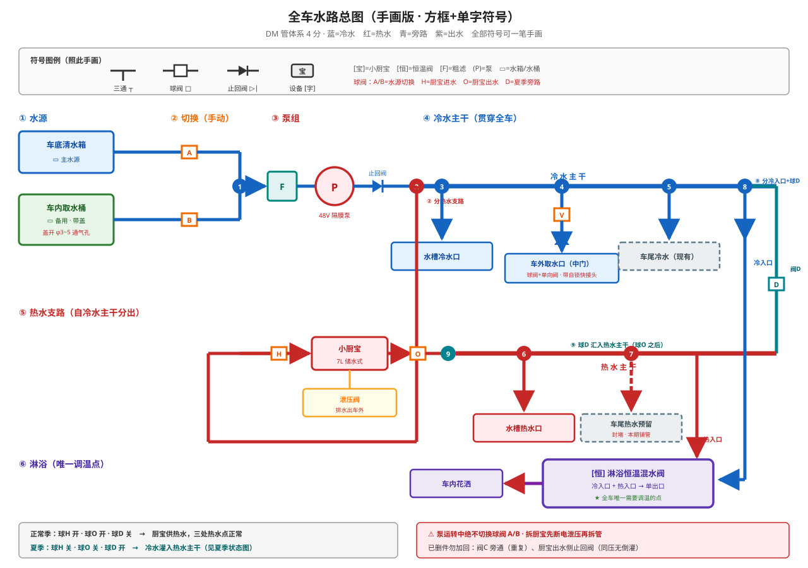
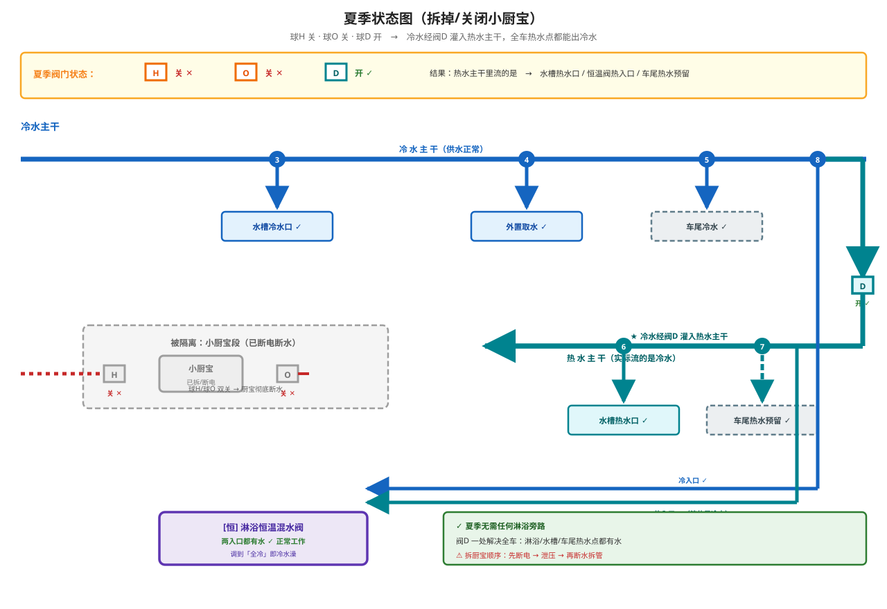

# 设计决策：用水系统

## 方案概述

全车单一 4 分净水器快接体系，**双水源可切换**：车底固定清水箱为主水源，车内便携水桶为备用水源。两者经手动阀门切换后汇入同一路前置过滤器与水泵，下游管路、用水点、传感器完全共用。

选择这套架构的核心原因：**加水不方便时不必动车、不必接管**——拎一个带盖小桶去拉水，回来把桶往车上一放、快接一插即可供水。

> **本文仍是主体设计，泵组 / 冷暖母管 / 热水子系统 / 用水点分配 / 切换 SOP 全部有效。**
>
> **增补方案**：[design-tank-portability.md](design-tank-portability.md) 在**不改动已装内容**的前提下新增——
>
> | 新增项 | 说明 |
> |--------|------|
> | **车尾可移副箱**（车尾右侧柜下，20~25 L） | 第二水源：能拉出去装水，也能被泵抽来供全车 |
> | **中门 + 尾门双加水口** | 两个口都能灌，且可切换灌**车底主箱**还是灌**副箱** |
> | **两把切换** | 加水侧 **W1/W2** 选灌哪个箱；用水侧 **A/B** 选抽哪个箱。**两箱之间不输水** |
>
> **两处状态变化**（不是被替换，是本期不实施）：
>
> | 项 | 状态 |
> |----|------|
> | 车内取水桶（备用水源，下文 §车内取水桶） | **本期不做**；双水源阀组的 **B 路**装封堵头，见增补方案 §6.3 |
> | 车底清水箱 | **已装** ✅，保持为主水源与唯一供水源 |

## 系统架构



> **总图**：从水源到花洒的完整线路，含全部阀门（A/B/H/O/D）与三通（①–⑧）。符号为**手画友好式**（方框+单字），可照图在纸上复现。
>
> 夏季阀门状态另见**夏季状态图**（下方「热水子系统」章节）。
>
> **🆕 全车最新总图见 [diagrams/water-overview-2.svg](diagrams/water-overview-2.svg)**——含双水源（主箱+副箱）、双加水口、冷水主干、热水支路、尾门恒温阀（洗澡）+ 尾门/中门洗车口。本图（water-overview.svg）仍是泵组细节的权威图，但**不含副箱与加水切换**，坐标以新总图为准。

```
  车底清水箱 ──[球阀 A]──┐
                          │
                          ├─ DM三通 ─→ 前置粗滤 ─→ 48V 隔膜泵 ─→ 单向阀 ─→ 冷/热母管
                          │                                              │
  车内取水桶 ──[球阀 B]──┘   ← 本期改接"车尾副箱快拆"，拓扑不变                              ┌───────────────┼───────────────┐
  （带盖 + 软管辫 + DM快接公头）                          ↓               ↓               ↓
                                                    台面水槽(冷+热)  淋浴(恒温阀)   外置取水(冷)
                                                         ↓               ↓
                                            灰水箱 ← 排水（重力自流，DM 快接）
                                    热水支路：阀H → 小厨宝S1 → 阀O → 热水母管（含车尾预留封堵）
```

**关键点**：切换只发生在**泵的吸入侧**，泵之后的管路全部共用，不做任何重复投资。

## 关键决策

| 项目 | 决策 | 理由 |
|------|------|------|
| **管材体系** | **DM 管体系（韩国 DM 快速接头）· 4 分 = 管外径 6.35 mm** | DM 是三通/弯头/直通**全系列齐备**的成熟快接体系，4 分口径与净水器通用件可互插；全车统一一种口径，年审可整段拆断 |
| 水泵 | **48V 隔膜泵**，由中门配电箱 中8.Y4 直切 | 详见 [04-power-system](../04-power-system/design-distribution-box.md#63-48v-水泵控制详图几十瓦--直接-y-切--续流二极管)；几十瓦感性负载，续流二极管 1N5408 必需 |
| 主水源 | 车底固定清水箱 + 外置注水口 | 容量大、重心低（**已装**） |
| 副水箱（增补） | **车尾右侧柜下可移副箱 20~25 L + 快拆** | 第二水源，可拉出去装水、也可被泵抽供全车；与主箱**不互相输水**，见 [design-tank-portability.md](design-tank-portability.md) |
| 备用水源 | **车尾可移副箱**（20~25 L）+ 快拆 K1/K2 接 **B 路** | 拉出去装水，或用它供水；原"车内水桶"本期不做 |
| 切换方式 | **两个 DM 4 分快接手动球阀** | 不依赖电与软件，断电断网可用；符合"关键功能保留物理手动开关"原则 |
| 吸水口 | 不锈钢配重沉头，离桶底 5~10 mm | 颠簸时吸水口不露出水面、不吸桶底沉淀 |
| 排水 | 重力自流至灰水箱，**不设电动排水泵** | 减少故障点；地漏/水槽快接可拆洗 |
| 材质 | 食品级 PE / PP，涉水管路全食品级 | 饮用水安全 |

> **管件齐备性**：DM 体系提供**三通（T 型/快插式）**、**弯头（90°）**、**直通**、**外牙/内牙转换**等完整系列（[DM 食品级附件](https://dailytek.cn/spjfj/20.html)），因此本方案的每个分支、每个转角都能用对应管件实现，**无需自制过渡件**。

## 双水源切换（本方案核心）

### 管路拓扑

```
车底水箱吸水管 ──[球阀 A]──┐
                            ├── DM 4分三通 ──→ 前置粗滤 ──→ 泵吸入口
车内水桶软管辫 ──[球阀 B]──┘
```

- 两个球阀都是 **DM 4 分球阀**，直接插在管上，不用螺纹+生料带。
- 汇流用 **DM 4 分三通**；转角用 **DM 4 分弯头**（转角一律装弯头，不硬弯 PE 管）。
- **禁用电磁阀自动切换**：吸水侧若两路同开，泵两侧同时吸水导致压力紊乱；若两路全关，泵干转几十秒即过热损坏。此路必须手动。

### 切换操作 SOP（打印后贴在水泵旁边）

```
1. 先关泵 —— 按入口键3 或 主控键4（中8.Y4 断电）
2. 确认目标水源水量充足
3. 开目标路球阀 → 再关另一路球阀
4. 开泵，听声音正常（连续、无频繁启停）后再用水
5. 用完关泵
```

> **铁律：泵运转过程中绝不切换阀门。**

### 为什么不做"自动切换 / 三通阀一把切换"

- **L 型三通球阀**：一个阀搞定，少一个件；但 4 分快接体系的 L 口球阀不好买，且切换过程中存在两路同时通/同时断的瞬时窗口。
- **双电磁阀自动切换**：软件复杂度高，且失去物理冗余，一旦 485 掉线或逻辑出错就是干转烧泵。
- 结论：**两个手动球阀，成本最低、可靠性最高。**

## 车内取水桶（备用水源的实现）

### 结构

```
带盖食品级水桶（10~20L，螺旋盖）
   │
   ├─ 桶盖开 φ13 孔 ── 4分穿板直通（bulkhead，内外各一硅胶垫圈 + 锁紧螺母）
   │                        │
   │                        └─ 30~50 cm 食品级硅胶软管（柔性过渡段）
   │                                  │
   │                                  └─ 4分快接公头 ──→ 插上球阀 B
   │
   └─ 桶内：硅胶软管 + 304 不锈钢配重沉头，沉底但不贴底（留 5~10 mm）
```

### 三个设计要点

**① 硬管不插桶，软管只做"桶内过渡"**

这是本方案成立的关键。4 分净水器 PE 管硬，弯折半径大，直接往桶里插既插不到位、又会在桶口折弯憋死水流。正确做法是：

- **桶内那一段用食品级硅胶软管**（内径 6~8 mm），随便弯，怎么放都能沉到底；
- **桶外那一段仍是 4 分硬管**，通过**快接公头/母头**插拔；
- 所以每次取水时你插拔的是"一个快接头"，而不是"一根管子往桶里捅"。

> 注意：软管会被泵负压吸扁，所以**只做短辫（≤50 cm）**，且选壁厚 ≥2 mm 的食品级硅胶管；不要试图用整根软管代替硬管。

**② 桶盖必须通气，否则桶会被吸扁**

带盖密封桶在泵抽水时内部形成负压，轻则变形、重则吸裂，且泵会因背压异常而空转。

- 桶盖上另开 **φ3~5 mm 通气孔**，装一个小防尘滤芯（避免行车时进灰）；
- 或者拧盖时**不拧死**，留一道缝——但这在行车时会晃出水，只作临时办法。

**③ 桶内吸水口形态**

- 用 **304 不锈钢配重沉头** 套在硅胶管末端，保证沉底；
- 吸水口**离桶底 5~10 mm**，避免把桶底沉淀物全部吸入；
- 若自制约：一段 304 不锈钢管，下端口磨斜口或开 2~3 个侧孔，兼作粗滤与防贴底。

### 桶盖开孔方案对比

| 方案 | 做法 | 评价 |
|------|------|------|
| **A. 穿板接头**（推荐） | 桶盖钻 φ13，装 DM 4 分穿板直通 + 内外硅胶垫圈 + 锁母 | 密封好、可反复拆洗桶盖、不渗漏 |
| B. 成品快接桶盖 | 直接买"纯净水桶 4 分快接桶盖" | 最省事，但需匹配桶口螺纹规格 |
| C. 软管穿孔 + 橡胶塞 | 钻孔穿软管，孔口压硅胶塞 | 便宜但长期渗水、桶盖难清洗，不建议 |

## 吸水侧保护（两路共用）

### 前置粗滤

**泵吸入口之前必须装不锈钢网粗滤**，且**两条水源支路各装一个**（车底水箱的水、外面拉来的水，杂质情况完全不同）。

不装粗滤的后果：隔膜泵的阀片是橡胶件，一颗砂粒就能卡住导致不出水或压力骤降，且拆泵清理非常麻烦。

### 干转保护（软件层，硬件已具备条件）

吸水侧一旦忘开阀，48V 泵干转几十秒即过热。本项目已具备实现条件：水表脉冲已直接进 485 模块（见 [04-power-system/design-distribution-box.md](../04-power-system/design-distribution-box.md)）。

**建议在 ESPhome 中加入保护逻辑：**

```
泵（中8.Y4）通电 → 15 秒内水表无脉冲 → 自动断 Y4 + 上报告警
```

> 当前为待实现项，见文末「待确定」。

## 泵下游（共用段）

| 部件 | 说明 |
|------|------|
| 单向阀（止回阀） | 装在泵出口，防止停泵后水倒流回水箱/水桶（尤其拔掉取水桶时） |
| 压力开关 / 蓄能罐 | 48V 隔膜泵自带压力开关，配小蓄能罐可减少频繁启停、稳定出水 |
| 主管路 | DM 4 分管，沿途固定卡扣，转角装 DM 弯头，禁止悬空晃动 |

## 热水子系统（米家小厨宝 S1）

### 核心决策：小厨宝**不接混水阀**，采用分层调温

**决策**：小厨宝 S1 出水侧**直连混水阀热水口是错误接法**，本方案明确排除。

**原因**：米家智能小厨宝 S1 是**储水式**（7L / 2000W）。储水式热水器靠**自身温控**决定出水温度，而非现场混水调温。在它出水口加混水阀会引发两个在房车上必然发生的问题：

1. **出水口被节流** —— 混水阀关小热水流量时，罐内出水变慢，加热管附近局部过热致温控提前跳；再开大又猛升温，来回震荡。
2. **进口冷水压力波动** —— 房车常态：泵在启停、双水源切换、其他用水点开关，冷水压力一直在变。固定开度的混水阀上冷水压力一变，混合比立刻跑偏，出水忽冷忽热。

> **原则：混水阀适合"一路持续供热水"的热水器（即热式、锅炉、发动机余热换热），不适合"存一罐热水"的小厨宝。**

### 分层调温方案

不同用水点的用水节奏完全不同：洗菜要快速开关，淋浴要长时间稳定流量。**共用一个混水阀必然互相干扰**，故分层：

| 用水点 | 调温方式 | 理由 |
|--------|----------|------|
| **台面水槽** | **水槽自带冷热龙头**（其内部即混水阀），**冷、热两路分别接入** | 直接利用已有龙头，不额外引入不稳定因素 |
| **车内淋浴** | **独立恒温混水阀**（带蜡感温包） | 唯一需要精确调温的点；蜡感温包**自带流量补偿**，能吸收泵启停造成的压力波动 |
| **外置取水点** | **只给冷水**（纯冷水直出） | 洗车、冲脚、涮锅不需要调温 |
| **尾门洗澡**（车内浴盆 + 车外帐篷共用） | **一个恒温混水阀**，冷/热母管各取一路 → 花洒；两处共用这一个口 | **已预留快接口**，见下文「未来增项预留」 |

> **不设"全车统一混水阀"**：房车小体量 + 压力本就不稳，统一混水阀的收益小于引入的麻烦。
>
> **原则：需要调温的只有淋浴，其余点位各取所需——要热水直接给小厨宝热水，要冷水直接给泵冷水。**

### 主干水路路线（精简后：只有两个阀）



**核心思路：一根主干（冷水母管）贯穿全车，热水是挂在主干上的一条支路。**

```
① 源头              ② 泵组                      ③ 冷水母管（主干）
────────────────────────────────────────────────────────────────────────────
车底清水箱 ─[球阀A]─┐                                              ┌→ 水槽冷水口
                    ├─[粗滤]─[48V泵]─[止回阀]━━━━━━━━━━━━━━━━━━━┼→ 外置取水（仅冷水）
车内取水桶 ─[球阀B]─┘         ↑                                    │
                              止回阀必需                            └→ 淋浴恒温阀「冷入口」
                          （防压力开关反复启停）                              ↑
                                                                            │
④ 热水支路（挂在主干上，仅此一条，串两个阀）                                  │
────────────────────────────────────────────────────────────────────────────
        [阀H] → 小厨宝 → [阀O] ─┬→ 水槽热水口 ──────────────────────────────┘
              ↑                 │                              （两入口汇于恒温阀）
          泄压阀                ├→ 淋浴恒温阀「热入口」
        （排水出车外）           │
                                └→ 车尾预留（封堵，本期铺管）
```

**路线要点**：

| 段 | 内容 | 阀门 |
|----|------|------|
| **① 源头** | 车底主箱 / 车尾副箱，**双水源手动切换**（B 路改接副箱，见增补方案 §5） | 球阀 A / B |
| **② 泵组** | 两条水源**各一个粗滤** → 汇流 → 48V 泵 → **止回阀** | 止回阀（必需） |
| **③ 冷水母管** | **全车主干**，发散供 4 处 | 无阀 |
| **④ 热水支路** | 从主干分一支 → 阀 H → 小厨宝 → 阀 O → 供热水点 | **仅阀 H / 阀 O** |

**为什么热水侧只需要两个阀**：

- **阀 H（进水）**：拆小厨宝时断供水，防止拆管喷水
- **阀 O（出水）**：拆小厨宝时断出水；并同时隔离车尾热水预留路
- **不需要旁通阀**：淋浴恒温阀的**冷入口本来就直连冷水母管**——夏季要洗冷水，直接走冷入口即可。**绕经热水母管的"旁通"是重复路径**

### 曾经设计过、现已删除的件（留档，避免重复入坑）

| 已删除 | 原设想作用 | 删除理由 |
|--------|-----------|----------|
| **阀 C 旁通球阀** | 夏季拆厨宝后给混水阀供冷水 | **重复**——恒温阀冷入口已直连冷水母管 |
| **阀 C 配套 DM 三通 ×2** | 构成旁通路 | 随阀 C 一并删除 |
| **小厨宝出水侧止回阀** | 防混水阀侧冷水倒灌回热水罐 | **理由不成立**——冷/热两侧压力源同为该泵、压力基本相等，无压差驱动倒灌；且储水式厨宝**进水口已内置防倒流结构**（国标要求） |

> **全车只保留一个止回阀**：**泵出口**那个。它防的是"泵停 → 管路水倒流 → 压力掉 → 压力开关又启泵"的**反复启停**，属必需件。
>
> **例外（不计入本条）**：增补方案新增的 **两个加水口回吸切断阀**，属于**重力/加水路**——那里没有泵提供压力，只有水位差，倒灌驱动真实存在，必须装。见 [design-tank-portability.md §7](design-tank-portability.md#7-加水口：为什么必须装「自动回吸切断阀」)。
>
> **不需要新增吸水侧单向阀**：A/B 两路都在泵的**负压侧**，不存在被压倒灌的问题。
>
> **删掉这三个件后，柜内只剩阀 H、阀 O、泄压阀** —— 空间问题随之解决。

**各用水点取路规则**：

- **每个用水点从母管独立取一路**（各装 DM 三通），任意一点开关不影响他点压力分配
- **严禁**把某个用水点串接在另一个用水点的下游
- **例外**：车尾为单一用途出水口，冷水复用现有车尾管，不另拉母管

### 未来增项预留：尾门洗澡 + 尾门洗车

**现状（过渡态）**：车尾洗澡帐篷尚未接。但**洗澡盆就在过道靠尾门**，因此尾门恒温阀**同时服务"车内浴盆"与"车外帐篷"两处**——这是一个恒温阀、一个花洒口，车内车外共用。

> **⚠️ 车尾新增的部件落位**：**尾门加水口**、**尾门洗车口（冷水直出）**、**副箱柜下格位** 三件事都在车尾。装恒温阀、布置车尾柜时互留位，见 [design-tank-portability.md §6.1](design-tank-portability.md#61-车尾右侧柜下的格位改造（不切钣金）)。

> **与帐篷设计的接口**：车尾淋浴帐见 [02-external/design-shower-tent.md](../02-external/design-shower-tent.md)。该方案要求**尾门关闭时也能从车外操作出水口**（花洒软管经 40 mm 过管口进帐），因此装恒温阀时，阀/快接放**车尾柜或后门外侧检修口**内，车内车外都够得着，并留外侧开口。

**最终规划**：车外淋浴为主力场景（天不太冷在车外洗），车内浴盆为备选，**同一根花洒软管切换位置**即可。

**决策：尾门分成两个口——洗澡（恒温阀）+ 洗车（冷水），不再"共用一个口"。**

```
尾门：冷水主干 ─┬──→ [恒温阀 冷水口] ─┐
                 ├──→ 洗车口（冷水直出）  │
热水主干 ────────┴──→ [恒温阀 热水口] ─┴──→ 花洒（洗澡，车内+车外共用）
```

> 洗车/冲脚是**纯冷水**，不需要恒温阀，直接一字冷水管即可；洗澡才走恒温阀。两路独立取路，互不串接。

#### 预留清单（现在做）

| 预留项 | 做法 | 成本 |
|--------|------|------|
| **热水管到车尾** | 热水母管（**阀 O 之后**）加 **DM 三通** → 铺 DM 管至车尾柜 → **DM 封堵头封死** | 一根管 + 1 三通 + 1 封堵头 |
| **管内不进水** | 预留端封堵，**管内为空气**——避免长期存水变质发臭 | — |
| **车尾柜阀位** | 预留约 **150×150 mm** 空位，供装恒温阀 + 花洒口 | 0（别做满即可） |
| **冷水侧** | 从冷水主干**取两路**：恒温阀冷入口 + 洗车口（各自独立） | 0（复用现有车尾冷水管分叉） |

> **为什么热水预留要做在阀 O 之后**：这样阀 O 能同时隔离车尾这一路。夏季拆小厨宝时，车尾热水一并断开，逻辑统一。

#### 何时装恒温阀：取决于验证

**恒温阀已采购，先装来验证。** 这个阀要**同时服务车内浴盆 + 车外帐篷**，验证结果决定它是否真能胜任（而不是决定"买不买第二个"）：

| 验证项 | 观察什么 | 通过标准 |
|--------|----------|----------|
| **水量衰减** | 连续淋浴 3~5 分钟，出水温度是否由烫转凉（7L 见底） | 全程可维持目标温度，无骤降 |
| **压力扰动** | 开/关另一个冷水点（水槽），淋浴温度漂不漂 | 恒温阀自动补偿，基本不漂 |
| **小厨宝跟得上吗** | 连续用水后，小厨宝反复启停能否维持出水温度 | 无长时间"出冷水"段 |
| **关水再开** | 关龙头再开，是否先烫后凉 | 温差可接受 |

**验证通过** → 这个恒温阀**同时服务车内浴盆 + 车外帐篷**（共用一个，不买第二个），按上述预留把阀装到车尾柜。
**验证不通过** → 车尾洗澡改用手动混水阀（成本 40~90 元），或加大热水容量（见文末待确定）。

> **这一步的意义**：7L 小厨宝配恒温阀的实际表现，**没有人能预先判断**——它可能温度很稳，也可能因容量太小而剧烈震荡。**先花一个阀的钱验证**——因为现在是"一个阀两处用"，买错一个的代价更低。

**"两阀隔离"实现"夏天不用时断电断水、甚至整机拆除"：

| 阀门 | 作用 | 夏季拆除小厨宝时 |
|------|------|------------------|
| **阀 H 热水进水** | 关掉 = 小厨宝彻底断水，可安全拆管 | **关闭** |
| **阀 O 热水出水** | 关掉 = 断出水；并隔离车尾热水预留路 | **关闭** |

> **夏季怎么洗冷水**：阀 H/O 关闭后，热水侧无水没关系——**淋浴恒温阀的「冷入口①」本来就直连冷水母管（主干）**，直接往冷入口供水即可。**不需要任何旁通阀。**

#### ✅ 单边进水已实测：**该阀不支持** → 必须装旁通阀 D

**实测方法**：恒温阀冷入口接自来水、热入口空着，开冷水观察流量。

**实测结果：出水明显偏小／不出水 —— 该恒温阀不支持单边进水。**

这意味着：**夏季拆掉小厨宝后，不能只靠恒温阀冷入口供水**（否则淋浴水量不足甚至不出水）。

**解决方案：加一个夏季旁路球阀 D，把冷水引到热水主干**

```
冷水主干 ─┬─→ [H阀] → 小厨宝 → [O阀] → 热水主干
          │                              ↑
          └──────[三通]──→ 球D ──────────┘
```

> ★★ **接法铁律：阀D 就在「进小厨宝的冷水管」上开三通取水，就近接回阀O 之后。**
>
> 不要从冷水主干末端另拉一根、也不要让冷水管绕到下方再爬回来——那样既费管、又是在**末端最低水压处取水**，还会让夏季旁路的水绕一大圈才到用水点。
>
> **冷水管本来就直通 H 阀，在它上面开个三通引一路给阀D，管线最短、水压最好。**

| 季节 | 球 H / 球 O | 球 D | 结果 |
|------|------------|------|------|
| **正常（用小厨宝）** | 开 / 开 | **关** | 厨宝供热水，三处热水点正常 |
| **夏季（拆厨宝）** | **关 / 关** | **开** | 冷水灌入热水主干 → **全车热水点都有冷水** |

> ★ **为什么接热水主干、而不是接花洒（重要）**：
>
> - **接热水主干** → 夏季热水主干里流的是冷水 → **恒温阀两个入口都有水**（冷入口来自冷水主干、热入口来自热水主干）→ 恒温阀正常工作 → 淋浴可调冷热 ✅
> - **同时受益**：水槽热水口、**车尾热水预留**（将来装恒温阀）也都有水 → **一处解决全车**
> - **若只接花洒** → 只能救淋浴，**水槽热水口照样没水**；车尾将来装恒温阀时**还得再做一次旁路**
>
> **球 D 是必装件**（不是可选项），**且必须在做热水支路这一期就装上**。

> ★★ **不装阀 D 的直接后果（决定它不能延后）**：夏季关掉球 H / 球 O 后，热水主干整段断水 →
>
> - **水槽热水口没水** → 水槽只剩一个冷水口，**半个水槽报废**；
> - 恒温阀热入口没水 → 实测已知**不支持单边进水**，淋浴水量骤减甚至不出水；
> - 车尾热水预留没水（将来装尾门恒温阀同样废掉）。
>
> 这三条都不是"以后再说"的小问题，而是**夏季水槽、洗澡两个主力功能直接失效**——所以阀 D 与热水支路同期施工，不留尾巴。

> **与已删除的阀 C 的关系**：阀 C 原本就是"冷水主干 → 热水主干"这条路径，当时因"恒温阀冷入口已直连主干、旁路重复"而删除；**现在实测证明该恒温阀不支持单边进水，这条路径是必需的**——所以球 D 回来了，位置就在阀 C 原本的位置。
>
> **教训记录**：删阀 C 时未先做单边进水实测就下了结论。**以后凡涉及"某条路径是否重复"的判断，应先验证流量可行性再决定删除。**

### 小厨宝必配的两个安全件

**① 泄压阀（安全阀）—— 必须装，排水引至车外**

储水式热水器加热时罐内水体膨胀，**必须泄压**。泄压阀排水口**必须接软管引到车外或灰水箱**，绝不可堵死——堵死会导致内胆超压。

**② 拆除/断电前必须泄压**

带压拆管会喷一身热水。**拆除顺序铁律：先断电 → 开泄压/排水阀泄压 → 再断水拆管。**

> **关于止回阀**：小厨宝**出水侧不装止回阀**（理由见上文「已删除的件」）。储水式厨宝**进水口已内置防倒流结构**（国标要求），本方案不再另加。
>
> **全车唯一的止回阀在泵出口**，作用见上表。

### 冬夏两季 SOP

**夏季（长期不用热水）**
```
1. 关小厨宝电源（断电）
2. 先泄压（开泄压阀）→ 再关阀 H（热水进水）
3. 关阀 O（热水出水）
4. **开阀 D（淋浴旁通）** ★ 冷水绕过恒温阀直达花洒
5. 若要整机拆除：断电 + 泄压 + 排空罐内 7L 水 → 断阀 H/O → 拆管拆机
```

**冬季（防冻）**
```
1. 断电
2. 泄压 → 排空罐内 7L 水（7L 水结冰必然冻裂内胆）
3. 关阀 H / 阀 O
4. **开阀 D（淋浴旁通）** → 冷水直达花洒
```

> 小厨宝罐内 7L 水不排空会冻裂内胆——"夏季拆除"的思路在冬季同样适用，**入冬前必做断电排空**。

### 容量现实提醒

小厨宝 S1 为 7L，在淋浴流量下**约几十秒见底**。因此：
- 淋浴热水**不适合长时间连续冲洗**，需穿插使用（打湿→关水→搓洗→冲净）；
- 期望"洗 15 分钟热水澡"是不现实的，这是本方案选择"淋浴独立恒温阀"而非共用的另一原因；
- 若后续需要长时淋浴，应另行评估发动机余热换热或即热式方案（见文末待确定）。

## 用水点

**每个点位从冷/热母管独立取一路，互不串接**（车尾例外，见下）。

| 点位 | 冷/热 | 取用方式 | 模块 |
|------|-------|----------|------|
| 台面段水槽 | **冷 + 热** | 从**冷水母管**取一路 → 水槽冷水口；从**热水母管**取一路 → 水槽热水口。由水槽自带龙头调温 | [07-cabinetry](../07-cabinetry/design-countertop.md) |
| 车内淋浴 | **冷 + 热** | 冷/热母管各取一路 → **恒温混水阀** → 花洒（**与车外帐篷共用一个恒温阀**，洗澡盆在过道靠尾门，距离够） | [09-shower-module](../09-shower-module/) |
| 中门洗车口 | **仅冷水** | 从**冷水母管**取一路 → 球阀 → 单向阀 → 车外自锁快接 | [02-external](../02-external/) |
| 尾门洗车/冲脚口 | **仅冷水** | 从**冷水母管**取一路 → 快拆头 | [02-external](../02-external/) |
| **尾门洗澡** | 冷 + 热 | **恒温混水阀**（冷/热母管各取一路）→ 花洒，**车内浴盆 + 车外帐篷共用一个口**。**详见「尾门洗澡」** | [02-external](../02-external/design-shower-tent.md) |
| 外置注水口 | 加水 | 独立，不参与母管 | 车身左侧（**已装**） |
| **中门 + 尾门双加水口**（增补） | 加水 | **独立支路，不进泵**，各带自动回吸切断阀，可切换灌主箱/副箱 | 见 [design-tank-portability.md](design-tank-portability.md) |

> **热水来源**：米家智能小厨宝 S1（7L 储水式），安装位待定（建议近水槽柜内，缩短热水管路，减少管路存水浪费）。
>
> **为什么外置取水点不接混水**：洗车、冲脚、涮锅这类用途不需要精确水温，接一路纯冷水即可，少一个阀、少两个接头、少一处漏点。

## 车外取水口（中门 + 尾门 · 洗车/冲脚用）

**现状**：中门已装**带自锁的房车快接头**（防行车时软管甩脱），内部尚未接管——接法本次定稿。**尾门新增一个快拆冷水口**，两处都走同一条冷水母管。

### 决策：走泵单模式 + 单向阀（两个口同一套路）

```
中门：冷水主干 ━┳━[三通]━[球阀]━[单向阀]━→ 车外自锁快接头（已装）
尾门：冷水主干 ━┳━[三通]━→ 快拆头（尾门洗车/冲脚口）
```

| 件 | 作用 |
|---|---|
| **DM 4 分三通 ×2** | 中门、尾门各自从冷水主干独立取一路（不与水槽串接） |
| **球阀**（中门） | 平时关闭；冲脚/洗车时打开 |
| **单向阀**（中门） | ★ 允许车上水往外流，**阻止外部水倒灌回车** |
| **车外快接头**（中门，已装） | 带自锁 |
| **快拆头**（尾门） | 尾门洗车/冲脚，纯冷水直出 |

> **为什么尾门不设单向阀**：尾门口只做纯冷水直出、不接洗车机自吸（洗车机自吸直接插桶即可），不存在"外部水倒灌"路径；中门口因要接洗车机自吸软管，保留单向阀防倒抽。

**两个口都保留**：中门口供接洗车机软管，尾门口供尾门附近冲脚/冲车，不必拉长软管。

### 为什么不做"双模式"（重要，避免以后重复设计）

曾考虑给此口做**两条内部通路**（走泵 / 外接外部水源，两个球阀切换）。**经推演后否决**，理由：

> **洗车机吸水根本不需要经过车上这个口。** 自吸式洗车机自带吸水管，直接插桶/河/营地龙头即可。
>
> 若把"外部水源"接进车上管路，那实际变成**往车上水箱灌水**（属注水口功能，与此口无关）；若不进车上管路，则**与车上这个口毫无关系**。
>
> 因此"双模式"是**把「接口物理方向」与「水来源」混淆**的产物。**单模式即够。**

### 洗车机怎么用（三种情况）

| 情况 | 做法 | 走车上口吗 |
|------|------|-----------|
| **外部水源洗车**（桶/河/营地） | 洗车机吸水管**直接插桶** | ❌ 不经过 |
| **用车上水洗车** | 开泵 → 车外口出水 → 洗车机吸水管**接在车外口上** | ✅ 走泵 |
| **冲脚 / 涮锅 / 少量冲洗** | 开泵 → 车外口直接出水 | ✅ 走泵 |

### 必须注意的六点

| # | 注意 | 原因 |
|---|------|------|
| 1 | **单向阀必装** | 洗车机自吸会从车外口倒抽，脏水/泥沙可能倒灌回车 |
| 2 | **用车上口供水时必须同时开泵** | 否则洗车机自吸把管路抽成负压，可能吸开泵的止回阀、吸扁取水桶 |
| 3 | **绝不在车上管路里抽浑水** | 泥沙卡死隔膜泵阀片——这是泵最容易坏的方式 |
| 4 | **DM 4 分管径是流量瓶颈** | 内径约 4mm。洗车机若需 5 L/min 以上可能供不上；**先用现有口径实测**，不够则改用桶接 |
| 5 | **车外那段用粗软管** | 车上 DM 管只到车外；车外接内径 8~10mm 软管（洗车机通常自带） |
| 6 | **冬季必须能排空** | 车外口暴露在低温，有冻裂风险 |

> **退路**：即使车外口流量不足，洗车机仍可**吸水管插桶**独立工作——**桶接是永远可靠的方案**，不依赖车上管路。

## 排水

- 水槽排水 → 台面下方 → 灰水箱（快接）
- 淋浴地漏 → 快接软管 → 灰水箱（重力自流，见 [09-shower-module](../09-shower-module/)）
- 灰水箱可拆卸清倒
- 所有下水段设可拆快接，便于夏季清洗管路异味

## 传感器

- 清水箱水位传感器（车底箱）：超声波 / 压力式，接 485 总线，见 [10-smart-control](../10-smart-control/sensors/)
- 灰水箱水位传感器
- 水表脉冲（流量）：直接进 485 模块，兼作干转保护输入

## 冬季防冻

车底水箱位于底盘下方，是**全车最先结冰的部位**，必须：

- 车底水箱及外露管段做保温包裹；
- 冬季长期停放前，**排水阀打开彻底排空**管路与泵腔；
- 泵体安装在车内（中门柜），避免直接暴露在底盘；
- **小厨宝罐内 7L 水必须排空**（详见上文「热水子系统 · 冬季 SOP」）。

## 待确定

- [x] ~~车底清水箱容量（预估 60~100L）~~ —— **已装**
- [ ] 灰水箱容量
- [ ] **车尾副箱柜下格位**尺寸与安装方式，待实车量（见增补方案 §6.1）
- [ ] **中门 + 尾门注水口开孔位置**（须高于所服务箱体水面），待实车
- [ ] 48V 隔膜泵具体型号与流量/扬程参数（当前仅确定电压为 48V）
- [ ] 取水桶容量（10L / 15L / 20L 待实测柜内收纳空间后定）
- [ ] **小厨宝 S1 安装位**（建议近水槽柜内，缩短热水管路）与腔体散热空间
- [x] ~~淋浴恒温混水阀选型~~ —— **已采购，先装验证**
- [ ] **恒温阀验证结果**（4 项观察点见「未来增项预留」）→ 决定尾门洗澡用恒温阀还是手动混水阀（**一个阀车内浴盆+车外帐篷共用**）
- [ ] 小厨宝供电回路（2000W，需确认由 220V 逆变器供电并核算逆变器余量）
- [ ] **尾门花洒口固定位置、软管长度**（车内浴盆 + 车外帐篷两处怎么切换）——待真装时定
- [ ] **尾门洗车口位置**（纯冷水直出，与注水口、恒温阀留位协调）——待实车
- [ ] 是否需要长时淋浴方案（发动机余热换热 / 即热式）——**若恒温阀验证不通过，此项优先级上升**
- [ ] ESPhome 干转保护逻辑实现

> **关于尾门洗澡 + 洗车**：
> - **洗澡**：一个恒温阀，**车内浴盆 + 车外帐篷共用一个花洒口**（洗澡盆在过道靠尾门，距离够）
> - **洗车/冲脚**：尾门另设**冷水直出口**，纯冷水、不经过恒温阀；中门口接洗车机自吸软管
> - **本期做**：铺热水预留管到车尾（阀 O 后取，封堵不进水）+ 车尾柜留 150×150 mm 阀位 + 尾门洗车冷水口
> - **本期不做**：恒温阀、花洒、帐篷（等验证结果）
> - **决策依据**：恒温阀先验证。通过 → 装一个阀两处用；不通过 → 洗澡改手动混水阀或加大热水容量
