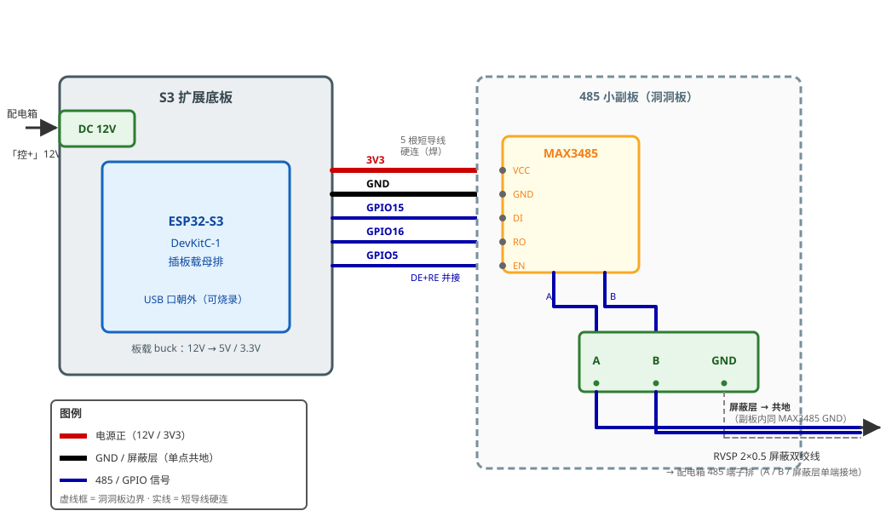

# 施工指导：ESP32-S3 485 网关（面包板 → 上车）

> **安全提醒**：12V 模块接线前先断电再动手；485 模块 12V 供电正负极严禁接反；上车阶段插保险前先用万用表确认电压。

MAX3485 是 3.3V 收发器，与 ESP32-S3 电平完全匹配——RO/DI 全部直连，不需要任何分压电阻（这是选它而不是 MAX485 的原因）。

## 阶段 0：准备

### 工具

| 工具 | 用途 |
|------|------|
| 万用表 | 电压/通断/电阻（量 A-B 间 120Ω） |
| 面包板 + 杜邦线 | 原型验证 |
| USB 数据线 | S3 烧录/日志（要数据线，不能是纯充电线） |
| 电脑（已装 esphome CLI） | 烧录 + 看日志 |
| 手机 | 连 my-van 热点按 web 按钮 |
| 12V 电源（适配器或可调电源，≥2A） | 给 485 继电器模块供电（桌面联调） |
| USB-485 转换器（CH340/FT232） | 外部对端联调（推荐） |
| 电烙铁 + 焊锡 + 热缩管 + 热风枪/打火机 | 组装焊接 |
| 压线钳 + 螺丝端子 | 组装上车 |

### 物料

| 名称 | 规格 | 数量 | 用途 | 状态 |
|------|------|------|------|------|
| ESP32-S3 开发板 | DevKitC-1 | 1 | 485 网关，运行 ESPHome | 已有 |
| MAX3485 TTL→485 模块 | 3.3V，带 DE/RE 引脚 | 1 | 信号转换 | 已有 |
| 485 继电器模块 | 通道分配见 04-power-system/switch-assignment.md | 1 台桌面联调 | 联调对象 | 已有 |
| S3 扩展底板 | 6~24V→5V/3.3V buck + 板载母排 | 1 | 车载供电 + S3 插装 | 待购 |
| 小洞洞板 + 3P 螺丝端子 | 剪约 8×6 孔；5.08mm | 各 1 | 485 小副板（MAX3485 + A/B/GND） | 待购 |
| 短导线 / 漆包线 | 5 根，约 8cm | | 副板 ↔ 扩展板母排 | 待购 |
| 电解电容 1000μF 25V | 1 | 12V 进线侧滤波（可选） | 待购 |
| 终端电阻 120Ω 0.5W | 2 | 总线首尾匹配 | 待购 |
| RVSP 2×0.5mm² 屏蔽双绞线 | 按走线长度 | 485 总线 | 待购 |
| ABS 防水盒 | 1 | 封装 | 待购 |

## 阶段 1：面包板接线

### 1.1 引脚对应（按 test-485-connect.yaml 定义）

| ESP32-S3 DevKitC-1 | MAX3485 模块 | 说明 |
|--------------------|--------------|------|
| GPIO15 (TX) | DI | 发送 |
| GPIO16 (RX) | RO | 接收（3.3V 直连） |
| GPIO17 | DE + RE（两根并接） | 高=发送、低=接收 |
| 3V3 | VCC | **接 3V3，严禁接 5V** |
| GND | GND | 共地 |

DE 和 RE 用杜邦线短接后一起到 GPIO17（有的模块板上已并好）。逻辑：GPIO17 高电平 = 发送，低电平 = 接收，由固件自动切换。

> **引脚变更（2026-09 实装）**：DE 使能脚由 **GPIO5 改为 GPIO17**（位于 RX 16 旁边）。
> 固件里引脚号集中在 substitutions 的 `de_pin`（base.yaml / test-channel-mapping / test-mid8-logic），
> `rs485.yaml` 用 `${de_pin}` 引用，**再换引脚只改一处**。
> ⚠ 切勿把 DE 接到 GPIO16——那是 RX，会被 UART 配成输入，与 DE 输出冲突导致收不到回包。
> ⚠ **切勿把 DE 与 TX(GPIO15) 接反** —— 数据流会去翻方向，MAX3485 长期停在发送态
> 霸占总线，表现为「S3 不响应 + **连 PC 也控制不了模块**」。判据与排查见 [6.4 §2](#2-tx-与-de-接反--表现为接入-s3-后连-pc-也控制不了)。
> ⚠ **改 `de_pin` 必须同步挪实体线**，否则 DE 全程不驱动（见 [6.4 §3](#3-万用表抓不到-1ms-窄脉冲曾导致误判-gpio17-损坏)）。

> **模块丝印对照**（芯片引脚名 vs 成品板常见丝印）：RO = **RXD**、DI = **TXD**、DE/RE 合并脚 = **EN**（高=发送、低=接收）。板子只有 VCC/GND/RXD/TXD/EN/A/B 六个功能脚时，按此对照接线。

### 1.2 接线图

```
ESP32-S3 DevKitC-1                  MAX3485 模块 #1
┌────────────────┐                 ┌──────────────┐
│ 3V3            │─────────────────│ VCC          │
│ GND            │─────────────────│ GND          │
│ GPIO15 (TX)    │─────────────────│ DI           │
│ GPIO16 (RX)    │─────────────────│ RO           │
│ GPIO17          │──────────┬──────│ DE           │
│                │          └──────│ RE           │
│                │                 │ A ──→ 总线 A │
│                │                 │ B ──→ 总线 B │
└────────────────┘                 └──────────────┘
```

S3 由 USB 供电即可，MAX3485 从 S3 的 3V3 引脚取电（模块耗电 <1mA，无压力）。

### 1.3 通电前检查（万用表）

- 3V3 ↔ GND 之间电阻 >10kΩ（无短路）
- DE 与 RE 之间导通
- 插 USB 后测 3V3 引脚 = 3.2~3.4V

## 阶段 2：首次烧录

```bash
cd modules/10-smart-control/gateway/esphome
esphome run test-485-connect.yaml
```

- **第一次烧录**：按住 S3 板上 BOOT 键不放 → 插 USB → 松开 → 执行 run。之后重烧一般自动处理，无需再按
- 烧完看日志：`esphome logs test-485-connect.yaml`（S3 原生 USB 口就是日志口）
- 注意：S3 的 USB 是 GPIO19/20 原生口，板上丝印 UART0（GPIO43/44）与它无关，别接

**验证烧录成功**：日志出现启动信息 + web_server 就绪。wifi 占位符（ooxx）连不上会自动开热点：

- 手机连 WiFi **my-van**（密码 12345678）
- 浏览器打开 **http://192.168.4.1**
- 应看到页面和「485测试发送」按钮

> test-485-connect.yaml 已带 web_server 组件，自带 OTA 功能——装车后不用再插 USB，手机连热点即可无线刷固件。

## 阶段 3：面包板自测（三步走）

### 3.1 TTL 回环——验证 S3 的 UART 本身

- 拔掉 MAX3485 的 DI/RO 两根杜邦线（模块先不参与）
- 用一根杜邦线把 GPIO15 ↔ GPIO16 直接短接
- 手机 web 页按「485测试发送」→ 电脑日志应出现：

```
✅ 收到 8 个字节：01 03 00 00 00 01 84 0A
```

- 通过 = S3 串口、ESPhome 固件、web 按钮、脚本逻辑全部正常

### 3.2 双 MAX3485 回环——验证 485 收发 + DE/RE 切换

> **需要第二块 MAX3485 当对端**。只有一块模块的话跳过 3.2，直接进 3.3（USB-485 转换器已购）或阶段 4 用真实 485 继电器模块当对端——效果一样且更真实。

第二块 MAX3485 当「对端」：

| #2 引脚 | 接 | 说明 |
|---------|-----|------|
| VCC / GND | 3V3 / GND | 供电 |
| DE、RE | 都接 GND | 恒接收 |
| RO | GPIO16 | #1 的 RO 此时**悬空**，两根 RO 不能同时上 RX |
| A / B | 与 #1 的 A/B 并联 | A-A、B-B |

按按钮 → 日志应收到自己发出的 8 字节（S3 → #1 → 总线 → #2 → S3）。

验证的是：TX、#1 的 DI/DE/RE 切换、总线差分传输、#2 的 RO、RX。若收到 **多于 8 字节** 的乱字节，说明 #2 模块无 A/B 偏置电阻，总线悬空时 RO 在输出噪声——不影响结论（前 8 字节正确即通过），后续接真实设备无此问题。

### 3.3 USB-485 联测——验证与真实设备互通

- #1 恢复最终接法：RO→GPIO16（拆掉 #2 的 RO），#2 移除
- USB-485 转换器插电脑，A/B 并到面包板总线，**两端 GND 共地**
- 电脑串口助手（38400 8N1）：

| 方向 | 操作 | 预期 |
|------|------|------|
| 发送 | S3 按 web 按钮 | 电脑收到 `01 03 00 00 00 01 84 0A` |
| 接收 | 电脑发送 `01 03 00 00 00 01 84 0A` | S3 日志收到 8 字节 |

两步都过，面包板阶段完成，接线定稿。

> 为什么三步：单模块回环只能「自发自收」，分不清 TX 坏还是 RX 坏；USB-485 用真实对端分别验证两个方向。

## 阶段 4：接入真实 485 模块（桌面联调）

### 4.1 模块准备

- 继电器模块 12V 供电（接 12V 电源，正负别反）
- A/B 接面包板总线（A-A、B-B），**模块 GND 与面包板 GND 连一根线共地**
- 模块地址为 **1**（出厂默认就是 1，与 test-485-connect.yaml 测试帧的从站号 01 一致）
- 全车地址规划（用厂家软件设置）：额头=1、中8=2、中4=3、**16DO=5**，禁止重复。能源设备同挂此总线：MPPT=0x10、PZEM-017=0x11（见 [energy/](../energy/)），485 传感器建议 0x20 起。**中8 已实际改好地址 2**（厂家软件改、重启生效，阶段 3 实测确认）——固件/手动帧里它的从站号一律用 02。**16DO 到货后必须先改成地址 5**（固件 relay-mid-16do.yaml 全部帧按 05 写死）。0x04 原为车尾模块预留，**该模块已取消**（倒车灯并进 中8.Y7），如未来加设备可用 0x04
- **手册已确认**：地址=Modbus 站号（1~255）；出厂默认通讯参数为 **地址 1、波特率 38400、8 数据位、1 停止位、无校验**。**本模块无拨码开关，地址/波特率纯软件设置**：厂家上位机软件，或写寄存器 0032H/0033H，掉电保存
- **波特率终局 = 9600**：MPPT 最高只支持 9600，全车统一降速（规划源 [energy/mppt-protocol.md §二](../energy/mppt-protocol.md)）。桌面联调阶段用出厂 38400 即可，**MPPT 上车前必须完成 4.7 总线改造**
- **DI 按键触发方式（手册 + 实测确认）**：输入是**双向光耦**，PNP/NPN 都兼容——只要 **X 与 COM 之间有电压差（任一极性）就触发**（实测：负极接 COM、正极接 X1 可以；反过来也可以）。**COM 必须接电源一极**（12V+ 或 0V 都行），**COM 悬空时怎么短接都不会触发**。桌面模拟按键：COM 接 12V+，杜邦线短接 DI↔GND 即可
- 用万用表量模块 A-B 电阻：>1kΩ 正常（无板载终端）。若模块带 120Ω 跳线帽，桌面单模块测试可短接，**上总线后只留首尾两端**

### 4.2 手动测试帧

改 test-485-connect.yaml 里 `data:` 那一行 → `esphome run test-485-connect.yaml` 重烧 → 按按钮看结果。帧表（CRC 已校验）：

> **data 必须用字节列表格式**：`data: [0x01, 0x03, 0x00, 0x00, 0x00, 0x01, 0x84, 0x0A]`。不要用字符串 `"\x01\x03..."` 写法——`\xNN` 中 NN ≥ 0x80 会被当作 Unicode 码点做 UTF-8 编码，展开成两个字节（`\x84` → `C2 84`），帧就发错了。

| 操作 | 帧（十六进制） | 期待响应 |
|------|----------------|----------|
| 读保持寄存器（当前测试帧） | `01 03 00 00 00 01 84 0A` | 回 7 字节：`01 03 02 00 00 B8 44`（通道1关）或 `01 03 02 00 01 79 84`（开） |
| 读 8 路线圈状态 | `01 01 00 00 00 08 3D CC` | 回 6 字节：`01 01 01 XX crc`（XX 的 bit0 = 第 1 路） |
| 读 8 路输入状态 | `01 04 00 00 00 08 F1 CC` | 回 19 字节：`01 04 10 <16字节> crc`，前 2 字节位图 bit0=X1…bit7=X8，按下=1（地址2：`02 04 00 00 00 08 F1 FF`；地址3：`03 04 00 00 00 08 F0 2E`） |
| 写线圈 1 通 | `01 05 00 00 FF 00 8C 3A` | 原帧返回 + 继电器 1「咔哒」 |
| 写线圈 1 断 | `01 05 00 00 00 00 CD CA` | 原帧返回 + 继电器 1 释放 |
| 写 8 路全通 | `01 0F 00 00 00 08 01 FF BE D5` | 原帧返回 + 全部吸合 |

**手册已确认寄存器表**（汇控数字量输入输出系列，HK-8DO-8DI）：

- 支持功能码：01（读线圈）、02（读离散输入）、03（读保持寄存器）、04（读输入寄存器）、05（写单个线圈）、06（写单个保持寄存器）、0F（写多个线圈）、10（写多个保持寄存器）
- 线圈 0000H~002FH = 通道 1~48 输出控制——**起始地址 0x0000，通道 N = 地址 N-1**
- **输入状态实测在 FC04 输入寄存器**：reg0=X1…reg7=X8（按下 = 0x0001）。手册写的 FC02 离散输入实测读出来**恒 0**，厂家 PC 软件轮询的也是 FC04 0000H 起——诊断按键状态用 FC04，别用 FC02
- 8 路及以下模块只支持普通工作模式（0 关 / 1 开），无联动/点动等模式
- **保持寄存器 0031H（40051）= 输入状态主动上传使能**：写 **1** 开启（掉电保存状态不确定，固件每次上电写一次），输入变化即发上传帧 `<地址> 04 02 <16位位图> <CRC>`，按下/释放各一次；写 0 关闭。开启帧：`01 06 00 31 00 01 19 C5` / `02 06 00 31 00 01 19 F6` / `03 06 00 31 00 01 18 27`；关闭帧：`01 06 00 31 00 00 D8 05` / `02 06 00 31 00 00 D8 36` / `03 06 00 31 00 00 D9 E7`。读取验证：FC03 读 0031H（`01 03 00 31 00 01 D5 C5` / `02 03 00 31 00 01 D5 F6` / `03 03 00 31 00 01 D4 27`），回 `XX 03 02 00 01 crc` = 已开启
- 批量控制：保持寄存器 0034H 写 0 全关 / 1 全开；0035H 按位控制通道 1~16（也可用 FC06 写保持寄存器 0000H 替代线圈写）

### 4.3 实测步骤

1. 按 web 按钮 → 日志出现「✅ 收到 N 个字节」= 通讯建立
2. 换成「读线圈」帧重烧 → 看回包字节（bit0 = 第 1 路）
3. 换成「写线圈 1 通」重烧 → 听继电器「咔哒」、模块 LED 亮
4. DI 测试：确认模块 **COM 已接电源一极**（如 12V+）→ 杜邦线短接模块 DI1 ↔ GND（模拟按键）→ 用「读输入状态」FC04 帧看位图 bit0 变 1（COM 悬空时测不出来，见 4.1）
5. 无响应排查顺序：模块地址（与固件是否一致）→ A/B 对调 → 波特率 → 共地线 → 模块 12V 是否上电

### 4.3.1 三方总线监视测试（S3 收不到回包时）

模块配套 PC 软件 + USB-485 转换器是现成的总线监视器，把 **S3、转换器、模块全部并在同一条总线上**（A-A、B-B、全共地）：

1. **验证模块在线上**：PC 软件正常读/写模块 = 模块在线、地址 1、波特率 38400、A/B 接线全部正确
2. **验证 S3 发送**：按 S3 按钮 → 转换器 RX 灯闪 = S3 帧已上总线（已实测通过）
3. **验证 S3 接收**：PC 软件随便读一次模块 → S3 缓冲区应存下这些字节（PC 的请求帧 + 模块回包），再按一次 S3 按钮就能在日志里看到它们——只要打印出任意字节，S3 接收链路就是通的
4. 判断：第 1 步通过 + 第 3 步打印出字节 = S3 收发全通，问题只剩「模块为何不回 S3 的帧」；第 3 步仍然「缓冲区为空」 = S3 接收链路有问题（查 RO 线、GPIO16、EN 切换时序）；第 1 步就失败 = 模块侧（供电/共地/地址/波特率/A-B）

### 4.4 切换到生产配置（主动上传驱动）

手动 script 只用于测试。**生产固件 = `esphome/prod.yaml`（packages 组装）**，文件按区域拆分：

| 文件 | 内容 |
|------|------|
| `esphome/rs485.yaml` | 485 写帧公共件（DE 时序 + 参数化 `rs485_write` 脚本） |
| `esphome/base.yaml` | 基础：网络/串口/上电策略/场景状态/DI 上传驱动解析/LED 全灭 |
| `esphome/relay.yaml` | **继电器模块汇总入口**：include 下列 4 个子模块 + 「模块×站号×路数」索引表（站号因绑定帧 CRC 仍写在各子文件） |
| `esphome/relay-forehead-8ch.yaml` | 额头 8 路（地址 0x01）：负载 + 按键 |
| `esphome/relay-mid-8ch.yaml` | 中门 8 路（地址 0x02）：纯负载 |
| `esphome/relay-mid-4ch.yaml` | 中门 4 路（地址 0x03）：低功率负载 3 路 + 1 预留 |
| `esphome/relay-mid-16do.yaml` | 中门 16DO（地址 0x05）：全部 LED |
| `esphome/scenes.yaml` | 场景自动化（灯光模式/离车驻车/排气扇/长按全关） |
| `esphome/prod.yaml` | 生产主文件（上面所有 packages 的组装） |

**测试固件 = 完整单文件，每阶段一个**（不拆 packages，烧录哪个就验哪个阶段）：

| 文件 | 阶段 | 验证目标 |
|------|------|---------|
| `esphome/test-485-connect.yaml` | 阶段2 桌面 | 485 连通性（手动帧 + 总线监听） |
| `esphome/test-channel-mapping.yaml` | 上车第一步（4.6） | 4 模块全部继电器 + 按键映射（按键只读） |
| `esphome/test-mid8-logic.yaml` | 桌面（4.5） | 中8 全逻辑（场景循环/双控/长按/断电恢复） |

烧录：`esphome run prod.yaml`（wifi 连不上自动开 AP，手机连 my-van → 192.168.4.1）。

**写帧方式（2026-09 重构）**：通道动作不再手抄 5 行 DE 时序，改为调用公共脚本：

```yaml
on_turn_on:
  - script.execute:
      id: rs485_write
      frame: [0x02, 0x05, 0x00, 0x00, 0xFF, 0x00, 0x8C, 0x09]
```

DE 置 1 → 1ms → `uart.write` → `flush()` → DE 置 0 的时序统一在 `rs485.yaml`。
**新增通道只需写一条帧，不再复制时序代码**；帧格式 `站号 FC 线圈高低 值高低 CRC低高`，
线圈地址 **通道 N = 地址 N-1**（Y1=0x0000）。

**按键架构 = 模块主动上传驱动**（阶段 3 实测定稿，替代早期 modbus_controller 轮询方案——轮询周期长会漏掉 0.5s 短按，且与厂家 PC 软件抢总线）：

- 上电时 base.yaml on_boot 对三个继电器模块各写一次 FC06 0031H=1（`01 06 00 31 00 01 19 C5` / `02 06 00 31 00 01 19 F6` / `03 06 00 31 00 01 18 27`）开启输入主动上传
- 模块输入变化即发上传帧 `<地址> 04 <字节数N> <N字节位图> <CRC>`，按下/释放各一次；帧带 CRC16-Modbus 校验
- base.yaml 每 100ms 读一次 UART 缓冲，解析上传帧、按首字节（模块地址）分发到对应按键
- **2026-10-23 实测定稿（重要，见 §6.4 第 8~11 条）：主动上传单独扛不住按键**。
  实测释放帧会丢约一半，状态卡在 ON → 下一次按下被吞。最终方案 =
  ① 解析器一 tick 处理所有帧（含残帧跨 tick 保留）；
  ② **重复 1 位「补释放沿」**（500ms 门限，防触点抖动双动）；
  ③ **模板传感器不挂任何 filter**（`delayed_on` 会吞 <50ms 短按、`delayed_off` 会吞快速连按 —— 两者都实测丢键）；
  ④ **每 60s 重写一次 0031H 上传使能**（模块单独断电重启后上传使能可能丢失）；
  ⑤ 诊断日志限流（见 §6.4 第 10 条）。
  ⚠ **不要再加周期性 FC04 轮询兜底**：实测 10Hz 轮询约 50 秒就把模块打到「不回复任何请求」
  （上传帧还在发），继电器写帧也全部失效（§6.4 第 11 条）。
- **位图字节数按模块自适应**（中8=2 字节、中4 可能=1 字节）：解析按帧内自带的 `N` 算帧长 `3+N+2` 再校验 CRC。早期统一按 `04 02` 解析，中4 若上报 1 字节会整体错位、CRC 不过而丢帧
- 写帧方式（GPIO17 不再交给 modbus 组件）：见 rs485.yaml；DE 驱动一律用 `gpio_set_level`（ESPHome 2026.7 下 `digitalWrite` 是静默空操作，见 memory）
- 按键→继电器联动（含场景、双控、离车模式）全部用 ESPHome 自动化本地运行，不依赖网络/HA
- 完整生产 YAML（prod.yaml）已按地址 1/2/3/5 写好全部模块/通道帧；模块实际地址必须与之一致，不一致改帧首字节并重算 CRC（CRC16-Modbus，低字节在前）

**LED 架构**（2026-09 定稿）：**全部 LED 集中在中门 16DO 模块（地址 0x05）**，
负载模块（中8/中4/额头）不再占用任何 LED 通道。负载 `on_state` 只调用 `relay-mid-16do.yaml` 里的
`led_*` 脚本（单一真源），场景键 LED 为**单色**（亮 = 进入模式）。

### 4.5 桌面中8 全逻辑验证（test-mid8-logic.yaml）

> **目的**：把中8 全部按键逻辑在家验完，车上的活儿只剩接线 + 通道映射。用 1 块 8 路模块 + 杜邦线模拟按键即可。
>
> **接线**：同 4.2（模块 12V 供电、A/B 上总线、GND 共地、S3 USB 供电）。模块地址为 **2**（厂家软件已改、重启生效，实测确认），固件只含中8，其他模块离线不刷屏。

1. **烧录**：`esphome run test-mid8-logic.yaml`。手机连 my-van AP → 192.168.4.1
2. **web 测试按钮**：点「Test 灯光模式/离车驻车/排气扇循环」→ 看日志场景切换 + 继电器动作（场景脚本验证）
3. **按键模拟**：COM 接 12V+，杜邦线短接 DI↔GND 再松开（按下 0.5s），对照下表。固件已开启模块主动上传（0031H=1），按键即发帧，日志立即出现 `keys X1-X8: 00XX`（按下/释放各一次）

| 短接 | 预期 |
|------|------|
| DI1 | 水阀切换 |
| DI2 | 日志「入口-户外灯」——户外灯按键映射确认（跨模块驱动额头.R2 + 16DO.Y2 LED） |
| DI3 / DI8 | 水泵切换（双控，同切 Y4） |
| DI4 | 离车模式：主灯/氛围灯/排气扇/水泵/水阀全关，16DO.Y4 单色 LED 亮 |
| DI5 按 0.5s | 主灯切换（短按） |
| DI5 按 3s | 长按 2s → 主灯+氛围灯全关（灯光全关） |
| DI6 | 氛围灯切换 |
| DI7 | 排气扇循环：后窗开 → 全开 → 全关 |

4. **断电重启**：S3 拔 USB 重插 → 主灯若上次开着则恢复开；水泵/水阀/排气扇全关；LED 全灭

**在家测不了、留到车上的**：灯光模式场景端到端（触发键在中4/额头，桌面无此模块）、
跨模块动作的实际效果、总线通信质量（远端模块、终端电阻、屏蔽层）。

> **16DO 已到货**（2026-09）：地址已改成 5、通道映射已验（Y1-Y16 对得上），可直接按 4.6 验一轮 LED。

### 4.6 上车第一步：通道映射验证（test-channel-mapping.yaml）

> **目的**：模块装好、485 总线接齐后，先用只读固件确认全部继电器 + 按键的通道映射全对，再上生产逻辑。与 prod 的区别：按键只打日志不动作（主灯键例外，按下会真的切灯）。
>
> **烧录**：`esphome run test-channel-mapping.yaml`（wifi 连不上自动开 AP，手机连 my-van → 192.168.4.1）。

1. **web 点开关**：逐个点开关 → 听继电器咔哒 + web 状态回读翻转。对应关系：
   - 额头（地址 1）：射灯 R1 / 户外灯 R2 / DSP R3 / 副驾扇 R4
   - 中8（地址 2）：主灯 Y1 / 氛围灯 Y2 / 后窗扇 Y3 / 上水泵 Y4 / 电控水阀 Y5 / 冰箱 Y6 / 倒车灯 Y7
   - 中4（地址 3）：4 路 DO 全空（未来负载），点上无反应属正常
   - 16DO（地址 5）：Y1-Y10 全部 LED，逐个点亮确认对应面板灯
2. **按键验证**：逐个按物理按键 → 日志出现 `key: <名称>` = 该按键 DI 映射正确
3. **断电重启**：重启后全部开关应为关、LED 全灭
4. **验完再烧 prod**：`esphome run prod.yaml`（MPPT 上车前还要先做 4.7 总线改造 9600，再重烧 prod）

### 4.7 全车 485 总线改造（38400 → 9600，MPPT 上车前必做）

> **为什么**：MPPT（易科 Fcu）波特率最高只支持 9600，无法迁就 38400，故全车统一降速（定稿见 [energy/mppt-protocol.md §二](../energy/mppt-protocol.md)）。**这一步做完，全车 485 设备（4 个继电器模块 + MPPT + PZEM + 后续 485 传感器）统一 9600 8N1。**
>
> **前置**：4.6 通道映射已在 38400 下验完（模块地址/接线无误，排除变量）。
>
> **工具**：USB-485 转换器 + 模块厂家 PC 软件（推荐，带读回），或直接用 ESP32 发 FC06 帧（帧已算好 CRC）。

**寄存器与波特率代码（继电器模块）**：0033H = 波特率，**9600 = 代码 1**（⚠ 与 MPPT 不同：MPPT 的 9600 = 代码 4，且走 LCD 菜单或 0xDE 广播帧，见 energy/）。掉电保存。

**改造帧（CRC16-Modbus 已校验）**：

| 模块 | 地址 | 写 9600（FC06 0033H=1） | 读回验证（FC03 0033H，期望回 `XX 03 02 00 01 ...`） |
|------|------|--------------------------|------------------------------------------------------|
| 额头 | 1 | `01 06 00 33 00 01 B8 05` | `01 03 00 33 00 01 74 05` |
| 中8 | 2 | `02 06 00 33 00 01 B8 36` | `02 03 00 33 00 01 74 36` |
| 中4 | 3 | `03 06 00 33 00 01 B9 E7` | `03 03 00 33 00 01 75 E7` |
| 车尾（装机时） | 4 | `04 06 00 33 00 01 B8 50` | `04 03 00 33 00 01 74 50` |

**操作步骤（逐台改、逐台验，不要一次全改）**：

1. 主端（USB-485 或 ESP32）仍设 **38400**，对目标模块发「写 9600」帧 → 收到原帧返回 = 写入成功
2. **立即把主端切到 9600**，发「读回」帧 → 回 `XX 03 02 00 01` = 该模块已是 9600 ✅（改完的模块在 38400 下不响应是正常的，别误判成故障）
3. 下一台模块重复 1-2（此时主端保持 9600，未改的模块发写帧仍用 38400 临时切回即可，或直接全程用厂家软件）
4. 4 台全部改完后：
   - 固件改波特率：`base.yaml`（生产固件共用）+ 3 个 `test-*.yaml` 的 `baud_rate: 38400` → `9600`（**共 4 处，一处不漏**；`rs485.yaml` 只是写帧逻辑，不参与，无需改）
   - 重烧 `prod.yaml`
   - 快速复验 4.6 一遍（web 点一轮开关 + 按一轮按键），确认 9600 下通道映射无回归
5. 车尾模块新购装机时：地址 4 + 9600 一并写，终端电阻从当前最远端（中4端）移到车尾端

**出口验收**：

- [ ] 4 个模块在 9600 下读回 `00 01`
- [ ] `prod.yaml` 已切 9600 重烧，4.6 复验通过
- [ ] 总线空闲无 0x00 噪声流（有则查偏置/接地，见 6.3）

## 阶段 5：组装焊接

### 5.1 扩展板 + 485 小副板方案



图例：红 = 电源正（12V/3V3），黑 = GND，蓝 = 485/GPIO 信号，橙 = MAX3485，绿 = 端子。**S3 插扩展底板**（自带 12V→5V/3.3V 降压 + 排母），**485 部分单独焊在小副板上**，两者用 5 根短导线硬连。

- **供电**：**额头柜「控+」**（F12-1 控制电源）12V → 扩展板 DC 输入端子；S3 插扩展板母排；MAX3485 从扩展板母排的 **3V3** 取电（**严禁接 5V**）
- **485 小副板**：小洞洞板上焊 MAX3485（排针穿过洞洞板焊死）+ 3P 螺丝端子（A/B/GND）。MAX3485 的 A/B 走线到端子的 A/B；端子 GND 接**屏蔽层**（单端接地，见 6.1）
- 5 根短导线从扩展板母排**背面过孔焊出**，另一端焊到 MAX3485 排针焊盘；副板热熔胶粘在扩展板旁，导线留余量但不盘绕

| 扩展板母排孔（S3 引脚） | MAX3485 | 说明 |
|------------------------|---------|------|
| 3V3 | VCC | 3.3V 供电，严禁接 5V |
| GND | GND | 共地 |
| GPIO15 | DI（丝印 TXD） | 发送 |
| GPIO16 | RO（丝印 RXD） | 接收 |
| GPIO17 | DE + RE（并接，丝印 EN） | 高=发送、低=接收 |

- 滤波：1000μF 25V 电解并接在扩展板 DC 输入端子背面（防车载电压尖峰，可选）

### 5.2 焊接检查清单

- [ ] 焊点饱满无虚焊、无连锡（万用表通断档逐点核对）
- [ ] MAX3485 VCC 只接 3V3，不接 5V
- [ ] DE 与 RE 并接后再上 GPIO17
- [ ] 扩展板母排 → MAX3485 五根线逐根通断核对（3V3/GND/GPIO15/GPIO16/GPIO17）
- [ ] 副板 A/B ↔ 端子 A/B 导通；端子 GND 与扩展板 GND 导通（共地）
- [ ] 信号线裸露处套热缩管
- [ ] 量 485A-485B 电阻 >1kΩ（终端电阻上车外接，不焊板上）

### 5.3 外壳

S3 插扩展板后整体偏大，不再考虑 S3 专用亚克力壳。扩展板 + 副板一起装 **ABS 防水盒**：

- 盒侧开 3 个孔：12V 进线（**额头柜「控+」**）、485 双绞线、可选的 USB 数据口（方便初始烧录）
- 扩展板和副板用热熔胶/尼龙柱固定在盒内（避开盒盖开合），走线最短
- 装盒后检查盒内无金属物、无裸露焊盘相互短路风险，再上车

## 阶段 6：上车

### 6.1 车上接线（**额头柜**，2026-10-23 定稿）

> **网关位置定稿 = 额头柜**（与额头模块同柜）。理由见 [04-power-system/switch-assignment.md §十](../../04-power-system/switch-assignment.md)：
> 网关在总线上只需要 **485 A/B + 12V + WiFi**，与模块远近无关，但**必须落在菊花链端点**；
> 放中门柜（中段）将来接床头模块会形成 T 型分支。额头柜空间宽裕、WiFi 更好、USB 口可及。

- **供电**：额头柜「控+」端子（F12-1 控制电源）→ 扩展板 DC 输入端子；负极回负排（与额头模块共用这一路）
- **485 总线**：A/B **并入额头模块的 A/B 端子**（同柜，线最短），从额头柜沿车顶/侧围拉到中门配电箱、再到中门柜：

```
ESP32（额头柜）
  └── 额头 8路模块（额头柜）── 中8（中门配电箱）── 中4（配电箱）── 16DO（中门柜，全 LED）── 床头模块（规划，接在 16DO 之后）
      ↑ 首端 120Ω                                                     ↑ 当前末端 120Ω            ↑ 接入后末端 120Ω 移到床头
```

> **车尾不设模块**（架构定稿）：倒车灯由 中8.Y7 切，电源从中门拉线到车尾。
> 16DO 在中门柜，是当前菊花链的最末端。

- **终端电阻**：额头柜端（网关 A/B 间）并一个 120Ω；最末端模块（当前 16DO，接床头模块后移到床头端）并一个；**中间节点（中8/中4/额头）一律不接**
- **屏蔽层**：单端接地——**额头柜网关端接地**，沿途与末端悬空
- **强弱电分离**：485 双绞线与 12V 负载线间距 ≥15cm，禁止同管；与射灯/DSP 的 12V 线也保持距离
- **施工顺序建议**：先只接「网关 + 额头模块」验证通讯 → 再逐段延长到配电箱（中8、中4）→ 最后到中门柜（16DO），每加一段都读一遍全部地址

### 6.2 上电验证

1. 插保险前万用表确认控+ 电压 12V 左右
2. 上电 → S3 起 AP「my-van」→ 手机连上打开 http://192.168.4.1，页面正常
3. web 页逐个切继电器 → 负载动作、对应按键 LED 同步
4. 物理按键按一轮 → 页面/日志状态跟着变（主动上传驱动，按键即发帧）
5. 拔掉 WiFi（断网场景）：按键→负载联动仍正常（ESPhome 本地自动化）

### 6.3 故障排查

> **先看 [6.4 排查经验](#64-排查经验2026-10-实测)** —— 下面这些现象里有好几个
> 真正的根因都很反直觉（帧头丢失、双驱动器冲突、半双工盲区），先读那一节能省几小时。

| 现象 | 先查 |
|------|------|
| 整条总线无响应 | 终端电阻是否只首尾两个；A/B 是否接反；共地 |
| **接入 S3 后，连 PC 也控制不了模块** | **双驱动器冲突**：MAX3485 的 EN 长期为高（发送态）霸占总线。查 EN 是否接到 DE 脚、GPIO15/17 是否接反。**RS485 上"第三方接入导致整体失效"几乎只有这一种解释** |
| **继电器偶尔响应（10~20%），或只收到帧的片段** | **帧头丢失**：DE 用了 `output` 组件（调度延迟不确定）而非 `gpio_set_level`。详见 6.4 |
| 发送已上总线（转换器灯闪）但收不到回包，偶尔收到几个乱字节 | EN 释放太晚：发送后若用固定长延迟（如 80ms）占住发送模式，模块回包（请求后 ~10ms 内到达）整个落在接收器关闭的窗口里，RO 悬空还会产生偶发乱字节。正确做法：`uart.flush` 等最后一个字节发完立即切回接收（见 4.3.1） |
| **S3 日志收不到自己刚发的帧** | **正常现象，不是故障**：RS485 半双工，发送期间接收器关闭。别据此判断"帧没发出去" |
| 个别模块无响应 | 模块地址（与固件是否一致）；该模块 12V 供电；并线点松动 |
| 收到乱码 | 波特率不匹配（全车终局 9600，见 4.7；模块出厂默认 38400，漏改的模块会乱码）；强弱电间距不足；屏蔽层未接 |
| 收到字节比预期多 | 多出的字节若固定在 ≥0x80 字节之前（如 84 前多 C2）：`\xNN` 字符串被 UTF-8 编码，data 改用字节列表 `[0x01, 0x03, ...]`；双模块回环悬空噪声：给 #2 加 A→3V3、B→GND 各 4.7k 偏置。生产配置有 CRC 校验自动丢弃 |
| 连续 0x00 噪声流 | 总线空闲无偏置（A/B 差分≈0，RO 输出落低）：A→3V3、B→GND 各接 4.7k 偏置电阻；同时检查对端模块是否真的上电、共地、A/B 接触 |
| 按键没反应 | 先确认 COM 接线（悬空必不触发，见 4.1），再用 4.3 第 4 步的短接法定位：面板线 → 模块 → 固件 |
| 按键时灵时不灵 / 响应慢 | ① 上传帧丢失（尤其释放帧）→ 已加 100ms 轮询兜底 + 补释放沿，见 §6.4 第 8/11 条；② 短按 <50ms 被 `delayed_on` 过滤器吞掉 → 已去掉 `delayed_on`；③ `0031H` 被写回 0（FC03 读，见 4.2）；④ 场景键连发打满写帧队列（§6.4 第 9 条） |
| **web 连点快了会漏** | 测试固件的脚本是 `mode: single`（运行中丢弃新调用），**属正常设计**；生产 `rs485.yaml` 用 `mode: queued` 排队不丢帧 |
| S3 死机/重启 | 5V 供电抖动（查扩展板 buck 输出、12V 进线滤波电容）；日志看重启原因 |

### 6.4 排查经验（2026-10 实测）

桌面联调阶段为了定位「S3 发帧、模块不响应」花了数小时，最终根因只有两个，
但过程中的假象极具误导性。以下按「踩坑 → 真相 → 判据」记录。

#### 1. DE 使能脚必须用 `gpio_set_level`，不能用 `output` 组件

- **坑**：`test-485-connect.yaml` 早期用 `output: platform: gpio` + `output.turn_on/off`
  驱动 EN，而 `base.yaml` / `rs485.yaml` 用 `gpio_set_level`。当时以为两者等价。
- **真相**：`output.turn_on` 走 ESPHome 组件调度，**实际生效时刻不确定**。
  EN 还没真正拉高，`uart.write` 就开始了 → **帧头 `01 05 00` 丢失** →
  模块 CRC 校验失败而**静默丢弃**（Modbus 规范：CRC 错不应答）。
  实测继电器成功率仅 **10~20%**。
- **判据（抓帧）**：PC 侧串口监听收到的 S3 帧是 `... 00 FF 00 8C 3A`（**只剩后 5 字节**），
  完整帧应为 `01 05 00 00 FF 00 8C 3A`。**丢的是帧头，不是帧尾** ——
  这一点决定了"加长 `flush` 后的延迟"完全无效，必须改前端。
- **正确写法**（全项目统一）：

  ```yaml
  substitutions:
    de_pin: GPIO_NUM_17
  esphome:
    on_boot:
      - priority: -100
        then:
          - lambda: 'gpio_set_direction(${de_pin}, GPIO_MODE_OUTPUT);'
          - lambda: 'gpio_set_level(${de_pin}, 0);'    # 上电即接收态
  script:
    - id: rs485_write
      mode: queued
      parameters:
        frame: std::vector<uint8_t>
      then:
        - lambda: 'gpio_set_level(${de_pin}, 1);'
        - delay: 1ms              # gpio_set_level 立即生效，1ms 足够（MAX3485 切换 ~100ns 级）
        - uart.write:
            id: rs485_bus
            data: !lambda 'return frame;'
        - lambda: 'id(rs485_bus).flush();'
        - lambda: 'gpio_set_level(${de_pin}, 0);'
        - delay: 10ms
  ```

  > 与 `rs485.yaml:16` 记录的 `digitalWrite` 是同一类坑的另一个变体：
  > `digitalWrite` 是**静默空操作**，`output.turn_on` 是**生效时刻不确定**，后者更难发现。

- ⚠ **`on_boot` 里必须显式初始化 DE 为输出且拉低**。缺这一步时引脚上电可能浮空，
  MAX3485 的 DE 状态不确定，**可能长期处于发送态**（见下一条）。

#### 2. TX 与 DE 接反 → 表现为「接入 S3 后连 PC 也控制不了」

- **坑**：GPIO15(TX) 与 GPIO17(EN) 接反。目视完全看不出，两根线都在 MAX3485 上且位置相邻。
- **现象（极具误导性）**：
  - PC 单独连转换器+模块 → 正常
  - **接上 S3 后 → PC 也控制不了模块**
  - S3 收到自己发送的碎片；继电器不响应
  - 容易误判成「波特率不对 / 时序不对 / 总线噪声」
- **真相**：TX 的数据流跑到 EN 上乱翻方向，**长期停在发送态** →
  MAX3485 持续驱动 A/B → 与模块/转换器**双驱动器冲突** → 整条总线瘫痪。
  同时 DI 收到的是 GPIO17 的静态电平，模块永远解不出合法帧。
- **判据**：**「第三方接入后整条总线失效」在 RS485 上几乎只有「双驱动器冲突」一种解释**
  → 直接查 EN 接线，不要往波特率/时序方向排查。
- **验证方法**：把 EN 那根线**直接接 GND**（强制接收态），若 PC 立刻恢复 → 确认。

#### 3. 万用表抓不到 1ms 窄脉冲（曾导致误判 GPIO17 损坏）

- **坑**：量 DE 脚电压，「有变化但不到 3.3V」→ 判断 GPIO17 驱动能力不足，
  为此把 `de_pin` 改到 GPIO5 并挪线，**白排查一轮**。
- **真相**：DE 脉冲只有 **1ms**，普通万用表每秒采样 2~3 次，**根本抓不到**，
  读数只是平均值。**GPIO5 与 GPIO17 实测都能正常工作。**
- **判据**：想用万用表验证 DE，必须**先临时把脉冲拉长**（如 `delay: 500ms`）
  再量；或直接看模块 TX LED / 换逻辑分析仪。
- **⚠ 改 `de_pin` 必须同步挪实体线**。否则 DE 全程不被驱动，
  RX 表现为**持续读到 `0x00`**，与"接线坏了"完全一样（2026-10 已踩过一次）。

#### 4. 半双工盲区：S3 收不到自己发的帧是正常的

- **坑**：按发送按钮后，S3 日志没有出现刚发出去的 8 字节 → 误判「帧没上总线」。
- **真相**：RS485 半双工，**发送期间接收器是关闭的**，自己的帧天然收不到。
  **不能用"S3 是否收到自己的帧"判断发送是否成功。**
- **正确的判据**（按优先级）：
  1. **继电器/负载是否动作**（最可靠）
  2. **PC 侧串口监听**收到的字节内容
  3. 模块应答帧的**字节数**是否符合协议（FC01→6 字节、FC04→7 字节、FC05→8 字节原帧返回）

  > ⚠ PC 软件监听时**必须关掉它的轮询**，否则总线上两个主站抢总线，
  > 抓到的会是混合的残段，容易误导。

#### 5. `mode: single` 会导致连点丢帧（测试固件特性，非故障）

- 测试固件里 probe 脚本是 `mode: single`：**脚本运行中（含 `delay: 300ms`）新调用被直接丢弃**。
- 所以「web 连点快了会漏」**是预期行为**，不是通信问题。
- 生产固件 `rs485.yaml` 的 `rs485_write` 用 **`mode: queued`**，多路按键同时触发也不丢帧。

#### 6. 原生 USB 口 vs CH340 口（ESP32-S3 开发板有两个 USB 口）

- 板子通常有**两个 USB 口**，枚举结果完全不同：

  | 插哪个口 | VID:PID | 设备名 | 用途 |
  |---------|---------|--------|------|
  | 板载 USB-UART 桥（CH340/CH9102） | `0x1a86:0x55d3` | "USB Single Serial" | 走 UART0（GPIO43/44），需装 WCH 驱动 |
  | **原生 USB（推荐）** | **`0x303a:1001`** | **"USB JTAG/serial debug unit"** | **走 GPIO19/20，免驱、可自动进下载模式** |

- **优先用原生口**：macOS 免驱；且 USB-Serial-JTAG 能自动复位进下载模式，
  **通常不需要按 BOOT 键**。
- 序列号形如 `44:B1:76:CE:D2:C8`（即 ESP32 的 MAC，OUI `44:B1:76` = Espressif）。
- ⚠ **`/dev/cu.usbmodem*` 的数字部分每次插拔都会变**（如 `1101` → `101`），
  **烧录前先 `ls /dev/cu.usb*` 确认口名**，不要记死。

#### 7. 网络与 OTA

- **不要设 `use_address`**：写死 IP 会让 OTA 在换网段后失效。
  留空时 ESPHome 用 mDNS（`${name}.local`），**任何网段都能 OTA**。
  实测设备 DHCP 地址会变（`192.168.5.92` → `.101`），靠 IP 记设备必然失败。
- **首次烧录必须 USB**：设备联网后才能 OTA；**改 WiFi 配置的那一次也需要 USB**。
- AP 兜底：`ap:` 段 + `ap_timeout: 0s`（写在 `ap:` **内部**，写在 `wifi:` 顶层会报
  `invalid option`）→ 上电立即开热点，车上无路由器时直接可用。
- SSID/密码集中在 `secrets.yaml`（已在 `.gitignore`），按 `networks:` 顺序尝试。
- **OTA 实际走 web_server 端口 80，不是 3232**：`base.yaml` 里空的 `ota:` 会被解析成
  `platform: web_server`（`esphome config` 可确认），所以 3232 端口是关的、别去排 3232。
  只要设备在跑带 `web_server` 的固件，`esphome upload prod.yaml --device <设备IP>`
  就能直接 OTA 刷入（实测 2026-10-23，无需 USB、无需 3232）。

#### 8. 按键「按一下有用、下一次没反应」（上传帧解析一 tick 只处理了首帧）

- **现象**：单个按键测试（桌面：按钮 → 中8 DI，按钮 → 继电器）时开关继电器**时灵时不灵**，
  典型的「按一次动、下一次不动、再下一次又动」，不是完全没反应；web/HA 里对应按键状态
  偶尔一直显示「按下」不恢复。
- **根因**（固件 bug，2026-10 修正）：`read_upload` 每 100ms 把串口缓冲区的字节全读进
  `buf[]`，但解析循环**遇到第一帧有效上传帧就 `break`**。快速点按（按下到松开 <100ms）时，
  模块的「按下帧」和「释放帧」会落进**同一个 tick**，第二帧（释放）被直接丢掉 →
  该按键的 `binary_sensor` 卡在 on → 下一次按键 `publish_state(on)` 值没变，
  **不会触发 `on_press`**，于是这一次按键被吞掉；直到下一次释放帧把状态复位才恢复。
  表现为「隔一次丢一次」的随机丢键。
- **判据**：日志里按一次键只出现 **1 条** `[di] keys addr=02 ...`（正常应为**2 条**：
  按下一条、释放一条）。若连按三次只有两三条日志，就是这个 bug。
- **修复**（`base.yaml` → `read_upload`）：
  1. 解析循环改为扫完整个缓冲区，**逐帧全部处理**（`i += flen` 继续，不 break）；
  2. `buf/len` 改为 **static 跨 tick 保留**，并把未解析完的残帧挪到缓冲区头部 ——
     一帧 7 字节 @38400 只占约 2ms，100ms tick 有约 2% 概率正好切在帧中间，
     残帧丢弃同样等于丢一次按键。
  3. 逻辑已用独立 C++ 用例验证（快按同时到达 / 帧被 tick 切断 / 回包混入 / 噪声前缀 /
     正常连点 10 次 20 条事件），换固件后应看到每次按键**固定两条日志**。
- **排查顺序**（先分硬件还是固件）：按一次键看日志 ——
  **0 条** = 硬件/配置（DI 的 COM 没接、波特率不符、0031H 上传没开）；
  **1 条** = 本 bug；**多条乱跳 `FFFF`** = 总线噪声/偏置/干扰（见 6.3）。

#### 9. 场景键「时动时不动」——写帧队列被默认上限截断（ESPHome 2026.7 默认 max_runs=5）

- **现象**：桌面单个按键测试时，继电器时灵时不灵，且**场景键**（离车/驻车、灯光模式、
  排气扇场景）尤其明显；日志出现
  `[W][script:129]: Script 'rs485_write' max instances (running + queued) reached!`
- **根因**：`rs485_write` 是 `mode: queued`，ESPHome 2026.7 起 queued 模式**默认
  `max_runs: 5`**（1 个运行 + 4 个排队）。场景键一次触发要改 **8~12 路继电器**
  （每路一帧，每帧约 25ms 含 DE 时序），连按两下就打满队列，**超出的写帧被静默丢弃**
  → 部分继电器根本没收到命令，但 ESPHome 里开关状态已经变了（optimistic），
  于是「状态对、继电器不动」，下一次按键又反向，看起来就是随机乱跳。
- **判据**：日志里搜索 `max instances`；场景键按一次后应只有一串 `[S][switch]` 状态变化，
  出现该告警就说明有写帧被丢。
- **修复**：① `rs485.yaml` 的 `rs485_write` 显式 `max_runs: 20`（≈0.5s 缓冲）；
  ② `scenes.yaml` 三个 `*_scene_next` 末尾加 `delay: 600ms`，靠 `mode: single`
  丢弃 600ms 内的重复触发（DI 抖动/连点不再把场景连跳）。
- **顺带确认通道语义**：桌面「一个按钮测继电器」要接 **X5（主灯）**才是单路翻转；
  接到 **X4** 就是离车/驻车场景键，一次按下去会联动 8~12 路，看起来像“继电器乱动”，
  其实场景逻辑本身没问题。判断方法：日志里 `[di] keys addr=02 n=2: 0008` → X4；
  `... 0010` → X5。

#### 10. 高频诊断日志把 web/API 通道灌满 → 页面状态卡住，误判「按键又不工作」

- **现象**（2026-10-23，桌面单按钮测中8）：一开始按键正常，几十秒后“好像又不行了”——
  继电器其实还在动作，但 web 页面/HA 里的状态不再刷新，看起来像彻底失灵。
- **根因**：为排查丢帧加了「每 150ms 轮询 + 每帧打一条 `[poll]` 日志」＝ **约 6.7 行/秒**，
  加上按键上传帧日志，ESP32 的 API/web_server 日志通道被灌满：日志开始丢行
  （抓日志端出现 `[W][api.connection]: ... is unresponsive; disconnecting`、
  `[W][web_server_idf]: Closing stuck EventSource connection`），
  **web 页面拿到的是残缺/停滞的事件流** → 页面里开关状态卡住不更新。
  同时抓日志的人（我）看到的也是残缺日志，导致互相误判。
- **判据**：`[stat] polls=... keys=... heap=...`（30s 一次）——
  polls 稳定在 ~140/30s（≈4.7/s，含丢包）、heap 稳定在 ~240KB，说明固件本身健康；
  故障只出现在「日志/UI 通道」，不在按键链路。
- **处理**：
  1. **轮询日志只在输入位图变化时打印**（`static last_poll_r[4]` 去重），安静时零日志；
  2. 加 30s 一次的 `[stat]` 汇总日志（polls/keys/heap），既能看健康度又只占 2 行/分钟；
  3. 保留 150ms 轮询兜底：主动上传帧丢了（尤其释放帧）时，状态最多滞后 150ms 即被纠正。
- **顺带验证方法**（推荐的桌面按键验收步骤）：
  ① **按住按钮 3 秒** → 日志 `inputs=0008` 应出现并**保持**（保持不住 = 触点/接线问题）；
  ② 再正常速度点按 5 次 → **每次**都应看到 `0008`→`0000` 一对，且继电器翻转一次。
  实测按此流程 5 次点按 5 次翻转、无丢失。
- **轮询回包解码**（FC04 8 个输入寄存器）：回包 `addr 04 10 <16字节> CRC`，
  `reg0=X1 … reg7=X8`，每寄存器大端 2 字节、按下=0x0001；**逐寄存器取非零拼位图**
  与主动上传帧语义一致（对单键/多键按下都等价，实测 X4=0x0008 对上）。

#### 11. 按键链路最终定稿（2026-10-23 实测通过）：别加轮询、别挂滤波器

一轮轮踩下来的完整结论，按重要性排序：

1. **周期性 FC04 轮询是毒药，别加**：为兜底丢帧曾加「每 100ms 主站读中8 输入」，
   实测约 **50 秒后模块就不再回复任何请求**（`polls` 计数归零），连继电器写帧也不生效
   （上传帧还在发 → 模块没断电，是通讯栈被打挂）。10 次/秒的请求流超出该模块承受能力。
   → 总线只在按键/写帧时才有流量；要恢复模块，必须给模块断电重启。
2. **DI 模板传感器不要挂 filter**（实测丢键元凶）：
   - `delayed_on: 50ms` → 系统只抓到 8ms 的短按会被整段吞掉；
   - `delayed_off`（哪怕 10ms）→ 当「释放帧 + 下一次按下帧」落在同一个 100ms 解析批次时，
     释放被推迟、又被下一个 ON 取消 → 状态停在 ON → 下一次按下不触发（实测 29 次按下只翻 25 次）。
   → 现在**完全去掉 filters**，边沿立即生效；防抖靠第 3 条的补沿门限，不靠 filter。
3. **补释放沿 + 500ms 门限**：同一上传帧里某位重复为 1 = 中间那次释放帧丢了 →
   先 `publish_state(false)` 再 `publish_state(true)` 把按下补出来；
   500ms 内的重复 1 位不再补，避免触点抖动让一次按动两下。
4. **上传使能保活**：模块单独断电重启后 0031H 状态不确定 → ESP32 每 60s 重写一次
   （`01/02` 两帧），否则车上只断电模块（检修保险）后按键全哑。
5. **诊断**：轮询只在变化时打印；30s 一条 `[stat] polls=… keys=… heap=… de=…`
   （`de` 应为 0=接收态；日志多时 API/Web 通道会被灌满、页面状态卡住，见第 10 条）。
6. **解析器**：一 tick 解析所有完整帧 + 残帧跨 tick 保留（第 8 条）。

**桌面验收（不用计时，靠日志判读，已通过）**：

- 单按/连击/快速连按各 5~10 次 → 每次按下 1 个 `0008`、继电器翻转 1 次，无漏、无双动；
- 长按 3 秒 → `0008` 保持（触点稳定），松开后 1 次释放；
- 快速连按出现漏按 → 一定是 filter 没去掉；出现双动 → 一定是 500ms 门限没生效。

### 6.5 手机控制面板 /dashboard（2026-10-27 新增）

固件内置自包含手机面板，复刻 RV Dashboard（React）深蓝 FORAGER 主题，**零依赖、完全离线**：
`http://<esp32-ip>/dashboard`（兜底 AP `http://192.168.4.1/dashboard`）。开关、光伏 MPPT、场景档位
均为真实数据。原生 `web_server` 前端仍在 `/`，两者并存。

**为什么不直接改 `web_server`、而要写自定义组件**

- ESPHome `web_server` 的 `/` 永远返回它自己的 index，里面硬编码了 `<esp-app>`（官方 Lit 前端挂载点），
  没有「serve 任意自定义 HTML」的配置入口。
- `js_include`/`css_include` 只是把文件以 `/0.js`、`/0.css` 插进原生 index，**与 `<esp-app>` 叠加共存**，
  不能替换整页；且 `local: true` 时（我们离线依赖它）这些 include **完全不参与编译**（走预打包的
  `server_index_v3.h`）。
- 要「打开就是自己的界面 + 完全离线 + 自由布局」三者兼得，唯一干净的路是 **external_component
  自己注册一条 HTTP handler** serve 自包含 HTML。这就是 `components/forager_panel/` 做的事：
  在 `web_server_base` 上 `add_handler`，把 `web/index.html` gzip 进 PROGMEM，`canHandle` 匹配
  `/dashboard` 后直接返回。

**组件构成**（全部随 `prod.yaml` 的 `panel:`/`scene_state:` package 引入）

| 文件 | 作用 |
|------|------|
| `components/forager_panel/__init__.py` | Python 侧：声明 schema、把 index.html gzip 成 `PROGMEM` 数组 |
| `components/forager_panel/forager_panel.h` | C++ 侧：继承 `web_server_idf::AsyncWebHandler`，serve `/dashboard` |
| `panel.yaml` | `external_components` + `forager_panel`（`html_file` + `route: /dashboard`） |
| `web/index.html` | 面板本体（原生 HTML/CSS/JS，无框架，SSE 订阅 + REST 命令） |
| `scene-state.yaml` | 3 个 template sensor 把 globals 的场景档位暴露给 REST |
| `system.yaml` | WiFi 状态（SSID/IP/信号）+ 重启按钮，供面板「设置」页 |

**数据流（SSE 实时推送）**

- **状态与日志走 SSE**：页面 `EventSource('/events')` 订阅 ESPHome 原生 SSE 流——
  `state_detail_all`（连接时全量推送，含 `name`）、`state`（后续实时更新，只有 `name_id`）、
  `log`（实时日志文本）、`ping`（心跳）。比早期 3s REST 轮询更实时、更省总线。
- **命令走 REST**：`POST /switch/<name>/toggle`、`POST /number/<name>/set?value=N`、
  `POST /button/<name>/press`（SSE 是单向的，不能下命令）。
- **调试日志页**：底部「调试」Tab 把 `log` 事件滚动显示，带「暂停/清空/自动滚底」。
  初期排查 485 模块不稳定（按键 `[di]`、轮询计数 `[stat]`、MPPT 告警）时，手机直接看，无需插电脑。
- **设置页**：底部「设置」Tab = 光伏充电控制（开关/限流滑块/维护按钮，实体来自 `mppt.yaml`）+
  系统维护（WiFi 状态/重启/OTA，来自 `system.yaml`）+ 面板偏好（`localStorage`，本地化）。
- **`name_id` 反查**：`state`（实时）事件只有 `name_id`（形如 `switch/[中8.Y1] 主灯`）、无 `name` 字段，
  故 JS 从 `name_id` 里 `split('/')` 取回 name 反查 key；`state_detail_all` 则直接用 `name`。
  两者都要兼容，否则「初始正确、后续不刷」。

**两个必须知道的坑（已踩过、已修）**

1. **REST 用 `name` 路由，不是 `id`**：`web_server` 的 `match_entity` 用实体的 `name:`（中文名）匹配 URL，
   不是 `id:`（object_id）。所以 `web/index.html` 里 `ENTITIES`/`SCENE_SENSORS` 存的是每个 key 的
   **精确中文 name**，再 `encodeURIComponent` 拼 URL。面板读不到某个开关 → 先查这两张映射表是否和
   实体 `name:` 一致。
2. **同一 platform 实体名必须有唯一 ASCII**：`scene-state.yaml` 最初用纯中文名
   `场景-灯光模式/离车驻车/排气扇`，全塌缩成同一 ASCII ID `__-____` 报 `Duplicate sensor entity`。
   已改成 `SceneLight`/`SceneCamp`/`SceneFan` 前缀（与现有 `[中8.Y1]` 前缀同理）。

**重编译 / 重烧**

```bash
cd esphome
esphome compile prod.yaml          # 纯编译（改 index.html 后必须重新 compile 才会打进 Flash）
esphome run prod.yaml              # 编译 + USB 烧录 + 进日志（选 1 = /dev/cu.usbmodem*，需 sudo/密码）
esphome upload prod.yaml --device myvan-485-gateway.local   # OTA（设备同网段时才通）
```

> ⚠ 改 `web/index.html` 只是改前端；**必须重新 `compile`（或 `run`）** 才会重新 gzip 打进固件。
> 只改实体映射（不改固件 YAML）时同理。

**已知待补（未来接入后再改 `web/index.html`）**

- **水位显示已移除**：固件暂无可读的水箱液位传感器（现用房车水箱探头为模拟/机械式、读不到连续值），
  故面板不含水位刻度；上水泵/电控水阀等真实继电器开关保留。等换上 485 数字液位传感器（0x20 起）后，
  在 `web/index.html` 补 `sensor` 映射并把水位区块加回即可。
- **场景是「只读展示」**：面板显示真实档位（来自 scene-state.yaml），但**不主动触发**场景切换
  ——切换仍由实体按键 / HA / 物理开关完成（符合「网络离线不影响安全关键操作」的设计原则）。

